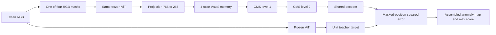

# Nested Learning for CAD

## Tài liệu khoa học, đặc tả hệ thống và hướng dẫn tiếp quản — v3

**Ngày chốt revision v3:** 2026-10-10. **Design ID:** `hope_cad_v3_masked_teacher_cms`. **Selection-rule ID:** `prefix_cms_stress_v3`.

**Architecture/selection: FROZEN FOR IMPLEMENTATION v3. W3 visual front end: implemented/tested tại `hope_cad_v2@363634b`, 24/24 tests trong Kaggle có T4; chưa có trong checkout clone. Full method: NOT IMPLEMENTED END-TO-END / NOT EXPERIMENTALLY VALIDATED.** [Báo cáo W3 v2](hope_cad/w3_implementation_v2.md) giữ historical artifact 23-test, failure trước fix và artifact Kaggle mới đã kiểm source hashes. W4/W5 và các gate mới của v3 vẫn proposed/pending. Tài liệu phân biệt evidence numerical correctness với full CAD learning/benchmark.

**Nhánh làm việc:** chỉ `hope_cad_v2_clone`, giữ HEAD `a89fd48f94ed9c5deb26041151ea63b79911342f` theo yêu cầu ngày 2026-10-10. `hope_cad_v2` là source tham khảo W3 ở `6dbe4f1` và fix `363634b`; không cập nhật clone bằng các commit này trong task tài liệu. Khang tiếp tục ReplayCAD trên `dikhang_space`; `main` là nhánh tích hợp. Trước W4 trên clone cần bước tích hợp W3 được cho phép và kiểm chứng source/test tương ứng.

**Quy ước phiên bản.** Đây là bản đầy đủ kế thừa v2, tích hợp các sửa đổi sau audit; ba tài liệu v2 và báo cáo W3 cũ được giữ nguyên. Design/method ID mới là `hope_cad_v3_masked_teacher_cms`, selection-rule ID là `prefix_cms_stress_v3`, vì quy tắc chọn cấu hình đã thay đổi. Topology, recurrence, initialization, teacher, masks, final score, clocks và quyền dữ liệu cốt lõi giữ nguyên. Namespace code `models/hope_cad_v2/`, `scripts/hope_cad_v2/`, các tên module `_v2` và protocol IDs `mvtec_1x15_prefix_cal_v2` / `visa_1x12_prefix_cal_v2` vẫn là các tên kế thừa; không tạo bản sao code chỉ để đổi số. Full run phải ghi method ID v3 và selection-rule ID riêng, không lấy component metadata W3 v2 làm identity của full method.

**Phạm vi checkout ngày 2026-10-10.** Theo yêu cầu mới nhất, chỉ soạn tài liệu trên `hope_cad_v2_clone@a89fd48f94ed9c5deb26041151ea63b79911342f`, không cập nhật nhánh này bằng code W3. W3 có ở nhánh `hope_cad_v2`: commit `6dbe4f1` thêm implementation, commit `363634b18d98eefc6da28660a99b967988077ef3` sửa backward của spectral guard gần denominator floor và thêm regression test. Các đường dẫn W3 dưới đây là bản đồ source ở nhánh đó hoặc đích tích hợp tương lai, **không phải file đã có tại HEAD của clone**. W4/W5, full method v3 và các gate mới vẫn **proposed/not implemented**. Snapshot `a89fd48` của baseline/core/pilots trong các bảng lịch sử được giữ nguyên; không gán W3 hay kết quả test mới vào commit này.

### Tóm tắt

Đồ án nghiên cứu **Nested Learning for Continual Anomaly Detection**, viết tắt CAD: học tuần tự từ ảnh bình thường của nhiều nhóm sản phẩm, sau đó phát hiện và định vị bất thường trên mọi nhóm đã học. Phương pháp dự kiến kết hợp một frozen ViT-B/8 ImageNet-21k, visual self-modifying memory thích nghi trong từng ảnh theo cơ chế VisionHOPE, và Continuum Memory System (CMS) lưu tri thức xuyên ảnh/task. Hai tầng CMS học với chu kỳ khác nhau. Một outer loop trên normal prefix của task đầu học các tham số chậm và initialization; không được nhìn trước task tương lai.

Để HOPE nằm trực tiếp trên đường dự đoán, predictor nhận ảnh đã che một phần RGB, đi qua visual memory và CMS, rồi dự đoán đặc trưng clean image của frozen teacher. Anomaly score là sai lệch của prediction từ **output cuối CMS** với teacher. Đây là một instantiation HOPE cho CAD, có objective và giao thức riêng, không phải bản tái lập toàn bộ HOPE language model hay toàn bộ backbone VisionHOPE. Đóng góp cần chứng minh là lợi ích của các quá trình học lồng nhau đối với acquisition, retention và anomaly detection, không chỉ sự tồn tại của một memory module.

CADIC patch-memory là baseline chính; các kết quả thật do nhóm cung cấp được giữ nguyên. ReplayCAD do Khang phát triển là baseline bổ sung với điều kiện backbone/data access được công khai. Thí nghiệm tiến hành trên MVTec AD trước, VisA bắt buộc sau đó, cùng schema và metric definitions. Tài liệu khóa thuật toán, quyền dữ liệu, ablations, acceptance criteria và cách truy vết artifact; kết quả nghiên cứu vẫn có thể âm hoặc chưa đủ bằng chứng.

## 1. Cách đọc và nguồn chuẩn

### 1.1 Đọc gì để tiếp quản?

Đọc tài liệu này trước, rồi đọc các implementation được chỉ ra ở §12 và các tests tương ứng. Không cần đọc toàn bộ historical docs để hiểu phạm vi hiện tại. Hai tài liệu bổ trợ là:

- [Architecture decision v3](hope_cad/architecture_decision_v3.md): bản ghi freeze, phương trình và ranh giới claim.
- [Planning v3](hope_cad/planning_CAD_v3.md): phần A audit implementation/config/branches, phần B công việc và nghiệm thu.

Tài liệu hiện tại tự chứa các quyết định cần để triển khai; không dùng câu “xem docs cũ” để bỏ trống thuật toán. Tuy nhiên, không tài liệu nào thay được source code khi kiểm tra behavior, raw artifacts khi xác nhận thí nghiệm, hoặc paper khi thay đổi/chứng minh định lý. Các provenance chưa có trong workspace được ghi là chưa xác minh, không điền giả để tạo cảm giác “hiểu 100%”.

### 1.2 Thứ tự giải quyết bất đồng

| Câu hỏi | Nguồn có thẩm quyền |
|---|---|
| Mục tiêu, scope, quyết định được người dùng chấp thuận | Yêu cầu của người dùng; ba tài liệu v3 diễn giải nhất quán; v2 giữ nguyên lịch sử |
| v3 phải được triển khai như thế nào? | Architecture decision v3 và contract trong tài liệu này; có bất đồng thì dừng phần liên quan và tạo revision rõ ràng |
| Code hiện đang làm gì? | Source tại commit được ghi, cộng kết quả test tái lập |
| Một run thực sự dùng gì/đạt gì? | Resolved config, effective adapter, commit, hashes, logs và metrics của chính run đó |
| Paper chứng minh điều gì? | Paper/version cụ thể; không suy rộng từ tên module hoặc README |
| Historical Meta-NATH/HOPE v1 hoạt động thế nào? | Source và tài liệu v1, giữ nguyên tên/version lịch sử |

Không tự sửa định nghĩa phương pháp theo code cũ để “khớp spec”. Ngược lại, không coi code cũ đã thực hiện điều v3 đề xuất. Mỗi thay đổi khoa học cần cập nhật cùng lúc decision, planning, instruction và method version.

### 1.3 Ý nghĩa trạng thái

`implemented`: có source cụ thể. `tested`: có log chạy test trên commit/environment xác định. `experimentally validated`: có thí nghiệm thực với phạm vi kết luận phù hợp. `not implemented`: phần yêu cầu chưa có trong code được audit. Có file test, chuỗi `PASS`, notebook hoặc class name không đủ để nâng trạng thái.

Trong lượt chuẩn bị spec: đã đọc source/papers/docs và làm các sanity checks toán học nhỏ ở §15. Chưa chạy pytest repository, chưa load backbone weights, chưa chạy benchmark GPU. Các bảng CADIC do người dùng xác nhận là kết quả thật; full HOPE-CAD theo contract v3 chưa có kết quả.

Cập nhật W3 sau freeze v2: artifact local ngày 2026-10-09 ghi 23 unittest tests trên source `6dbe4f1`, CPU FP64/FP32 và reduced CUDA trên RTX 3050 Ti. Source đó fail canonical full-grid CPU backward trên Kaggle theo transcript người dùng. Fix `363634b` thêm regression gần denominator floor và đã pass **24/24, không failures/errors/skips** trong [artifact Kaggle](../results/hope_cad_v2/w3_verification_kaggle.json); 7/7 source hashes khớp commit. Runtime Linux/Python 3.13.15/PyTorch 2.11.0+cu128, CUDA runtime 12.8, Tesla T4. Canonical full-grid tests vẫn là CPU; CUDA test dùng reduced fixture. Chưa AD benchmark, full-grid T4/16-event profile hoặc upstream numerical parity. W3 chưa có ở HEAD clone; tests legacy không có execution evidence mới từ suite này.

## 2. Bài toán, phạm vi và giả thuyết

### 2.1 Continual anomaly detection

Có chuỗi task \(\mathcal T_1,\ldots,\mathcal T_T\), mỗi task là một category sản phẩm. Tập train \(\mathcal D_t^N\) chỉ gồm ảnh normal; test \(\mathcal E_t\) gồm normal/anomaly và pixel masks dùng riêng trong evaluator. Một hệ duy nhất học lần lượt các tập train, không có task-specific head lúc test.

Sau task t, hệ có state \(S_t\). Với ảnh bất kỳ thuộc các task đã thấy, hệ trả image score \(s(x;S_t)\) và anomaly map \(a(x;S_t)\). Score càng cao càng bất thường. Đánh giá cả task mới và các task cũ để đo học mới và quên. Task ID phục vụ loader, checkpoint và bảng báo cáo, không được đi vào predictor hoặc chọn memory/head.

Ba loại thời gian phải tách rõ: thứ tự token/chunk trong ảnh, thứ tự normal images trong stream, và bước outer optimization. Task boundary là mốc quan sát, không phải tín hiệu reset learner.

### 2.2 Câu hỏi nghiên cứu và phép bác bỏ

| ID | Giả thuyết | Bằng chứng cần / khả năng bác bỏ |
|---|---|---|
| H1 | Adaptation tạo giá trị ngoài static teacher fitting | Full method vs trained static controls và reset/freeze interventions; chỉ đổi hidden norm mà không đổi final score là chưa đủ |
| H2 | CMS nhiều timescale giúp cân bằng acquisition và retention | So với một level và cùng hai level nhưng cùng period; forgetting thấp do không học task mới không ủng hộ H2 |
| H3 | Visual self-modification có ổn định và tác động hữu ích | Oracle, guard ablations, scan ablations, score sensitivity, contraction/collapse diagnostics; finite thôi chưa đủ |
| H4 | Kết quả không chỉ do một category/order | Full MVTec, VisA, nhiều seeds và hai order controls; không chọn best seed/order |

Giả thuyết bị bác bỏ vẫn là kết quả khoa học hợp lệ. Không thay metric, score hoặc split sau khi xem anomaly test để cứu giả thuyết. Mục tiêu đồ án là trả lời câu hỏi Nested Learning cho CAD bằng implementation và evidence hoàn chỉnh, không hứa trước thắng mọi baseline.

### 2.3 Phạm vi cố định

Main method không dùng ACC gate, offline Phase 3, synthetic anomaly labels, task routing, nearest-neighbor fusion head hoặc adaptive frequency scheduler. Các thứ đó không cần để định nghĩa Nested Learning này. Fixed update periods vẫn tạo nhiều timescale khi objective, state và gradient ownership rõ ràng. Tên lớp lịch sử có chữ TITANS được giữ để truy source; hệ v3 phải là visual self-modifying memory **kết hợp CMS và outer learning**, không đổi tên single-matrix fast weight thành HOPE.

## 3. Nền tảng toán học và đối chiếu paper

### 3.1 Nested Learning và associative memory

Một associative memory tuyến tính M học ánh xạ key k sang value v. Với \(\ell(M)=\tfrac12\|Mk-v\|^2\), gradient là \((Mk-v)k^T\). Một update có retention có dạng \(M' = \alpha M-\eta(Mk-v)k^T\). Memory vì vậy là trạng thái của một quá trình tối ưu, không nhất thiết là danh sách samples.

Nested Learning mô tả nhiều quá trình tối ưu được lồng trong nhau, với context, objective và frequency khác nhau. Outer optimization có thể học initialization và các quantities quyết định inner dynamics. HOPE kết hợp self-modifying associative memories với CMS: các tầng network tiếp tục học ở những tần suất khác nhau. “Có hai vùng lưu trữ” tự nó chưa chứng minh nested learning; cần nói chúng học cái gì, khi nào và tác động thế nào tới output.

Trong thiết kế v3 kế thừa v2, visual memory thay đổi trong ảnh; CMS thay đổi theo ảnh normal; outer optimization học xuyên qua các update này trên prefix được phép. ViT là prior pretrained cố định. Sau calibration, outer optimizer dừng; việc không tiếp tục cập nhật thang chậm nhất không làm mất các clock inner/continual đã định nghĩa.

### 3.2 Research checkpoint

| Thuộc tính | CADIC | HOPE / Nested Learning | VisionHOPE | Quyết định đồ án |
|---|---|---|---|---|
| Bài toán gốc | Continual AD | Học lồng nhau, kiến trúc HOPE | Visual representation | CAD là bài toán đích |
| Memory | Patch coreset | Self-modifying maps + CMS | Content/key/value/rate/retention maps | Giữ đủ 5 map visual và 2 CMS levels |
| Scoring | Patch NN và image reweight | Không đưa sẵn head cho CAD này | Không đưa CAD benchmark | Masked teacher residual sau CMS cuối |
| Spatial processing | ViT patch features | Cần mapping ảnh riêng | 4 hướng, chunk theo hàng/cột | Áp scan geometry vào frozen ViT features |
| Persistence | Bank xuyên task | Nhiều tầng/frequency | Working memory trong ảnh | Visual reset; CMS xuyên ảnh/task |
| CMS | Không | Có | Không trong VisionHOPE | CMS là phần HOPE-CAD adaptation |
| Outer objective | Không train head/backbone | Objective theo bài toán | Supervised visual tasks | Normal-only first-task calibration |
| Stability | Bank budget/update rule | Không đủ để suy ra CAD stability | Injection/spectral guards | Dùng đúng phạm vi operator theorem |

Nguồn chính: [CADIC](https://arxiv.org/html/2511.08634v1), [Nested Learning](https://arxiv.org/html/2512.24695v1), [VisionHOPE](https://arxiv.org/html/2609.33325v1). Frozen teacher discrepancy có tiền lệ trong [Reverse Distillation](https://openaccess.thecvf.com/content/CVPR2022/html/Deng_Anomaly_Detection_via_Reverse_Distillation_From_One-Class_Embedding_CVPR_2022_paper.html); nguy cơ identity shortcuts được nghiên cứu trong [UniAD](https://papers.nips.cc/paper/2022/hash/1d774c112926348c3e25ea47d87c835b-Abstract-Conference.html). RGB masking cụ thể dưới đây là lựa chọn của đồ án, không gán nó thành thuật toán nguyên bản của hai paper đó.

### 3.3 Những mâu thuẫn đã giải quyết

V1 giữ fast state xuyên task, trong khi VisionHOPE reset theo ảnh: v3 kế thừa quyết định v2 chọn reset visual, để CMS giữ continual state. VisionHOPE không có CMS: thiết kế bổ sung CMS theo HOPE và ghi rõ adaptation. Bank trên transformed features sẽ stale khi CMS đổi: main score không dùng bank đó. Pilot P1/P2 image-average/SVD không phải token-wise VisionHOPE guards: giữ làm reference lịch sử. HOPE paper có nhiều cách diễn giải self-modifying maps/objectives: thiết kế chọn linear head maps theo VisionHOPE và local teacher objectives cho CMS, không tuyên bố đã triển khai mọi biến thể HOPE.

Các điểm còn cần artifact là nguồn launcher/resolved config của CADIC thực nghiệm, exposure ledger của các pilot và continual checkpoints của ReplayCAD. Chúng ảnh hưởng độ mạnh/comparability của evidence; không làm topology, loss hoặc reset semantics hiện tại bỏ ngỏ.

### 3.4 CADIC làm baseline

Với raw patch feature \(p_j\in\mathbb R^{768}\) và bank \(C\), patch score \(d_j=\min_{c\in C}\|p_j-c\|_2\). Gọi \(j^*=\arg\max_j d_j\), \(c^*\) là nearest memory vector của patch đó, và \(\mathcal N_b(c^*)\) là b memory vectors gần **c*** nhất. Image score:

\[
s_{CADIC}(x)=\left(1-\frac{\exp(d_{j^*})}{\sum_{c\in\mathcal N_b(c^*)}\exp(\|p_{j^*}-c\|_2)}\right)d_{j^*}.
\]

Không bỏ thừa số cuối, không thay bank-centered neighborhood bằng query-centered neighborhood. Code tính tỷ số bằng logsumexp để tránh overflow. Baseline dùng raw features, không áp teacher normalization của HOPE.

Bank chứa tối đa B patch vectors. Implementation hiện tại fill theo thứ tự input; khi đầy, lặp chọn incoming vector có nearest-bank distance lớn nhất, so với khoảng cách cặp khác chỉ số gần nhất trong bank. Nếu lớn hơn, thay một phần tử của cặp bank bằng candidate rồi xét lại tập incoming còn lại; nếu không thì dừng. Ties có rule xác định. Unit đưa vào một lần update là tập patches của **một ảnh** trong route paperfaithful; ghép nhiều ảnh thành một candidate set có thể tạo bank khác.

Budgets chính B=2,500 và 10,000, b=9 trong config hiện tại. Initialization, b và một số preprocessing choices được metadata ghi là assumptions tái lập; tên folder `paperfaithful` không tự chứng minh exact parity với tác giả. Chỉ feature storage FP32 lần lượt khoảng 7.68 MB và 30.72 MB theo decimal bytes; peak distance workspace, backbone, Python overhead và checkpoint storage phải tính thêm.

## 4. Kiến trúc HOPE-CAD v3 đã chốt

**§4–10 mô tả frozen contract**, không đồng nghĩa đã implement. Visual W3 (§4.2–4.3 và projection) có source/tests ở nhánh tham khảo đã ghi, chưa nằm trong clone. CMS, teacher/masks, outer learning, long gate, scoring và end-to-end benchmark vẫn proposed. Không import core v1 rồi mặc định rằng công thức v3 đã được thực hiện.

### 4.1 Ký hiệu và shapes

| Ký hiệu | Shape / ý nghĩa |
|---|---|
| x | Một ảnh RGB đã resize 224×224 |
| F | Frozen ViT-B/8 ImageNet-21k; block index 8, layer 9 one-based |
| F(x) | `[1,784,768]`, 28×28 patches, row-major; bỏ CLS |
| u | Clean teacher features được L2-normalize từng patch, detached |
| P, X | Learned affine 768→256; X `[1,784,256]` |
| Z | Visual internal width 128; 8 heads/direction, head dimension 16 |
| \(M^m,M^k,M^v\) | Mỗi direction/head: ba matrices 16×16 |
| \(M^\eta,M^\alpha\) | Mỗi direction/head: hai row maps 1×16 |
| \(h_0,h_1,h_2\) | Visual/CMS outputs `[1,784,256]` |
| D | Shared decoder 256→768→768, GELU giữa hai affine layers |
| \(\phi_1,\phi_2\) | Current weights của hai CMS pre-LN residual MLPs |
| \(\theta\) | Slow parameters và learned initial states, frozen sau calibration |

Extractor không thêm final LayerNorm hoặc L2 vào raw features. Teacher head riêng tạo \(u_j=\operatorname{stopgrad}(F(x)_j/\max(\|F(x)_j\|_2,10^{-8}))\). Predictor dùng F của **masked RGB**, không dùng clean features làm input. Cùng weights SHA, layer, resize và normalization với baseline.



Teacher target chỉ đi vào losses/score. Main score không fusion raw-patch NN, intermediate visual residual, CLS hay task ID. Decoder nonlinear tránh buộc prediction nằm trong một affine subspace 256 chiều cố định; vẫn có bottleneck và nguy cơ generalization kém, cần đo.

### 4.2 Spatial wrapper

Áp dạng structural block của VisionHOPE Eq.27:

\[
Z=\mathrm{DW}_{3\times3}(P_{in}(\mathrm{LN}(X))),\quad
X'=X+P_{out}(\mathcal V(Z)),\quad
h_0=X'+\mathrm{FFN}(\mathrm{LN}(X')).
\]

`P_in:256→128`, `P_out:128→256`; depthwise convolution 3×3, padding 1, bias; FFN 256→1024→256, GELU. LayerNorm theo channel, eps 1e-6. Dropout/stochastic depth bằng 0. Không thêm CPE, per-route skip hoặc positional branch khác. Đây là wrapper CAD tối giản, không claim full upstream backbone Appendix B.5.

\(\mathcal V\) chạy bốn directions: row-major forward, reverse toàn row-major sequence, column-major forward, reverse toàn column-major sequence. Mỗi route inverse-permute về grid gốc trước khi fuse. Row chunk dài W=28; column chunk dài H=28. Fuse bằng \(\sum_r\lambda_r\odot Y_r\), mỗi \(\lambda_r\in\mathbb R^{128}\) learnable, init 1/4.

Shared slow query projection Wq 128×128 áp lên Z, split heads rồi normalize mỗi query head với eps 1e-6. K/V/control đọc head tokens của Z. Direction/head có initial memory riêng; mọi working state reset từ learned initials ở **mỗi ảnh/view**. `head_dim=16` có nghĩa **8 heads** khi internal width 128, không phải 16 heads.

Initial content/key/value matrices dùng truncated-normal std 0.01. Initial eta/alpha maps bằng zero và được outer-learn. Các affine/conv khác Xavier-uniform weights, zero bias; LayerNorm scale 1/bias 0. Reference implementation phải ghi cả truncation bounds trong resolved config; chốt bounds ±2 standard deviations, tức ±0.02 cho ba initial matrices. Không zero toàn residual network làm mất các gradient paths ở initialization.

### 4.3 Visual recurrence và safeguards

Trong chunk bắt đầu tại boundary b, quantities cho mọi token t được tạo từ **boundary state**:

\[
k_t^{raw}=M_b^k z_t,\quad k_t=k_t^{raw}/\sqrt{\|k_t^{raw}\|^2+10^{-6}},\quad v_t=M_b^v z_t,
\]
\[
\eta_t=0.025\operatorname{softplus}(M_b^\eta z_t),\quad
\alpha_t=\sigma(M_b^\alpha z_t+\operatorname{logit}(0.9)).
\]

Đặt \(\delta_t=k_t-v_t\), \(\epsilon=10^{-6}\). Dạng real-arithmetic trước safety margins:

\[
r_t=\sqrt{\|\delta_t\|^2+\epsilon^2}+\epsilon,\quad
\eta_t^{inj}=\frac{1-\alpha_t}{r_t},\quad
\bar\eta_t=\eta_t^{inj}\left(1-e^{-\eta_t/\eta_t^{inj}}\right),\quad
\tilde\eta_t=\min\left(\bar\eta_t,\frac{2\alpha_t}{\|k_t\|^2}\right).
\]
\[
A_t=\alpha_t I-\tilde\eta_t k_tk_t^T,\quad B_t=-\tilde\eta_t\delta_tk_t^T,\quad
G_b=I,\quad G_t=G_{t-1}A_t+B_t,\quad M_t^\square=M_b^\square G_t.
\]

Tương đương \(M_t^\square=M_{t-1}^\square A_t+M_b^\square B_t\) cho đủ năm maps. Token readout \(y_t=M_b^m q_t\); không đọc từ memory đã update bởi chính token đó. Cuối chunk, final memory thành boundary tiếp theo. Không thay recurrence bằng một image-average transition P1 hoặc SVD projection P2.

FP32 execution theo safeguards: injection limit nhân `(1-1e-3)` **trước** soft cap; spectral limit nhân `(1-1e-6)`, key-norm² denominator lower bound 1e-20, rồi `nextafter` hướng zero. Tính soft cap bằng `-expm1(-eta/injection_limit)`. Khi alpha round thành 1, injection limit 0: executed eta=0, không tạo phép chia 0/NaN ở nhánh không chọn.

**Spectral-guard implementation đã kiểm thử tại `363634b`.** Với `d=key.square().sum(-1).clamp_min(1e-20)`, tính `inverse_key_norm=torch.rsqrt(d)` rồi `spectral=(2*alpha*(1-1e-6))*inverse_key_norm.square()` trước `nextafter` hướng zero và backward mapping hiện có. Dạng này tương đương bound trong real arithmetic, nhưng FP32/autograd có thể khác phép chia trực tiếp; phải kiểm numerical/gradient parity, không suy từ đẳng thức đại số rằng mọi expression có cùng backward ổn định. Traceback Kaggle trước fix chỉ tới `DivBackward0` tại phép chia spectral limit. Không nâng denominator floor, đổi retention/init, bỏ guard hoặc nới tolerance để xử lý lỗi. Regression `test_spectral_limit_backward_is_finite_near_denominator_floor` tại `tests/hope_cad_v2/test_visual_w3.py` dùng key FP32 `1.01e-10`, kiểm first-order gradients hữu hạn gần floor; zero-key/saturated-alpha và full-grid backward cũng được suite kiểm. Gradgrad tests hiện có dùng fixtures riêng, không tự chứng nhận higher-order gần floor hoặc exact 16-event W4. Đây là numerical bug fix có source hash riêng; topology, phương trình, design/method ID và selection rule v3 giữ nguyên.

Outer differentiation đi qua quantities, chunk states và all initial maps. Local associative target được giữ cố định khi suy ra inner rule, không có nghĩa cắt outer graph. Với ULP rounding, backward dùng safeguarded real-arithmetic function trước `nextafter`; đây là gradient mapping được công khai, không là đạo hàm của phép quantization rời rạc. Kiểm tra finite differences tránh kink `min` và giới hạn safety.

Theo [VisionHOPE §§2.1–2.3, Appendices B–C](https://arxiv.org/html/2609.33325v1), các điều kiện injection/spectral bound kiểm soát gain tương đối với chunk boundary. Không suy ra full residual network hoặc CMS non-expansive; không suy ra anomaly AUROC/forgetting được bảo đảm. Không yêu cầu norm giảm so với token trước trong cùng chunk. Frozen ViT đã có global attention và wrapper có convolution: scan order có causality theo update boundary, **không phải pixel-causal model**.

#### 4.3.1 Paper/upstream fidelity và numerical gate

Recurrence ở trên giữ nguyên: `M_t = M_(t-1) A_t + M_b B_t`, tương đương `G_t=α_t G_(t-1)-η̃_t(G_(t-1)k_t+δ_t)k_tᵀ`. Đối chiếu đại số với Eq.45–46 Appendix B.4 không cho thấy lỗi “đếm đôi”; token oracle và optimized path cùng khớp spec chưa đủ để chứng minh numerical parity với tác giả.

Nguồn upstream ghim `98cfb5d6004472a0ba3d212d3cf884393e39c134`, MIT: [SRNL wrapper](https://github.com/PSRben/VisionHOPE/blob/98cfb5d6004472a0ba3d212d3cf884393e39c134/models/srnl.py), [chunk CUDA](https://github.com/PSRben/VisionHOPE/blob/98cfb5d6004472a0ba3d212d3cf884393e39c134/models/srnl_core/csrc/chunk.cu). Source audit chỉ bao phủ các operator paths liên quan, không toàn repository. Upstream có clamp pre-activations η/α ở ±10, query-normalization conventions cần đồng nhất, và custom operator hỗ trợ first-order gradients. W3 giữ unclamped paper-form controls và query eps 1e-6; không tự thêm clamp hoặc thay wrapper/init theo upstream trong revision tài liệu này.

**Gate bổ sung W3 — proposed/not executed:** gọi trực tiếp low-level upstream core và local reference trên cùng explicit tensors/initial maps/normalized queries, cùng layout, guards, dtype và chunk boundaries. Không dùng “cùng seed” thay việc copy chính xác weights; map states theo tên content/key/value/eta/alpha, không giả định positional argument order của hai APIs giống nhau. Chốt fixtures seeds 103/104/105, head dimensions 4/16, chunk lengths 1/7/28, nhiều chunks và ít nhất một sequence 784 tokens; bao gồm multi-image isolation và boundary readout. Main state-parity fixtures có sequence length chia hết chunk length. Với partial tail, [upstream normalized-query path](https://github.com/PSRben/VisionHOPE/blob/98cfb5d6004472a0ba3d212d3cf884393e39c134/models/srnl_core/chunk.py) padding tới đủ chunk: so valid-token outputs trước, ghi riêng padded terminal state, không nhầm nó với state ngay sau last real token. Fixtures parity chính giữ logits trong vùng clamp upstream không hoạt động. Fixtures ngoài vùng này ghi expected divergence do contract khác, không nới tolerance để gọi khớp.

So output FP32 và boundary/final states mà API thực sự expose: `atol=1e-5, rtol=1e-4`. So first-order gradients với inputs, normalized queries và đủ năm initial maps trên fixtures không tại clamp/min kink: `atol=1e-5, rtol=1e-3`; ghi max absolute/relative errors theo nhóm. Nếu cần instrumentation để expose states, lưu patch/hash harness; nếu chưa quan sát được state thì đánh dấu pending, không claim state parity. Ghi upstream SHA/license, build/runtime, source hashes và inputs hash vào artifact riêng.

Higher-order/gradgrad vẫn kiểm bằng local FP64 oracle và finite differences; không dùng upstream first-order kernel để chứng nhận Hessian hoặc thay vào exact 16-event outer unroll. Chưa chạy gate trực tiếp thì nhãn là **paper/operator mapping audited; upstream numerical parity pending**. W4 reference có thể được dựng tiếp sau diagnostics W3; fidelity claim và scientific use của backend cần gate phù hợp đã đạt, không giả định wrapper/full-backbone parity.

#### 4.3.2 Contraction: diagnostics ngay sau W3

**Bằng chứng và phạm vi.** Audit trước đã chạy `FourScanVisualMemory.inspect` với seed 103, input Gaussian `[1,784,128]`, FP32, chưa outer calibration. Norm tính FP64: mean initial content norm ≈`1.40e-1`, final ≈`1.36e-37`; direction-0 output RMS ở chunk đầu ≈`8.73e-3`, chunk thứ 14 ≈`1.42e-19`, chunk cuối ≈`1.63e-37`. Đây là synthetic measurement trong transcript audit trên source W3 trước fix NaN, **không nằm trong artifact 23-test và không phải CAD experiment**. Cần lưu artifact tái lập khi làm diagnostics mới; không gán các số này cho `a89fd48` hoặc coi artifact Kaggle 24-test là phép đo lại contraction sau fix.

Ở initialization, zero α-map cho retention 0.9; `0.9^784` giải thích một bậc độ lớn khả dĩ, **không phải định luật co chính xác cho mọi input** vì injection, normalized key và boundaries cùng tham gia recurrence. Zero control maps giữ zero qua inner right-action trước outer learning không có nghĩa outer gradient tới initialization bằng zero. Không suy ra mọi outer gradient giảm đúng `0.9^t`, hoặc outer learning không thể phục hồi utility.

**Thứ tự thực hiện:** ngay sau W3, trước đầu tư đầy đủ W4, đo init trên fixtures cố định; thêm real features chỉ từ `meta_support`/`meta_query` khi W2 có extractor/weights. Theo từng direction/head/chunk và restored spatial position, ghi memory/gain norms, output RMS, zero/subnormal fractions, α/η distributions và cap activity. Với full spatial wrapper, ghi `RMS(P_out(V(Z)))/max(RMS(X),1e-12)` và visual-on/off output deltas. Khi minimal W4 đủ chạy vài exact outer steps, đo lại ở steps 0/1/5/25 và selected checkpoint; chạy gradient diagnostics theo nhóm initial maps/q/projections/decoder/CMS initials, rồi final-score interventions ở W5/W6. Không chờ tới W7 mới nhìn contraction.

**Acceptance:** numerical NaN/Inf, state mutation sai hoặc gradient bị disconnect do implementation là correctness failure. Biên độ nhỏ ở init là **warning cần đo tiếp**, không tự động fail kiến trúc hoặc ép đổi initialization. Diagnostics completeness là gate sớm; utility được đánh giá sau calibration bằng trained static/reset/freeze controls và final-score sensitivity. Không đặt một cutoff dựa vào fixture đã xem rồi gọi là preregistered pass. Nếu chưa có bằng chứng utility thì ghi inconclusive/no-go cho claim H3, không bịa threshold đảm bảo gain. Mọi sửa init/retention/guards để xử lý quan sát phải thành method revision trước anomaly-test evaluation.

### 4.4 CMS objective và update clock

Với pre-event weights \(\phi_{l,t^-}\), mỗi level:

\[
h_{l,t}=h_{l-1,t}+W_{2,l}\mathrm{GELU}(W_{1,l}\mathrm{LN}_l(h_{l-1,t})+b_{1,l})+b_{2,l},\quad l=1,2.
\]

Hai MLP đều 256→512→256, LayerNorm eps 1e-6, biases. Current parameters bao gồm LayerNorm affine. Decoder D dùng chung cho local loss và final prediction; trong deployment D frozen.

Với masked positions \(\Omega\) của event:

\[
\mathcal L_{l,t}=\frac{1}{2|\Omega|}\sum_{j\in\Omega}\|D_\theta(h_{l,t,j})-u_{t,j}\|_2^2,\quad
g_{l,t}=\frac{\partial\mathcal L_{l,t}}{\partial\phi_{l,t^-}}.
\]

Loss reduction chính xác là `0.5 * (pred-target).square().sum(-1).mean()` trên masked positions. Mean cả channels thay cho sum sẽ làm scale gradient khác 768 lần và không đáp ứng contract.

Local derivative chỉ **sở hữu update** của level l. Cả hai losses/gradients dùng cùng pre-event snapshot; không update level 1 rồi mới tính gradient level 2. Decoder, visual parameters và level khác không được CMS optimizer chỉnh trong deployment.

Periods `(1,8)`. Mỗi level có accumulator \(A_l\) và count \(n_l\). Một ảnh normal = một event t: cộng gradient, tăng count. Nếu `t % p_l == 0`, commit \(\phi_l\leftarrow\phi_l-\beta_l A_l/n_l\), sau đó zero accumulator/count; chưa due thì giữ weights. Đây là **mean accumulated gradient**, không phải sum như core v1. CMS reference là plain SGD, không momentum/weight decay/gradient clipping.

Validate toàn bộ proposed weights/accumulators trước atomic commit. Non-finite làm event thất bại, giữ nguyên previous state/cursor/RNG để sửa và resume; không âm thầm skip ảnh rồi báo complete. Không reset/flush ở task boundary, evaluation hoặc cuối session. Với 16 normal events từ reset, M có `(16,2)` commits. Loader batch 8 là transport của 8 events tuần tự; không mean cả batch thành một event. Số `(16,2)` không áp đặt cho equal-period control C4.

Hai execution modes dùng cùng numerical update:

- **Functional outer training:** local gradients với `create_graph=True`, giữ dependencies qua input, decoder, state history và accumulators. Partial update ownership không đồng nghĩa detach inputs. Functional states không bị in-place overwrite cần cho backward.
- **Deployment:** slow parameters frozen; tạo local differentiable CMS tensors, tính gradient rồi detach state/accumulators sau mỗi image. Không giữ graph xuyên stream. Giá trị forward/update phải khớp functional reference trong tolerance.

Không đặt toàn bộ online update trong `torch.inference_mode()` hoặc `no_grad()` vì CMS cần gradient. Frozen feature extraction và read-only score có thể dùng no-grad; outer loop cần gradient qua visual/CMS nhưng không qua ViT. `.eval()` chỉ tắt training-mode behavior, không tự định nghĩa state immutability.

### 4.5 Mask family và final anomaly score

Trên 28×28 grid, \(k(r,c)=2(\lfloor r/2\rfloor\bmod2)+(\lfloor c/2\rfloor\bmod2)\). View k che RGB footprints của patches thuộc \(\Omega_k\). Bốn sets không overlap, mỗi set 196 patches, union 784. Một block che 2×2 patches = 16×16 pixels. Resize trước, che bằng ImageNet mean RGB trước normalization nên normalized masked pixels bằng 0. Không drop tokens; giữ positions.

Mask được áp trước frozen ViT. Zero clean ViT features sau global attention là một phương pháp khác, có leakage từ patch bị che. Teacher đọc clean RGB; chỉ predictor đọc masked RGB. Normal event t dùng view `(t-1) % 4`.

Inference dùng bốn views cùng một CMS snapshot, visual reset mỗi view. Với j thuộc masked set của view k:

\[
\hat u_j=D_\theta(h_{2,j}(F(x_k);S)),\quad a_j=\|\hat u_j-u_j\|_2^2,\quad s(x)=\max_j a_j.
\]

Ghép đúng một score cho mỗi patch, reshape 28×28 rồi bilinear tới 224×224 với `align_corners=False`. Image max lấy ở patch scores trước resize. Không normalize prediction, không smoothing, category normalization, test-derived threshold hoặc thêm scoring branch. Clean test target tham gia score nhưng không gradient-update persistent model.

Chi phí một image score: 1 clean + 4 masked ViT passes, 4 visual passes, 4 CMS reads. Batching views được phép nếu states độc lập và parity được kiểm tra. Một normal training event chỉ cần 1 clean + 1 masked pass và một CMS commit decision; nó không tự trả complete four-view anomaly map. Nếu cần full train-image diagnostic score phải gọi read-only scoring riêng và tính thêm chi phí.

## 5. Dữ liệu, calibration prefix và chống leakage

### 5.1 Main protocols

MVTec có 15 tasks theo thứ tự canonical hiện tại: `bottle, cable, capsule, carpet, grid, hazelnut, leather, metal_nut, pill, screw, tile, toothbrush, transistor, wood, zipper`. Trong mỗi task, online identities theo lexicographic relative-path order của manifest, cùng thứ tự cho mọi method. V1 hiện dùng `shuffle=False`; seed trong metadata không đồng nghĩa CADIC có randomized image order.

VisA dùng 12 categories của official one-class split, đối chiếu `split_csv/1cls.csv`: `candle, capsules, cashew, chewinggum, fryum, macaroni1, macaroni2, pcb1, pcb2, pcb3, pcb4, pipe_fryum`, main order alphabetic. Chỉ normal images thuộc official train được học. [Script chuẩn bị dữ liệu của tác giả](https://github.com/amazon-science/spot-diff/blob/main/utils/prepare_data.py) là nguồn kiểm tra layout và split; lưu version/CSV hash. Không dùng loader cũ chia normal 80/20 của repository để thay official split.

Đồng nhất RGB conversion, PIL bilinear resize ảnh về 224, normalization mean `(0.485,0.456,0.406)`, std `(0.229,0.224,0.225)`, GT mask nearest-neighbor/binary. Metric main ở 224×224. Không gọi nó là native-resolution benchmark. Normal train không lấy anomaly labels, defect masks hoặc synthetic defects làm supervision.

**VisA geometry/mask QA — proposed.** RGB được resize **trực tiếp về 224×224 bằng PIL bilinear**, không giữ aspect ratio bằng padding/crop; policy này áp dụng mọi method trong matched table. Ground-truth mask dùng nearest, binarize raw mask bằng `nonzero`, không mặc định threshold `>127`. Xác minh encoding/geometry từ official preparation và CSV; nếu mask annotation đa kênh phải xác minh kênh nội dung trước khi quy về binary, không tính alpha channel thành defect. Raw anomaly mask thiếu/rỗng hoặc geometry không hợp lệ là lỗi integrity cần giải quyết, không tự suy diễn/sửa nhãn.

Evaluator preflight lưu theo category: số official normal/anomaly images, positive pixels trước/sau resize, identity/hash và số anomaly masks trở thành rỗng ở 224. **Giữ nguyên các ảnh này**: image label lấy từ official CSV, không suy lại từ resized mask; pixel metric dùng đúng binary mask 224 kể cả all-zero. Không drop ảnh, tô lại defect hoặc đổi interpolation cho riêng HOPE. Nếu một category mất toàn bộ positive pixels khiến pixel metric undefined, ghi undefined và suite chưa đủ co-primary acceptance, không loại category khỏi macro để claim thắng. Native-resolution analysis nếu làm phải là protocol/table riêng, áp cho mọi method và công khai geometry.

Chưa có phép đếm local xác nhận tỷ lệ mất mask trên VisA; đây là rủi ro cần QA, không lỗi đã chứng minh. Mask QA nằm trong evaluator/data-integrity tooling, không cấp masks/labels/test metrics cho calibration hoặc dùng để chọn β/architecture. Recipe MVTec phải khóa trước VisA anomaly-test feedback.

### 5.2 Prefix và role allocation

Chọn \(P=\min(100,N_{first})\) ảnh đầu theo lexicographic path từ normal train task đầu; yêu cầu P≥32. Nếu không đủ, fail protocol; không lấy task tương lai bù vào. Đây là thứ tự giao thức, không khẳng định chronology thu thập ảnh thật.

| Role trong prefix | Count | Train quyền gì? | Online stream? |
|---|---:|---|---|
| `meta_support` | floor(0.50P) | Inner episodes của outer calibration | Có |
| `meta_query` | floor(0.20P) | Outer query loss | Có |
| `normal_validation` | floor(0.15P) | Chỉ selection bằng normal loss | Không |
| `normal_probe` | Phần còn lại | Diagnostic sau selection, không tune | Không |

Chia các đoạn liên tiếp theo role order trong bảng, không overlap. P=100 → 50/20/15/15; P=60 → 30/12/9/9; P=32 → 16/6/4/6. Giữ P≥32; validation chỉ 4 ảnh ở biên tối thiểu phải được disclosure, không tự nâng ngưỡng hoặc mượn future-task normals. Không tái sử dụng split 170-image OL-04 như protocol mới. Online train task đầu gồm toàn train-normal trừ validation/probe; các tasks sau dùng toàn official normal train. Prefix support/query được đọc nhiều lần khi calibration, gồm stress gate §6.2.1, và một lần khi deployment; công khai số reads và không gọi toàn pipeline strict single-pass từ ảnh đầu.

Calibration loader chỉ được nhận role-specific manifest của **task đầu**, không dataset object cho mọi task rồi trông chờ caller tự tránh leakage. Data path/mask/label của future tasks không được dùng fit, tune, normalize, chọn feature layer, epoch hoặc score. Biết danh sách category để tạo evaluator không là quyền đưa category information vào learner.

### 5.3 Hai track baseline

**Paper-control** giữ CADIC full official normal train và các historical metrics. **Matched-method** dùng cùng online-training identities/order đã loại normal holdouts cho M, CADIC và controls. CADIC matched không được thêm validation/probe vào bank. HOPE có nhiều calibration reads trên support/query; đây là khác biệt compute cần báo, dù unique training identities được match. Không lấy số paper-control làm matched baseline rồi bỏ qua split khác biệt.

ReplayCAD native có backbone/pretraining và generative replay riêng. Chỉ đưa vào bảng same-protocol nếu cùng data permissions/evaluation; cột backbone và extra models/data vẫn phải hiển thị. Nếu Khang làm ViT-B/8 adaptation thì đặt method ID khác native.

**Khóa baseline trước HOPE test feedback.** W1 phải chốt effective CADIC adapter route, update unit, score/kernel/preprocessing/metric resolution và resolved hashes cho matched 10k trước khi xem anomaly-test metrics của HOPE. Historical CADIC numbers vẫn được giữ là real results; matched run riêng chỉ cần khi chưa có artifacts cùng protocol/identities để dùng lại. Không đổi route hoặc chữa baseline dựa trên metric có lợi cho HOPE; thay đổi có căn cứ phải version hóa và rerun mọi comparison bị ảnh hưởng. Việc này không chặn W3/W4 correctness hoặc normal-only diagnostics.

### 5.4 Exposure ledger và confirmation

`exps/hope_anomaly_signal.py::development_manifests` đã định nghĩa DEVELOPMENT từ official test của bottle/carpet/hazelnut. Việc dùng labels để chọn score dù không backprop vẫn là test feedback. Lưu identities, thời điểm, mục đích và metrics đã xem; không gọi toàn MVTec test là untouched. Full canonical MVTec table vẫn hữu ích để so literature nhưng phải disclosure này.

Tên `CONFIRMATION_UNEVALUATED` không chứng minh subset chưa từng được xem: cần logs/artifacts. VisA sử dụng recipe khóa từ MVTec trước khi xem anomaly-test metrics. Nếu probe hoặc VisA test được dùng đổi thiết kế, ghi design revision/development exposure; không giữ nhãn confirmation cũ.

## 6. Outer learning, selection và lifecycle

### 6.1 Episode objective

Mỗi episode reset current CMS từ learned initialization, zero accumulators/counters. Sample 16 distinct support images từ `meta_support`, theo schedule có seed được lưu; views t=1..16 dùng `(t-1)%4`. Sample một query từ `meta_query`, view `outer_step % 4` với outer_step zero-based. Query read-only.

\[
S^{(e)}_0=\operatorname{Init}(\theta),\quad
S^{(e)}_t=U(S^{(e)}_{t-1},x^{support}_t;\theta),\ t=1,\ldots,16,
\]
\[
J_e(\theta)=\mathcal L_{2}(x^{query};S^{(e)}_{16},\theta),\qquad
\theta\leftarrow\operatorname{Adam}(\theta,\nabla_\theta J_e).
\]

Derivative giữ cả paths trực tiếp và paths qua support updates/gradient accumulators. Không dùng first-order approximation hoặc detach support history rồi vẫn gọi exact unroll. Sau outer step discard episode-terminal state; episode mới bắt đầu bằng learned initials vừa được optimizer cập nhật.

Outer trainables: P; visual projections/conv/FFN/norms/fusion/Wq; đủ năm initial maps cho mọi direction/head; CMS initial parameters; decoder. ViT frozen. CMS periods và reference beta là config được chọn theo finite search, không learnable scheduler. Query loss lấy **CMS cuối**, không mean tất cả local losses để âm thầm thay outer objective.

### 6.2 Recipe và model selection đã khóa

| Thành phần | Reference / selection rule |
|---|---|
| Outer optimizer | Adam lr 1e-4, betas (0.9,0.999), eps 1e-8, weight decay 0 |
| Budget một fit | Tối đa 200 outer steps, gradient-norm clip 1.0, log pre/post clip |
| CMS main rates | β1=β2=β; reference 1e-3 |
| Finite CMS-rate search | M/C2/C3: β∈{1e-4,1e-3,1e-2}, tối đa 3 fits/method, pilot seed 0 |
| C4 chính | Kế thừa β_M; rates (β_M,β_M/8), fit/chọn own step; không β search |
| Validation checkpoints | Steps 0,25,50,100,200 |
| Validation procedure | Reset CMS, fixed 16 support images từ support pool; mọi validation images đủ 4 views, không commit |
| Criterion | Shortlist một best short-validation checkpoint/β; loại bằng long gate §6.2.1; rank các pass theo short loss, tie earlier step rồi smaller β |
| Final seeds | 0,1,2; refit với selected β và selected step count, không chọn lại theo test |
| VisA | Fresh learned parameters từ prefix VisA; dùng selected recipe/rates/step counts từ MVTec, không chuyển learned MVTec state |

Episode support/query schedule và fixed validation support schedule phải materialize trước search; mọi candidate dùng common random numbers. Không lấy normal validation làm support. Validation data không backprop và không đi vào online stream. Nếu step 0 được chọn, báo đúng “0 calibration optimizer steps selected”; không claim thực nghiệm đã chứng minh lợi ích outer learning trong trường hợp đó.

Static C0/C1 học ordinary teacher fitting: trên cùng 16 support + 1 query identities/views mỗi step, mean loss cả 17 ảnh, không CMS commits. Chọn outer lr trong `{3e-5,1e-4,3e-4}`, cùng 200-step cap và validation checkpoints; static validation cũng không CMS adaptation. Dynamic controls C2/C3 dùng finite CMS-rate search + long gate như M. C4 chính **kế thừa selected β_M**, fit own initialization và chọn own step rồi chạy cùng gate, không tự search β. Mỗi control có own step selection trước lock final seeds; C4 không phải dùng step count của M. A1 tái dùng learned initialization của C1 và beta đã chọn của M; không thực hiện thêm test-driven selection.

Probe dùng sau selection để kiểm tra học có thực chất, đường tắt, collapse và causal contribution. Đổi design vì probe là development feedback phải ghi lại, không tiếp tục coi probe là unseen confirmation. Normal loss giảm chưa chứng minh anomaly detection tăng.

#### 6.2.1 Long-horizon CMS gate và selection contract

**Contract `prefix_cms_stress_v3` — proposed, bắt buộc trước scientific pilot.** Gate này bổ sung sàng lọc numerical/normal-prediction stability dài hơn 16 support events; không là định lý chống quên, không chứng minh anomaly detection, và không mô phỏng một lượt đi qua các task khác nhau. Các số 1,024 / 10 / 1 / 2 / 1.25 dưới đây là **policy kỹ thuật đăng ký trước các CMS runs**, chưa được thực nghiệm xác nhận là tối ưu; thay chúng để cứu một run phải tạo selection-rule/design revision, không tune bằng probe/test.

**Dữ liệu và lịch.** Nối hai manifests `meta_support` rồi `meta_query`, giữ canonical order nội bộ, lặp nguyên danh sách và cắt đúng **H=1,024 image events**. Lưu toàn bộ identity/view schedule và hash. Event t dùng view `(t-1)%4`, clock tiếp tục qua lần lặp danh sách; không reset ở điểm lặp. Chỉ support/query được update. `normal_validation` dùng read-only để đo loss; `normal_probe`, normals ngoài prefix, future tasks và official test không tham gia gate hoặc lựa chọn β. P≥32 giữ nguyên; với P=32 có 16/6/4/6 ảnh, validation nhỏ phải được disclosure, không tự nâng P để lấy thêm dữ liệu. Lặp ảnh là calibration/stress data reuse, phải tính vào read/compute ledger; không cộng thành thêm unique images.

**State.** Với từng checkpoint ứng viên đã shortlist, clone learned initialization, zero CMS accumulators/counters một lần, freeze slow θ/decoder và chạy đúng deployment numerical update: pre-event snapshots, mean accumulation, detach qua image events, không outer optimizer. Reference FP32. M có 1,024/128 commits; C4 có 1,024/1,024. Không thay period, flush, clipping hoặc warm-up để qua gate. Cuối gate discard terminal state; main deployment bắt đầu lại từ learned initialization, không nhận state đã đọc lặp 1,024 ảnh.

**Đo lường.** Tại `t∈{0,16,64,128,256,512,1024}`, tính `L_t` bằng mean masked teacher loss của **tất cả normal-validation images, đủ bốn views**, đọc cùng CMS snapshot, không commit hoặc đổi RNG/state/cursor. Dùng loss `0.5 * (pred-target).square().sum(-1).mean()` trên masked positions; không mean thêm channel 768. Mọi event đều kiểm finite outputs, local losses/gradients, proposed/current weights và accumulators; ghi norms, update counts và first failure. Đo loss cả khi weights hữu hạn để phát hiện predictor drift.

Đặt `D=max(L_0,L_16,1e-8)` và `E=max(L_16,1e-8)`. `L_16` ở đây đo sau 16 events đầu của stress schedule canonical, không được giả định bằng short-validation loss dùng fixed support schedule riêng để ranking. Với mỗi CMS level l, vectorize **mọi current parameters kể cả LayerNorm affine** thành w_l; w_l,0 là learned initial vector của chính checkpoint. Đo `R_w(l,t)=||w_l,t||₂/max(||w_l,0||₂,1e-12)`. Ngay sau cộng gradient nhưng **trước commit/reset**, gọi accumulator/count là `A_l^+,n_l^+` và đo `R_a(l,t)=||β_l A_l^+/n_l^+||₂/max(||w_l,0||₂,1e-12)`, kể cả event chưa due. Log thêm raw accumulator/gradient norms; không chỉ nhìn accumulator sau reset bằng zero. Norm diagnostics tính FP64 trên tensors FP32 để tránh norm reduction tự underflow/overflow; không đổi update precision.

**Pass iff:** tất cả kiểm finite đạt; mọi event và level có `R_w≤10`, `R_a≤1`; mọi checkpoint đo từ t=16 có `L_t≤2D`; và `L_1024≤1.25E`. Non-finite hoặc bất kỳ điều kiện nào fail thì candidate không eligible. Có thể dừng sớm sau failure, nhưng phải lưu event/reason và gọi run failed, không complete. Gate không sửa/clamp state để tạo pass. Validation t=0 cũng phải finite.

**Thứ tự chọn.** Với M, C2, C3: giữ search β∈{1e-4,1e-3,1e-2}, cùng initialization/episode schedules, tối đa 200 outer steps và short-validation ở 0/25/50/100/200. Fit có non-finite train state/loss/gradient hoặc short-validation loss bị đánh dấu failed và không eligible, lưu first failure; không chọn một checkpoint cũ để che failure của fit. Trong mỗi fit hoàn tất hợp lệ, shortlist **duy nhất checkpoint có short-validation loss thấp nhất**, tie earlier step. Chạy một long gate cho checkpoint đó, tối đa ba gate/method. Không thử lại checkpoint khác của β đã fail. Trong các candidates pass, chọn theo **short-validation loss ban đầu**, tie earlier step rồi smaller β; long-gate loss là bộ lọc, không là tiêu chí ranking mới. Nếu không có candidate pass, ghi `selection_failed`, không mở search, lấy probe hoặc thêm normals ngoài prefix để chọn lại.

**C4 chính:** kế thừa `β_M` đã chọn trên M; rates `(β_M,β_M/8)`, periods `(1,1)`. Fit initialization riêng với exact unroll của C4, chọn own step ở 0/25/50/100/200 bằng short validation, rồi chạy **một** long gate như trên. Không search β riêng, không bắt C4 dùng cùng số outer steps của M. C4 fail được báo unstable; không retune M để cứu C4. `C4_tuned_aux` nếu làm là control phụ có ID/search ledger riêng, không thay C4 chính. First-order matching `8×β_M/8=β_M` chỉ đúng khi coi gradient không đổi, không nói trajectories hoặc commit counts giống nhau.

**Controls và final runs.** C0/C1 không có CMS adaptation nên giữ ordinary calibration/outer-rate search đã chốt, không chạy CMS stress gate. A1 dùng lại C1 initialization + β_M; chạy gate như acceptance, không fit/search thêm. Final seeds 0/1/2 refit đúng selected β và own step count của từng method; recipe VisA khóa từ MVTec, fit fresh trên prefix VisA. Với các refits này, gate chỉ là acceptance đã đăng ký, không chọn lại rate/step/seed theo validation hoặc test. Fail phải có artifact và làm suite thiếu acceptance; không thay seed, bỏ control bất lợi hoặc báo complete matched suite. Seed 0 chỉ được tái dùng fit/gate nếu toàn bộ config, schedules, source và initialization hashes trùng, phải khai báo reuse.

Artifact cần có `selection_rule_id`, constants, schedule/role hashes, shortlisted/rejected candidates, short losses, trace L_t/R_w/R_a, counters, first failure, selected β/step hoặc failure, reads/time/memory, và hash learned initial state trước/sau gate. Gate dùng clone và không mutate checkpoint gốc. Normal probe chỉ chạy **sau khi selection hoàn tất**; không dùng nó chọn lại β. CLI/runner của policy này chưa được triển khai.

### 6.3 Deployment export và pseudocode

Export slow θ frozen; clone CMS learned initials thành deployed current weights, zero pending gradients/counts/global event index/cursor đúng một lần. Không xuất support-terminal CMS làm điểm bắt đầu stream. Outer optimizer chỉ nằm trong calibration-resume artifact, không chạy lại ở task boundaries.

```text
CALIBRATE(prefix_roles):                      # proposed algorithm, not existing CLI
    materialize episode/validation schedules
    for candidate in preregistered finite search:
        for outer step:
            state = functional_reset(learned_initials)
            for each of 16 support images:
                state = normal_event(state, image, meta_graph=True)
            query_loss = final_CMS_loss(query, state, commit=False)
            outer_step(query_loss)
        shortlist one checkpoint by short normal_validation loss
        gate_result = prefix_cms_stress_v3(clone_of_checkpoint)
        record candidate eligibility and all failures
    select lowest short loss among eligible candidates; else selection_failed
    # C4 uses selected beta_M, one fit, own short-selected step, one gate.
    # C0/C1 use static ordinary calibration; no CMS stress gate.
    # A1 reuses C1 fit + beta_M, stress acceptance only.
    freeze selected recipe; discard stress state; export learned initialization

DEPLOY(normal_stream):
    state = reset_once(exported_initials)
    for image in the immutable manifest:
        output, all_local_gradients = read_pre_event_snapshot(state, image)
        proposed = accumulate_and_apply_due_updates(state, all_local_gradients)
        validate_finite(proposed)
        atomically_commit(proposed, next_cursor)
        if task_boundary: save_checkpoint_without_flushing_pending_gradients()

SCORE(image, snapshot):
    teacher = frozen_clean_features(image)
    for view in 0..3:
        reset independent visual working memory
        read CMS from the same snapshot; do not commit
        collect only this view's masked-position residuals
    return patch_max_score, bilinear_224_map
```

### 6.4 State ownership matrix

| State | Calibration | Normal stream | Task boundary | Official test |
|---|---|---|---|---|
| ViT weights | Frozen | Frozen | Unchanged | Frozen |
| θ visual/projections/decoder | Outer learn | Frozen | Unchanged | Frozen |
| Visual working maps | Per-image/view reset | Per-image/view reset | Không persistent | Reset rồi discard |
| CMS learned initials | Outer learn | Reset source frozen | Unchanged | Unchanged |
| CMS current weights | Functional episode | Persistent SGD updates | Keep | Read-only |
| CMS accumulators/counts | Episode-local | Persistent, serialize | Không flush/reset | Unchanged |
| Global event/cursor/view clock | Episode-local | Advance per committed image | Continue | Unchanged |
| Outer optimizer | Active/resumable | Absent from online learner | Không chạy lại | Absent |

Evaluation phải kiểm tra weights, buffers, pending state, counters, train cursor và relevant RNG unchanged. Per-image scores không phụ thuộc thứ tự test images/views. Test clone không được carry state từ ảnh test trước. “Frozen slow weights” không đủ để suy ra toàn hệ read-only.

## 7. Giao diện phần mềm, checkpoints và artifacts

### 7.1 Adapter contract

Giữ giao diện hiện có của `models/benchmark_adapter_base_v1.py::BenchmarkMethodAdapter`: `fit_task`, `score_batch`, `state_dict`, `load_state_dict`, `memory_stats`, `method_metadata`. Full method v3 cần adapter/registry mới trong namespace v2; không monkeypatch route để chọn method cho final run.

`fit_task(task_id, task_name, train_loader)` dùng task metadata để log/checkpoint, không route predictor. Nó kiểm tra tất cả train labels normal và consume đúng manifest events. `score_batch` trả `image_scores [B]`, `anomaly_maps [B,224,224]`, finite và identity-aligned; không tự commit. Không trộn GT labels vào model return để vô tình dùng trong scoring. Unknown adapter/config version phải fail, không fallback Meta-NATH/fake/random backbone.

Validator dùng namespace v2, tạo mới bên cạnh `training/benchmark_config_v1.py`; không nới schema v1 rồi tái gán kết quả historical thành v2. Protocol IDs dự kiến: `mvtec_1x15_prefix_cal_v2`, `visa_1x12_prefix_cal_v2`; method ID `hope_cad_v3_masked_teacher_cms`. `smoke`/truncated-task run luôn `reportable=false`.

### 7.2 Schema cần có — proposed

| Artifact | Các trường bắt buộc |
|---|---|
| `run.json` | run_id, design/method/protocol version, selection_rule_id, phase/status, seed/order seed, Git SHA, dirty/untracked source hashes, three spec SHA256s, command, timestamps |
| Resolved configs | Tất cả defaults đã resolve; effective adapter/module/hash, update unit, periods, loss/score/mask versions, selected rates/step, search ledger |
| Data manifest | Dataset/version, relative identity, category, split/role, byte checksum, sizes/geometry; train/test manifests riêng; order hash |
| Backbone manifest | Model/pretraining/layer, weights SHA256, preprocessing/timm versions, dtype; không chỉ checkpoint label/path |
| Calibration checkpoint | θ/learned initials, optimizer, outer step, episode/validation/stress schedules, RNG, short selection metrics, gate trace/thresholds/failures, inherited β_M provenance cho C4, hashes |
| Deployment checkpoint | Frozen θ, initial/current CMS, pending gradient tensors/counts, commit counts, global event index, next identity cursor, RNG/hash metadata |
| Metrics | Per-class exact scores, macro summaries, checkpoint-task matrix, definitions/resolution, bootstrap spec/results, failed/undefined cells |
| Resource log | Cold/cached timings, GPU model/peak allocation, host peak, state/optimizer/cache/replay bytes, feature reads and update counts |
| Exposure ledger | Dataset/image roles, prior test feedback, development/confirmation scope, design revision and decisions |

Relative paths normalized về `/` để manifest hash không phụ thuộc Windows/Linux mount root. Contract v3 yêu cầu hash nội dung dữ liệu hoặc archive + verified file manifest; v1 hiện chủ yếu hash danh sách path, không tự xác nhận bytes ảnh không đổi. Manifest chứa test labels/masks chỉ cấp cho evaluator; không đưa nguyên manifest có nhãn test vào trainer.

Checkpoint atomic bằng temporary file trên cùng filesystem rồi replace sau khi write thành công. Resume kiểm tra method/protocol/backbone/data/mask/config hashes, state schema và next cursor; mismatch fail trước khi consume ảnh. Serialize partial-period accumulators để session dừng giữa hai slow commits vẫn đúng. Không checkpoint từ half-completed image rồi tự lặp update ảnh đó.

**Provenance v3 — proposed schema.** `run.json` phải lưu SHA256 bytes của `docs/instruction_CAD_v3.md`, `docs/hope_cad/architecture_decision_v3.md`, `docs/hope_cad/planning_CAD_v3.md`; `design_id`, `selection_rule_id`, code namespace/schema, actual source commit và source hashes, dirty/untracked bundle hash, backbone/data/role/schedule hashes. Không tự ghi `a89fd48` như thể commit đó chứa W3. Trước chuyển máy, dùng source commit hoặc archive có manifest hashes bao phủ cả untracked files; branch name/tag một mình không đủ tái lập. Lượt soạn tài liệu này không commit/push/tag. Khi tag freeze ở bước đóng gói, tag phải trỏ commit thực sự chứa đúng tài liệu/source được dùng, không hồi tố thay historical run metadata.

Nếu atomic replace thất bại, giữ checkpoint tốt cũ và báo lỗi; không `os.remove(old_checkpoint)` rồi move như fallback. Temporary file/cursor phải thuộc cùng completed event để resume không double-update.

### 7.3 Cache và precision

Được cache frozen ViT features cho clean/masked views với key gồm image content hash, backbone SHA, layer/preprocess/mask version/view và dtype. Teacher normalization có version riêng. Không cache learned visual/CMS output qua outer steps hoặc CMS updates. Cache invalidation sai có thể biến thí nghiệm thành static predictor dù code trông có adaptation.

Reference dùng FP32 cho features/model states/guards/losses/CMS updates; FP64 fixtures dùng numerical tests. Không bật AMP/custom CUDA kernel trước parity. V1 extractor hiện forward toàn ViT rồi hook block 8; tối ưu stop-after-block-8 chỉ được dùng sau khi chứng minh cùng features và ghi implementation hash. Cached-feature latency phải tách khỏi end-to-end five-view latency.

Không chạy hai worker cùng update một CMS state. Có thể batch frozen extraction và thực thi image events tuần tự; gradient accumulation của outer optimizer là implementation optimization chỉ khi giữ đúng episode objective và optimizer-step semantics.

## 8. Baselines và ablations

| ID | Cấu hình bắt buộc | Câu hỏi |
|---|---|---|
| B0 | CADIC paperfaithful 2.5k/10k, paper-control và matched tracks | Hệ mới so với patch-bank CAD như thế nào? |
| B1 | ReplayCAD native, Khang phụ trách | So literature/native với backbone/data/compute disclosure |
| B1-ViT | Chỉ khi Khang triển khai shared-backbone adaptation, method ID riêng | So cùng frozen ViT; không tráo native numbers |
| C0 | Cùng topology; visual updates OFF, CMS online OFF; vẫn học hai MLP trong calibration | Static fitting và capacity có đủ không? |
| C1 | Visual updates ON, CMS online OFF; hai MLP static đã fit | Within-image adaptation so với continual adaptation |
| C2 | Visual updates OFF, CMS online ON | Đóng góp self-modifying visual dynamics |
| C3 | Một CMS level period 1, hidden width 1024 | Một process gần match capacity vs hai process |
| C4 | Hai CMS periods (1,1), rates (β_M,β_M/8); kế thừa β_M, own fit/step | Update frequency so với effective learning-rate effect |
| M | Full v3, two CMS periods (1,8), rates (β,β) | Phương pháp chính |
| A1 | Initialization từ ordinary calibration C1, bật full M online dynamics | Meta-through-updates vs ordinary representation fitting |
| A2 | 1 scan; tắt từng guard trong pilot có kiểm soát | Geometry và stability mechanism |
| A3 | Reset/freeze/history interventions trên clone checkpoint | State có ảnh hưởng và giữ tri thức không? |

Visual OFF nghĩa là đọc từ learned initial maps ở mọi chunk, không cập nhật working maps; giữ spatial wrapper và depth. Unused control-map parameters phải freeze/ghi inactive, không tính chúng như active capacity. CMS OFF giữ hai residual MLP và decoder đã fit; không xóa module để vô tình so mạng nông hơn. C3 không exact-match depth/bias/LN parameters; báo exact active parameter count.

`C4_tuned_aux` tự search β nếu làm phải có ID/compute riêng; không thay thế C4 chính khi C4 fail hoặc có kết quả bất lợi. C4 match tổng first-order step của slow layer qua 8 ảnh **khi gradient được coi không đổi**: 8×β/8=β. Nó không match trajectory, gradient values hoặc số optimizer commits của M. Equal-period rates `(β,β)` nếu chạy thêm là control khác, không gộp với C4.

A3 là paired intervention, không thay cho retraining ablations. Wrong-history chỉ dùng images của tasks đã xuất hiện và state clone ngoài deployed run; phải tính replay/cost của diagnostic riêng. Hai samples history cùng phân phối có thể có performance giống nhau và vẫn thể hiện học bình thường; không bắt buộc “đúng history identity” phải thắng để chứng minh memory.

Nontriviality diagnostics gồm global/position-wise teacher mean fit chỉ trên allowed training pool, frozen masked-feature predictor, fitted static predictor, teacher variance, visual contribution so với residual bypass, scan-position memory norms và final score sensitivity. Random untrained decoder không phải control chính để claim outer learning hữu ích.

Main table tối thiểu B0, C0/C1/C2/C3/C4/A1/M và B1 khi Khang cung cấp đủ evidence. A2 chạy mechanism pilot trước; unstable outcomes giữ trong registry. Chi phí search của mỗi method được báo; không bỏ controls bất lợi sau khi xem test.

## 9. Metrics, thống kê và quy tắc claim

### 9.1 Point estimates

Co-primary: **final macro I-AUROC và P-AUPR**. P-AUPR được định nghĩa là `sklearn.average_precision_score` trên tất cả pixels ở 224, giống harness hiện có; không đổi sang trapezoidal PR area mà giữ cùng label. I-AP/P-AUROC là secondary. Image AUROC là xác suất score anomaly cao hơn normal, tính tie theo implementation chuẩn; AP là tổng precision có trọng số theo increment recall. Tính riêng từng category rồi macro-average, không pool categories rồi gọi macro.

Lưu \(R_m[t,j]\) = metric của task j ở checkpoint sau task t, chỉ cells j≤t. Final \(\bar R_m=\frac1T\sum_jR_m[T,j]\). Acquisition có diagonal \(R_m[j,j]\), và average performance từng stage \(\frac1t\sum_{j\le t}R_m[t,j]\). BWT và forgetting:

\[
\mathrm{BWT}_m=\frac1{T-1}\sum_{j<T}(R_m[T,j]-R_m[j,j]),\quad
F_m=\frac1{T-1}\sum_{j<T}\left(\max_{t=j,\ldots,T-1}R_m[t,j]-R_m[T,j]\right).
\]

Không clamp negative forgetting; nó biểu thị final improvement so với earlier history. T=1 thì forgetting/BWT undefined, không điền 0. Không dùng epoch checkpoints của joint training thay task checkpoints. Không so normalized F1 forgetting của paper khác như thể cùng AUROC/AP forgetting này.

### 9.2 Seeds, intervals và primary comparison

Final seeds 0/1/2, pairing giữa methods, report mean/std và per-seed values. Canonical CADIC có thể deterministic vì manifest lexicographic: chạy lặp cùng output không tạo ba quan sát độc lập. Không average prediction scores của ba models thành ensemble rồi gắn nhãn mean single-run metric.

Primary comparison khóa trước: **M − matched CADIC 10k**, hai co-primary endpoints. Dùng paired **97.5% intervals mỗi endpoint** (Bonferroni cho 2 endpoints, nominal family coverage 95%). Chỉ claim simultaneous superiority khi cả hai lower bounds >0; một gain và một interval chứa 0 thì báo từng endpoint/inconclusive, không gọi joint win. Statistical coverage là nominal theo bootstrap assumptions, không là bảo đảm với chỉ ba training seeds.

Reference bootstrap: 2,000 replicates, RNG seed 20261009, resample whole image identities có replacement **trong từng category và image-label stratum**, cùng weights cho các methods/checkpoints/seeds. Pixels của một image đi cùng nhau. Với mỗi replicate, tính metric từng seed rồi average paired metric deltas; categories giữ cố định. Dùng percentile endpoints 1.25/98.75% cho primary intervals, 2.5/97.5% cho secondary 95% descriptive intervals. Đây là image-sampling uncertainty conditional trên trained seeds/datasets; seed standard deviation báo riêng. Nested seed bootstrap nếu bổ sung phải có label/phương pháp riêng, không tráo interpretation.

Forgetting bootstrap dùng cùng sampled-image weights qua toàn task-checkpoint matrix để giữ covariance. Exact point AP không được dùng pixel subsampling/histogram approximation. Có thể tăng tốc bootstrap bằng weighted histogram nếu ghi approximation và kiểm tra tối thiểu 32 fixed replicates với exact weighted metrics, sai số tuyệt đối ≤2e-4; không đạt thì tăng độ chính xác/chạy exact, hoặc chưa được dùng interval đó để claim. Chi phí bootstrap và all-checkpoint evaluation phải profile trước full suite.

Hai order robustness runs cho B0/M/C4 giữ first task cố định, shuffle các tasks còn lại với order seeds 100/200; manifest lưu actual order để không phụ thuộc RNG-library implementation. Main alphabetical order và prefix không đổi theo training seed. Full permutation đổi first task là warm-start sensitivity study riêng, vì nó đồng thời thay calibration category. Không chọn order tốt nhất.

### 9.3 Resource và reporting

Báo static learned parameters, active/mutable weights, learned reset copies, pending gradients, outer optimizer, raw/generated replay, coreset, peak GPU, peak host và disk cache tách rõ. “Không có exemplar bank” không đồng nghĩa zero memory hoặc không lưu learned normal information.

Timing gồm cold extraction, cache build/read, outer fit/search, online update, full image score, checkpoint I/O và task-matrix evaluation; đồng bộ GPU khi đo. Một MVTec lower-triangular matrix cần 120 task-evaluations, VisA cần 78, chưa tính ablations/seeds. Báo five-view HOPE cost, không chỉ một ViT forward. So cùng backbone không có nghĩa cùng capacity/compute.

Mọi bảng phải truy được run IDs, config/protocol/backbone hashes, seed/order, precision và status. Failure cases/visualizations chọn theo rule đã định trước, có normal false positives và anomaly false negatives; không chỉ chọn ảnh đẹp. Không đặt acceptance là “phải đạt đúng paper” hoặc “phải tăng X điểm” sau khi đã xem metrics.

## 10. Những gì dự án hiện đã đạt được

### 10.1 Branch và evidence scope

**Bảng dưới giữ snapshot lịch sử v2.** Current doc checkout là `hope_cad_v2_clone@a89fd48`, không chứa W3; nhánh tham khảo `hope_cad_v2@363634b` có W3 từ `6dbe4f1` rồi fix spectral-backward. Không merge source trong task tài liệu. Artifact local 23-test có 7/7 hashes khớp `6dbe4f1`; artifact Kaggle 24-test mới có 7/7 hashes khớp `363634b`. Hai files `visual_memory.py` và `test_visual_w3.py` khác giữa hai commits nên hai artifacts phải giữ identity riêng. Đối chiếu source/hash ngày 2026-10-10 xác minh các runs đã lưu, không phải tự chạy lại suite trên clone.

| Ref audit | Commit | Ý nghĩa |
|---|---|---|
| `taitrn_2`, `origin/main` | `440da401466d30531d804c487a0e93adc77866a7` | Snapshot nhánh tích hợp/baseline |
| `main` local | `9b032b1` | Behind origin/main 13 commits ở thời điểm audit; không dùng làm gốc v2 |
| `dikhang_space`, `origin/dikhang_space` | `a89fd48f94ed9c5deb26041151ea63b79911342f` | Có core HOPE và các pilot mới |
| `hope_cad_v2` khi tạo | Cùng `a89fd48` | Nhánh phát triển HOPE đã được tạo theo quyết định người dùng |
| Hai commit mới liên quan pilot | `4df4358`, `a89fd48` | Bổ sung image-synchronous/AD readouts/normality/outer-learning experiments |

Direct diff các file CADIC core, paperfaithful adapter, extractor, benchmark engine/metrics giữa `origin/main` và `dikhang_space` không có thay đổi tại snapshot này. Điều đó không nói toàn nhánh giống nhau hoặc fast-forward. Chưa commit/push bộ tài liệu v2 trong lượt soạn; các status phía dưới áp dụng source commit, không một run v2 chưa có.

### 10.2 CADIC: kết quả thật và giới hạn đối chiếu

| Patch budget | Paper I-AUROC | Nhóm I-AUROC | Paper P-AUPR | Nhóm P-AUPR | Nhóm I-AP | Nhóm P-AUROC |
|---|---:|---:|---:|---:|---:|---:|
| 2,500 | 95.50% | 84.27% | 55.90% | 40.40% | 93.37% | 86.65% |
| 10,000 | 97.20% | 87.72% | 58.40% | 46.71% | 94.77% | 90.02% |

Số nhóm là kết quả thật từ ảnh người dùng cung cấp/xác nhận; số paper tham chiếu CADIC Table VII. Nhãn **experimentally validated** ở đây xác nhận aggregate results đã được báo cáo, không tự xác nhận exact paper reproduction hoặc đóng góp HOPE. Không yêu cầu người dùng chứng minh lại tính có thật. Chưa có run-directory/config/checkpoint provenance đủ để gắn hai bảng với một launcher cụ thể trong workspace này.

Từ số đã làm tròn, I-AUROC 10k−2.5k là 3.45 pp; ảnh thứ hai ghi 3.46 pp có thể do tính từ số gốc trước rounding. Giữ original report và dùng raw metrics khi tái lập bảng, không diễn giải sai khác 0.01 pp này thành bằng chứng run không thật.

### 10.3 Config/launcher audit cần xử lý ở W1

| Finding | Evidence tại `a89fd48` | Kết luận |
|---|---|---|
| Hai method YAML chỉ khác ID | `conf/benchmarks/methods/cadic.yaml`, `cadic_compatible_v1.yaml` | Tên YAML không chứng minh algorithm khác |
| Declared image update nhưng ordinary route batch update | `models/cadic_benchmark_adapter_v1.py::fit_task`, `scripts/benchmarks/1_run_benchmark.py::main` | Cần explicit effective adapter/update unit |
| Paperfaithful route loop từng ảnh | `models/cadic_paperfaithful/cadic_benchmark_adapter.py::fit_task`; `scripts/benchmarks/run_cadic_paperfaithful.sh::run_phase` | Launcher monkeypatch import; route này không mang lỗi ordinary batch semantics |
| Distance kernels khác | Ordinary `_nearest/_closest_pair` dùng cdist không MM; paperfaithful `euclidean_distance_mm` | Có thể khác sai số/tie; chưa đủ để quy gap paper cho kernel |
| YAML image-score string thiếu multiplier | `scoring.image_score`; cả hai core `pixel_scores` append `weight * star_score` | Metadata sai, code có nhân đúng s*; không sửa code theo string thiếu |
| Checkpoint trống/budget 2500 là template | Hai method YAML và launcher `--set` | 10k/weights phải lấy từ resolved override; label không thay SHA |
| Combined config cũ deprecated | `conf/cadic_compatible_v1.yaml` | Budget 10k/batch32/seed42 ở đây không tự là config của benchmark mới |
| Launcher paperfaithful chỉ train/eval | `run_cadic_paperfaithful.sh` | Cần chạy task-matrix/forgetting qua cùng effective adapter |
| Exact parity chưa xác minh | `training/benchmark_config_v1.py::validate_configs`, metadata `exact_parity_claim:false` | Giữ assumptions công khai; không đổi thành true chỉ vì tên paperfaithful |

Artifacts cần đồng bộ từ nơi đã chạy: `run.json`, resolved method/protocol, command/notebook, effective adapter/source/kernel, actual update unit, weights SHA, final metrics và task checkpoints. Đây là việc truy vết baseline, không phải kiến trúc còn đợi người dùng chọn.

### 10.4 Tóm tắt implementation status

| Thành phần | Implemented evidence | Tested / experimentally validated trong audit này |
|---|---|---|
| CADIC frozen extractor + patch banks | `CADICViTFeatureExtractor`, hai `CADICPatchCoresetV1`, adapters | Source có; real aggregate results như §10.2; chưa chạy lại tests/runs |
| Benchmark metrics/task checkpoints | `BenchmarkEngineV1`, `compute_metrics`, `forgetting_matrix` | Test source có; chưa xác minh execution ở snapshot |
| HOPE v1 self-modifying + CMS | `SelfModifyingTitans`, `ContinuumMemorySystem`, `HopeBlock` | Implemented core, chưa là full v2 CAD; không gán validation từ tên tests |
| P1/P2/anomaly heads/outer pilots | `exps/` và `scripts/exps/` ở hai commit mới | Implemented experiments; thiếu artifacts để xác nhận các claims thực nghiệm |
| ReplayCAD | Native pipeline scaffold và normalizer | `continual_boundaries` còn explicit unsupported; Khang đang làm |
| Visual front end W3 (source nhánh tham khảo) | `hope_cad_v2@363634b`: `FourScanVisualMemory`, `scan_chunked`, `HOPECADVisualBlock`, `scan_reference`, spectral-backward fix/regression | **Implemented/tested tại `363634b`**: Kaggle 24/24, 7/7 hashes khớp; full-grid CPU/reduced CUDA. Historical local 23-test tại `6dbe4f1` giữ riêng; chưa có trong clone. [Evidence W3](hope_cad/w3_implementation_v2.md) |
| Full visual VisionHOPE + CMS + dense head + benchmark v3 | Visual ở nhánh tham khảo; CMS/outer loop/head/adapter/selection v3 còn thiếu | **Not implemented end-to-end**, chưa experimentally validated |
| Official VisA adapter trong common benchmark | Chưa có protocol/validator v2 | **Not implemented**; loader legacy không thay thế |

## 11. Vì sao không tiếp tục nguyên pipeline Meta-NATH cũ?

`models/meta_nath_core.py::forward` dùng DINOv2 CLS → single-matrix fast memory → ACC → image-entry coreset; `score_image` tính patch-NN trên raw backbone patches. Fast memory có thể ảnh hưởng bank selection gián tiếp, nên không nói “hoàn toàn không tác động”, nhưng nó không trực tiếp biến đổi representation mà final patch score dùng. Khi gate gần như luôn pass theo báo cáo cũ, giá trị riêng của gate chưa được chứng minh.

`models/titans_memory.py::TITANSMemory.update` là một matrix delta-rule. Cần sửa cách mô tả lịch sử cho đúng source: eta không hoàn toàn fixed, mà `eta0/(1+surprise)`; retention dùng `(1-alpha)` với alpha là decay. Alpha trong contract v3 kế thừa v2 ký hiệu retention trực tiếp. Dù có eta scaling, module cũ vẫn không phải đủ self-modifying HOPE maps hoặc CMS.

`models/cadic_coreset.py::CADICCoreset` lưu entry theo ảnh gồm CLS, toàn patch embeddings, task/utility và có thể raw anchors; đây không phải bank patch-vector CADIC chuẩn. `training/consolidation_engine.py` là offline backbone distillation/consolidation riêng; không được gán thành slow CMS. Metric pipeline cũ và benchmark mới cũng khác: sampled pixels/pooled summaries/test-selected checkpoints không được nhập vào bảng v2 như cùng protocol.

Những vấn đề này giải thích sự chuyển hướng kiến trúc; không phủ nhận baseline CADIC mới của Khang. Baseline mới và v1 HOPE core/pilots phải audit riêng theo files/commits, không đánh đồng tất cả với phiên bản Meta-NATH đầu tiên.

## 12. Bản đồ codespace hiện tại

Tất cả đường dẫn code dưới đây là relative từ root, trỏ tới source tại `a89fd48`; W3 ở §13 được ghi riêng theo source commit nhánh tham khảo. Tài liệu mới ở `docs/`, markdown links tới code được tính relative từ vị trí này. Thư mục `.pixi/` là môi trường; `data/` là dataset không version-control; `compact/` không là implementation reference. Chỉ cần đọc data layout/manifest, không đọc bytes toàn bộ training set để hiểu code.

### 12.1 CADIC và benchmark dùng chung

| File / symbol | Vai trò và điều cần biết khi sửa |
|---|---|
| [cadic_vit_v1.py](../models/feature_extractors/cadic_vit_v1.py), `CADICViTFeatureExtractor.extract_patch_features/protocol_metadata` | Strict local timm weights, frozen layer-9 patches, geometry assertions; không random fallback |
| [cadic_patch_coreset_v1.py](../models/cadic_patch_coreset_v1.py), `CADICPatchCoresetV1.update/pixel_scores/score` | Ordinary cdist implementation, patch memory, deterministic tie handling |
| [paperfaithful core](../models/cadic_paperfaithful/cadic_patch_coreset.py), `euclidean_distance_mm`, `CADICPatchCoresetV1` | GEMM distances, repeated farthest-vs-closest-pair update; score Eq.9; state/statistics |
| [ordinary adapter](../models/cadic_benchmark_adapter_v1.py), `fit_task/score_batch` | Whole loader batch đưa vào update, dù metadata khai image |
| [paperfaithful adapter](../models/cadic_paperfaithful/cadic_benchmark_adapter.py), `fit_task/score_batch/memory_stats` | Honors image update; lựa chọn baseline route phải explicit |
| [adapter ABC](../models/benchmark_adapter_base_v1.py), `BenchmarkMethodAdapter` | Interface fit/score/state/memory/metadata; reuse concept cho adapter mới |
| [manifest](../dataset/benchmark_manifest_v1.py), `build_training_manifest/validate_manifest` | Task order + lexicographic paths; hash identities không đầy đủ content provenance |
| [protocol](../dataset/benchmark_protocol_v1.py), `MVTecContinualProtocol` | Normal train, RGB transform, nearest GT resize, fixed manifest/no loader shuffle |
| [config validator](../training/benchmark_config_v1.py), `validate_configs/apply_overrides` | V1 MVTec/adapter/metric constraints; không dùng làm generic VisA/v2 validator bằng cách bỏ checks |
| [engine](../training/benchmark_engine_v1.py), `BenchmarkEngineV1.train/evaluate_final/evaluate_forgetting` | Task checkpoints, all-pixel final/matrix evaluation; mutation check hiện optional, chưa kiểm đủ RNG |
| [metrics](../training/benchmark_metrics_v1.py), `compute_metrics/macro_task_metrics/forgetting_matrix` | Exact sklearn point metrics, macro, signed forgetting; source chuẩn công thức hiện có |
| [artifacts](../training/benchmark_artifacts_v1.py) | Run/checkpoint/metric artifact handling của harness |
| [setup CLI](../scripts/benchmarks/0_setup_benchmark.py), `main` | Resolve YAML/overrides, run metadata và manifest |
| [run CLI](../scripts/benchmarks/1_run_benchmark.py), `main` | all/train/eval/fm/summarize; import ordinary adapter; không tự chọn paperfaithful chỉ từ tên YAML |
| [paperfaithful launcher](../scripts/benchmarks/run_cadic_paperfaithful.sh), `run_phase` | Linux Bash wrapper, budget/GPU/tag, seed 0, monkeypatch adapter, train/eval |

`scripts/benchmarks/cadic/setup.py` và `run.py` là wrappers của legacy-numbered benchmark CLIs, không một implementation CADIC khác. `training/benchmark_core.py`, `cadic_engine.py`, `dataset/benchmark_protocol.py` và `benchmark_manifest.py` là compatibility/re-export layers quanh v1. `fake_benchmark_adapter_v1.py` dùng fixtures/smoke, không scientific baseline. `cadic_dev_split_v1.py` có utility normal dev split, nhưng canonical v1 protocol vẫn `dev_mode:disabled`.

`scripts/benchmarks/2_compare_benchmarks.py` và `compare.py`/`common/` tổ chức comparisons/result schema. Kiểm tra của wrapper mới không tự bảo đảm cùng full protocol/backbone/data access; contract v3 yêu cầu so hashes và effective runtime metadata, không chỉ protocol ID/task order.

### 12.2 HOPE core v1

| File / symbol | Thực tế source | Khoảng cách tới contract v3 |
|---|---|---|
| [self_modifying_titans.py](../models/hope_cad/self_modifying_titans.py), `SelfModifyingTitans._run/_prepare_update` | Multi-map linear memories, fixed-query default, optional adaptive query, 1D conv, chunk processing | Không four spatial scans/VisionHOPE guards; working state persistence và init khác |
| [continuum_memory.py](../models/hope_cad/continuum_memory.py), `_CMSLevel.objective_gradient`, `ContinuumMemorySystem.commit_image` | Caller-supplied local objectives, periods, gradient accumulators, state/counters | Local detached inputs/weights; sum accumulator; không dùng nguyên cho exact outer unroll hiện tại |
| [hope_block.py](../models/hope_cad/hope_block.py), `HopeBlock.commit_image/evaluate_image` | Composition, snapshot/rollback, clone cho eval; tests composition có sẵn | Chưa dense CAD objective/head/adapter; visual eval dynamics khác per-view reset hiện tại |
| [state.py](../models/hope_cad/state.py) | Snapshot, equality, tensor bytes, finite-state helpers | Có thể kế thừa patterns và bổ sung schema/RNG checks |

`scripts/hope_cad/probe_real_features.py` và `benchmark_hope_core.py` kiểm tra core/probe/performance, không thay final AD benchmark. Docs v1 là mô tả version này; các dòng “outer/anomaly deferred” không có nghĩa mọi experiment trên branch mới đều vắng mặt.

### 12.3 Experimental runners

| Source và runner cùng tên trong `scripts/exps/` | Nội dung hiện có | Không được suy ra |
|---|---|---|
| `hope_retention_stabilization.py`, `hope_update_stabilization.py`, `hope_gate3.py` | Health/stability/learning/geometry probes, normal features và objective controls | Norms/counters đúng chưa là AD/forgetting gain |
| [hope_image_synchronous_memory.py](../exps/hope_image_synchronous_memory.py), `ImageSynchronousMemory/propose_transition` | P0 old token dynamics; P1 shared image-average right-action; P2 SVD-clamped transition; FROZEN control | Không là VisionHOPE token/chunk recurrence; CMS disabled ở pilot |
| [hope_anomaly_signal.py](../exps/hope_anomaly_signal.py), `development_manifests/residual_scores/evaluate_metrics` | Residual \|Mmemory k−v\|², covariance/CADIC controls, development test subsets, exact point metrics | Không final CMS-output score; test exposure phải disclosure |
| [hope_anomaly_score_ablation.py](../exps/hope_anomaly_score_ablation.py), `angular_scores/affinity_scores` | Cosine/local relational score probes | Không bằng chứng full nested system |
| [hope_normality_audit.py](../exps/hope_normality_audit.py), `relational_alignment/direction_overlap/fixed_teacher` | CKA/eigen/direction/fixed-teacher diagnostics và ridge fit | Không benchmark continual đầy đủ |
| [hope_outer_learning_p1_v1.py](../exps/hope_outer_learning_p1_v1.py), `functional_support_sequence` | Functional P1, initial content/query trainables | Không outer-learn đầy đủ control maps/CMS |
| [hope_outer_learning_pilot_v1.py](../exps/hope_outer_learning_pilot_v1.py), `support_sequence`; runner `fit_arm/run` | Device pilot, bottle normals, masked RGB, 4 support + 1 query, A0/Wq Adam, static/history controls | `CMS=DISABLED`; không clock-8 meta-training hoặc dense anomaly evaluation |

OL-04 runner dùng split riêng 170 normal images và 16 masked centers; dependencies vào feature cache/checkpoint hashes và artifacts/authorization files của pilot cũ. Không lấy runner này làm Kaggle full-method entrypoint hoặc tái dùng giá trị `PASS` ghi sẵn như log vừa chạy. Dense four-view mask kế thừa v2 có 784 scored patches, khác center-only pilot.

Test sources nằm ở `tests/test_self_modifying_titans.py`, `test_continuum_memory.py`, `test_hope_block.py`, các probe/stabilization/gate tests, và `exps/test_hope_*.py`. Tồn tại tests là evidence về intended contract; muốn ghi tested phải thực sự chạy và lưu output/commit/environment.

### 12.4 ReplayCAD của Khang

`scripts/benchmarks/replaycad/setup.py`, `pipeline.py`, `run.py` triển khai preflight → conditions → generation → metadata → detector → evaluate → normalization. `scripts/benchmarks/common/` có config/CLI/subprocess/resources/result schema; `training/replaycad_normalizer.py` nhập native metrics vào common artifacts; `tests/test_replaycad_integration.py` có test source.

`refs/ReplayCAD` là gitlink `acc619597c3d14aa35f20f42ac2ed9d1c012678b` tại snapshot này; không mặc định upstream checkout/assets đã được initialize chỉ vì path tồn tại. Config native yêu cầu external ReplayCAD root, detector Python và LDM Python riêng, LDM/Stable Diffusion/SAM/encoder assets. Đây không tự động là một environment Pixi thống nhất.

Native config dùng InvAD, resolution 256, final epoch 200. `run.py::main` explicit reject `continual_boundaries` cho tới khi optimizer/model continuation qua task được xác minh; epoch checkpoints không phải task checkpoints. Không chế tạo forgetting từ native epoch history.

`replay_generation.n_samples=8`, `n_iter=25` cho default thực tế danh định 200 generated images, trong khi `configured_samples_per_class=800`; một số class có overrides. Policy hiện là `record_actual`: đếm actual files/identities, không lấy số 800 làm evidence. `reported_reference` trong YAML là paper numbers, không local-run results.

### 12.5 Historical Meta-NATH và hỗ trợ

| Nhóm files | Vai trò / trạng thái đối với v2 |
|---|---|
| `models/meta_nath_core.py`, `titans_memory.py`, `acc_gating.py`, `cadic_coreset.py` | Historical CLS fast-memory/gate/image-bank path; §11 giải thích khác biệt |
| `models/metanath_benchmark_adapter_v1.py` | Bridge legacy model vào common harness, không biến legacy memory thành CADIC chuẩn |
| `models/null_space_proj.py`, `cbp.py` | Experimental NSP2/CBP cho consolidation cũ; ngoài main method |
| `training/meta_nath_engine.py`, `run_experiment.py` | Old train/eval orchestration, khác metric/model-selection policy v2 |
| `training/consolidation_engine.py`, `checkpointing.py` | Offline teacher/distillation/anchor replay và checkpoint helpers lịch sử |
| `dataset/load_dataset.py`, `noise.py`, `anomaly_generators/` | Legacy data/synthetic augmentation; không dùng official VisA/v2 path mặc định |
| `conf/config.py`, full_demo/max_power/reference/visa/experimental YAMLs | Configs cho pipeline cũ; không overwrite benchmark configs bằng các defaults này |
| `scripts/pipeline/`, `scripts/workflows/`, `scripts/run_*` | Evaluation/consolidation/server workflows cũ; không launcher full HOPE v2 |
| `scripts/diagnostics/`, `utils/global_seed.py` | Diagnostics/seed helpers; kiểm tra caller/protocol khi reuse |
| `notebooks/kaggle_full_phase3_workflow.ipynb`, `kaggle_visa_workflow.ipynb` | Notebooks legacy; không coi chúng đã implement Kaggle HOPE v2 |
| `legacy/` | Phiên bản CIFAR/ViT/CMS experiments rất sớm, xem lịch sử khi cần |
| `README.md`, `docs/PIPELINE.md`, `docs/runs.md` | Historical Meta-NATH usage/results; README đã có link cảnh báo sang guide hiện tại |
| `docs/hope_cad/*_v1.md` | HOPE v1 decision/mapping, đọc khi sửa core đó hoặc phân tích run cũ |
| `pixi.toml`, `pixi.lock`, `requirements.txt` | Dependency intent/lock; cần preflight thực tế Linux/Kaggle trước claim reproducible |

Không cần xóa/rename historical modules để bắt đầu v2. Isolation theo namespace/version giúp chạy baseline cũ và đối chiếu đúng evidence.

## 13. Codespace kế thừa namespace v2 — đích triển khai contract v3

`models/hope_cad_v2/scan_geometry.py`, `visual_memory.py`, `reference.py`, `visual_block.py`, tests W3 và `scripts/hope_cad_v2/verify_visual.py` tồn tại tại `hope_cad_v2@6dbe4f1` rồi fix `363634b`, **không có tại HEAD clone a89fd48**. Bảng giữ các tên module để tiếp quản source này khi được phép tích hợp; không tạo namespace v3 trùng code. CMS/full method/selection/VisA rows vẫn proposed. Method config mới là `hope_cad_v3.yaml`; dataset protocol IDs `_v2` giữ quyền dữ liệu cũ, còn selection-rule ID mới phân biệt lịch selection v3.

| Path/module dự kiến | Trách nhiệm | Nghiệm thu trực tiếp |
|---|---|---|
| `models/hope_cad_v2/scan_geometry.py` | Four permutations/inverse, chunks, masks geometry shared | Coordinate fixtures/inverse/coverage |
| `models/hope_cad_v2/visual_memory.py` | 5 maps, fixed slow q, guards, oracle/chunk execution/fusion | FP64 oracle, FP32 parity, gradients/reset |
| `models/hope_cad_v2/reference.py`, `visual_block.py` — implemented ở nhánh tham khảo | Independent dense oracle; input projection + minimal spatial wrapper → h0 | W3 tests pass; h0 là interface cho CMS W4 |
| `models/hope_cad_v2/cms.py`, `state.py` | Functional/deployed CMS, mean accumulators, atomic commits/schema | Clock, partial resume, gradient ownership |
| `models/hope_cad_v2/teacher_head.py`, `model.py` | Teacher/input separation, projections/decoder, full forward/score | Dense final-CMS score and interventions |
| `dataset/hope_mask_views.py` | RGB mask family trước ViT, coverage/version | Exactly four disjoint 196-patch sets |
| `dataset/visa_benchmark.py` | Official split/GT geometry/common dataset interface | Counts/disjoint roles/checksums |
| `training/hope_outer_learning_v2.py` | Prefix episodes, exact unroll, inherited-β C4, shortlist/long gate/selection/export v3 | 16-event gradients, no future data, gate traces, đúng export/reset |
| `models/hope_benchmark_adapter_v2.py` | Fit/score/state/memory/metadata | Harness smoke, immutable eval, exact resume |
| `training/benchmark_config_v2.py` và registry | Versioned schema/permissions, explicit CADIC and HOPE adapters | Unknown/mismatched config fail; no monkeypatch final |
| `conf/benchmarks/methods/hope_cad_v3.yaml` | All resolved defaults/method identity | Shape/clock/score contract |
| `conf/benchmarks/protocols/mvtec_1x15_prefix_cal_v2.yaml`, `visa_1x12_prefix_cal_v2.yaml` | Canonical datasets/roles/metrics/order | Immutable manifests/data permissions |
| `scripts/hope_cad_v2/`, `notebooks/hope_cad_v2_kaggle.ipynb` | Preflight/cache/calibrate/train/eval/report entrypoints | Notebook chỉ bootstrap/CLI, resume/export |
| `tests/hope_cad_v2/` | Meaningful mathematical/lifecycle/integration tests | §15 gates |

Kế thừa extractor và metric definitions sau kiểm tra compatibility; không kế thừa trực tiếp v1 detached CMS graph, mutable visual persistence hoặc anomaly pilot score. Wrapper names không được che đi differences trong actual algorithm.

## 14. Môi trường và cách bắt đầu công việc

### 14.1 Pixi và prerequisite hiện tại

Người dùng sử dụng Pixi. Dùng `pixi shell` rồi Python, hoặc `pixi run python ...`; không mặc định system Python có đúng libraries. `pixi.toml` hiện khai Python 3.14, win-64/linux-64, PyTorch/torchvision qua CUDA 12.6 index, numpy/sklearn/Pillow/YAML/transformers và các dependencies cơ bản. Timm/pytest/pandas/parquet dependencies của một số paths chưa được bao phủ đầy đủ bởi manifest. Không hứa `pixi install` trên Kaggle sẽ chạy trọn pipeline khi chưa preflight.

W3 synthetic verifier đã pass trong runtime Kaggle **Linux/Python 3.13.15/PyTorch 2.11.0+cu128/CUDA runtime 12.8/Tesla T4**, theo artifact nguồn `363634b`. Đây là environment đã kiểm cho W3, không là lock/dependency validation của full pipeline; không suy ra timm/backbone/data/harness đã chạy từ smoke không cần các assets này.

W2 phải xác minh compatibility rồi lock Python/PyTorch/timm/CUDA và extras phù hợp Linux; không tự đổi lock hiện tại trong một task chỉ viết tài liệu. Ghi versions/runtime/GPU model vào run artifact. Backbone weights phải đúng ViT-B/8 ImageNet-21k, strict load và SHA; thiếu assets/dependency thì fail rõ, không fallback random conv hoặc tự thay DINOv2.

Các lệnh sau là entrypoints **đã tồn tại**, chưa được chạy benchmark trong lượt soạn này:

```powershell
# Từ repository root, kiểm tra môi trường hoặc xem CLI trước khi chạy.
pixi run python -c "import sys, torch; print(sys.version); print(torch.__version__); print(torch.cuda.is_available())"
pixi run python scripts/benchmarks/0_setup_benchmark.py --help
pixi run python scripts/benchmarks/1_run_benchmark.py --help

# Chỉ thực hiện khi cần tải dữ liệu; không phải prerequisite cho việc đọc spec.
pixi run python dataset/download_mvtec.py --data_dir data
```

Downloader Python có kiểm tra layout cơ bản; sau download phải validate đầy đủ counts/train-good/test/masks/checksums. Linux còn có `dataset/download_mvtec_ad.sh` hỗ trợ local archive và staging validation. Không đưa datasets/checkpoints/caches vào Git; layout MVTec hiện launcher mong đợi là `data/mvtec/<category>/{train/good,test,ground_truth}`.

Để chạy **historical paperfaithful CADIC**, sau khi vào môi trường có dependencies/data/weights, trên Bash/Linux:

```bash
# Usage hiện có: budget, physical GPU index, optional tag; seed cố định 0 trong script.
bash scripts/benchmarks/run_cadic_paperfaithful.sh 2500 0 cadic_pf_2500
bash scripts/benchmarks/run_cadic_paperfaithful.sh 10000 0 cadic_pf_10000
```

Script hiện hard-code repo-relative MVTec/checkpoint paths, dùng checkpoint `checkpoints/cadic/vit_base_patch8_224_augreg_in21k_state_dict.pth`, đặt CUDA_VISIBLE_DEVICES và chạy train/eval. Hai lệnh là hai runs tuần tự nếu dùng cùng GPU. Script chưa gọi forgetting. Muốn tính matrix của run này phải giữ cùng paperfaithful adapter/source/config; gọi ordinary runner mặc định có thể tráo route. W1 thay monkeypatch bằng explicit registry trước final suite. Không coi lệnh trên là xác nhận nó đã tạo hai bảng của nhóm.

Chưa có CLI full HOPE-CAD training/evaluation. Verifier W3 có trên nhánh tham khảo `hope_cad_v2`, không có tại HEAD clone. Lệnh dưới chỉ dùng **sau khi source W3 được tích hợp hợp lệ**, không cần weights/data/timm/pytest:

```powershell
pixi run python scripts/hope_cad_v2/verify_visual.py
```

Lệnh verifier local đã chạy 23 tests trên source `6dbe4f1`, lưu `results/hope_cad_v2/w3_verification.json`; giữ là historical evidence. Trên Kaggle, lệnh `python -u scripts/hope_cad_v2/verify_visual.py --output /kaggle/working/w3_verification.json` đã chạy **24/24 pass** trên `363634b`; file tải về hiện lưu thành [artifact Kaggle](../results/hope_cad_v2/w3_verification_kaggle.json). Source hashes đã khớp 7/7, không dùng JSON 23-test cũ để chứng nhận fix. Dùng output path riêng cho mỗi source/run và export artifact có hash vì `results/` bị gitignore. Đọc repo artifact trong task này không là rerun tests. Các training scripts ở §13 vẫn proposed, cần `--help`, preflight, explicit config/run-dir/phase, smoke/reportable flags và resume.

### 14.2 Kaggle là môi trường thí nghiệm chính

User cung cấp quota GPU T4×2 30h và TPU v5e-8 20h; quota thực tế kiểm tra ở phiên chạy. Mỗi T4 có 16 GB memory theo [datasheet NVIDIA](https://www.nvidia.com/content/dam/en-zz/Solutions/Data-Center/tesla-t4/t4-tensor-core-datasheet-951643.pdf), hai card không tự thành một GPU 32 GB. Reference correctness/pilot phải fit một GPU; card thứ hai ưu tiên seed/ablation độc lập. Không shard một online stream thành hai learners cập nhật CMS không đồng bộ.

Một FP32 feature tensor 784×768 chiếm 2,408,448 bytes ≈2.30 MiB; clean + four masks ≈11.49 MiB/ảnh nếu cache đủ views, chưa metadata. Dùng shards/lazy extraction và chỉ cache working set. Frozen extraction được cache; dynamic outputs thì không. Export artifacts/checkpoints ra storage bền vững trước khi session hết; resume kiểm hashes/cursor/pending gradients.

Exact meta-unroll 16 images cộng visual recurrence có thể tốn memory đáng kể; chưa có measurement chứng minh T4 đủ. W3/W4 ưu tiên vectorized heads/directions và chunk reference, functional recomputation/checkpointing giữ higher-order gradients. Mọi tối ưu phải qua parity/finite differences. Nếu vẫn OOM thì cần resource-backed design revision trước scientific run; không tự giảm support xuống 4, detach graph hoặc đổi periods để chạy được mà giữ method ID.

Vòng quota đầu dự trù 10% setup/profile, 30% mechanism/gradient pilots, 40% integration/MVTec pilot, 20% debug/resume; không coi đây là cam kết số full runs. Profile cả calibration/search, train, 120 task-evaluations và bootstrap rồi mới lập batch jobs. Suite 3 seeds × nhiều ablations × hai datasets có thể cần nhiều phiên/quota hoặc final GPU của Khang.

TPU không ở critical path: PyTorch/CUDA recurrent/autograd path phải đúng trước; không port chỉ để dùng quota. GPU final “khoảng 50 GB” chưa có model/runtime xác nhận. Khi có, preflight cùng configuration và precision; được thay transport batch để tối ưu throughput nhưng không đổi per-image update semantics.

**Resource spike sớm — proposed.** Ngay khi minimal functional CMS có thể unroll, profile một exact 16-event `create_graph=True` episode với random weights/synthetic features trên một T4: forward, backward, peak allocated/reserved VRAM, wall time, CPU RAM và backward tới mọi nhóm trainable. Tách synthetic feasibility khỏi real-feature learning evidence; W2/W4 chưa có measurement này. Sau đó đo real-feature cached/end-to-end, five-view score và đủ 120/78 task-evaluations cho MVTec/VisA, cả calibration stress gate và bootstrap. Không suy runtime toàn hệ bằng đúng 5× CADIC từ số lượt backbone.

Compute ledger seed-0 tối đa: M/C2/C3 mỗi method 3 fits, C4 1 fit, C0/C1 mỗi method 3 fits, tổng 16 fits; A1 reuse C1. Tối đa 10 long gates cho M/C2/C3/C4 và 1 acceptance gate A1; counts thực tế ghi cả failed fits. Final refits/seeds/orders/datasets là chi phí bổ sung, không nằm trong 16 fits. `C4_tuned_aux` thêm search riêng nếu được đăng ký. Trước anomaly evaluation, ưu tiên correctness/profile → M/C0/C1/C2 mechanism pilot → C3/C4/A1 → suite main/seeds → order studies/VisA theo W7/W8. Khi thiếu quota, hoãn optional auxiliary variants trước; không bỏ mandatory controls, co-primary metrics, intermediate pixel metrics, seeds hoặc VisA rồi tuyên bố hoàn thành 100%. Chuyển phiên/máy bằng checkpoint đã verify, không đổi toán học để vừa quota.

## 15. Kế hoạch triển khai và acceptance criteria

### 15.1 Work packages

| Gói | Công việc | Deliverable / điều kiện hoàn tất |
|---|---|---|
| W0 — DONE ở mức tài liệu | Branch/source, research checkpoint, decisions/hypotheses/ablations frozen, guide A–Z | Docs v3 nhất quán; clone/source scope rõ, gates mới proposed; không gán full-method implemented từ W3 |
| W1 — Baseline/protocol | Explicit adapter registry; CADIC provenance/config findings; versioned prefix/VisA protocol; common result schema | Real route/score/update-unit rõ; immutable manifests; unknown/mismatched config fail |
| W2 — Runtime, **partial evidence** | Linux/Kaggle environment lock, strict weights, mounts/cache/export/resume | W3 synthetic suite đã pass trong Kaggle; còn clean-session extractor + tiny harness, data/weights preflight, resource report và resume |
| W3 — Implemented/tested tại `363634b`, chưa tích hợp clone | FP64 oracle, chunks/scans/guards/init/fusion; thêm upstream-core parity và early diagnostics §4.3 | Artifact Kaggle 24/24, 7/7 hashes khớp; full-grid CPU/reduced CUDA. Upstream parity, diagnostics v3 còn thiếu, real features/full-grid T4 và exact-unroll profiling pending |
| W4 — CMS/outer loop | Functional state, mean accumulators, atomic updates, 16-support unroll, normal-only search/export, C4 β_M và gate §6.2.1 | Finite differences, clock/resume parity, đúng gradient/data ownership, gate loss/norm/finite trace và resource spike |
| W5 — Dense CAD integration | Four views/final CMS score, adapter/checkpoint/memory reporting | All patches scored; causal effect tới score; read-only/test-order invariance |
| W6 — Mechanism pilot | C0/C1/C2/M và diagnostics, selection/probe tách biệt, capacity/rate controls | Long gate có trước selection; init diagnostics từ W3, post-calibration/score controls tại W6; stable learning evidence/T4 profile |
| W7 — Full MVTec | Registered main/ablations/seeds/order studies, per-task matrix, ledger | Complete 15-task metrics/artifacts/uncertainty; claims hoặc negative/inconclusive findings rõ |
| W8 — VisA bắt buộc | Official adapter, recipe đã khóa, fresh dataset-specific calibration | 12-task metrics/forgetting/seeds, shared mask QA §5.1, no leakage hoặc β/step reselection, no anomaly-test tuning |
| W9 — Packaging | Reproduce representative run, shared ReplayCAD tables, figures/demo/thesis | Every number → run ID; guide khớp final code, còn thiếu ghi đúng trạng thái |

W1/W2 có thể làm đồng thời theo phần việc; W3→W4→W5→W6 cần correctness dependency. Hạ tầng VisA/fixtures thiết kế sớm, full VisA sau MVTec acceptance để không nhân đôi lỗi. ReplayCAD chưa xong không chặn HOPE correctness/pilot; bảng continual comparison phải chờ actual task-continuation evidence của baseline đó.

Clone hiện không có W3: tích hợp source đã audit cần được người dùng cho phép riêng, không coi tạo tài liệu là tích hợp code. Init diagnostics làm trước full W4; minimal W4 cần để đo post-outer và exact resource spike. Long gate là selection implementation W4, được nghiệm thu trước scientific pilot W6. Upstream numerical parity vẫn là gate riêng, không được đánh dấu done từ oracle nội bộ.

Bạn phụ trách HOPE; Khang phụ trách ReplayCAD. Giao diện phối hợp: dataset identities/order, backbone/preprocessing hashes, train/test permissions, output shape/resolution, checkpoint-task meaning, metrics, resource accounting. Không gửi message/commit thay Khang chỉ vì tài liệu có phân công.

### 15.2 Correctness gates trước full runs

1. **Geometry/input gate:** raw 784×768 features, đúng layer/checkpoint, bốn masks mỗi 196 patches, RGB masking trước F, inverse scan đúng coordinate; predictor không nhận clean target/GT/task ID.
2. **Numerical gate:** FP64 token oracle vs chunk execution `atol=1e-9, rtol=1e-7`; FP32 normalized-scale reference `atol=1e-5, rtol=1e-4`; report absolute/relative errors nếu feature scale khác, không nới tolerance âm thầm. Check guard boundary/zero-key/alpha saturation và finite forward/backward gần denominator floor theo §4.3, không chỉ forward hữu hạn. Thêm pinned upstream-core forward/first-gradient parity theo §4.3.1 (pending), giữ phạm vi unclamped/common regime; higher-order dùng oracle riêng.
3. **Gradient gate:** finite differences trên small nondegenerate fixtures tránh min kinks; outer gradients tới mọi declared trainable group gồm eta/alpha/CMS initials; frozen ViT không gradient. Không yêu cầu từng parameter luôn nonzero trên mọi batch, nhưng không được có nhóm bị graph-disconnected do implementation.
4. **Clock/state gate:** cùng pre-event snapshot, mean accumulators, M 16 events→16/2 commits; batch1/batch8 cùng numerical state; no task reset/flush; forced exception rollback; resume giữa period 8 khớp uninterrupted stream.
5. **Evaluation gate:** read-only state/counters/accumulators/RNG/cursor; scoring per-image không phụ thuộc test order; bốn views cùng CMS snapshot; changing/resetting CMS trên controlled fixture phải ảnh hưởng final score khi configured active.
6. **Protocol gate:** roles disjoint, holdouts không train/online, no future-task calibration, matched baseline identities đúng, official VisA split; fixed selection không dựa anomaly labels/metrics; smoke không reportable.
7. **Integration/resource gate:** clean Kaggle session và interrupted-resume smoke chạy; full event/score resource profile; không random backbone fallback hoặc stale dynamic cache; đủ artifact truy vết trước full run.
8. **CMS long-horizon selection gate:** §6.2.1, H=1,024, chỉ support/query-repeat, validation loss + weights/accumulator ratios + finite checks. Gate trace/selection failure/export reset phải có tests; không mở quyền dữ liệu để cứu β.
9. **Early contraction diagnostics gate:** đủ trace ở init theo §4.3.2 trước full W4, post-calibration khi minimal W4 tồn tại. Tiny init không tự làm fail design; correctness failure và utility inconclusive được phân biệt.

### 15.3 Scientific gates và cách xử lý không đạt

Đo normal-query/probe learning so với trained static/global-mean/position-wise-mean/reset controls; đo output variance, contribution của visual branch so residual bypass và contraction theo scan position. Memory health hữu hạn chưa chứng minh acquisition. Nếu học chỉ có ở static predictor hoặc score không thay đổi theo CMS state, ghi mechanism inconclusive/no-go cho claim tương ứng, xem lại trước khi dùng anomaly test để kết luận.

Đánh giá retention phải cùng acquisition và absolute AD performance: không học gì thường có ít forgetting. Final positive claims cần paired evidence và ablations theo §8–9; negative results vẫn phải có full provenance. Không yêu cầu baseline phải chạm paper numbers mới được nghiên cứu, nhưng phải sửa protocol/adapter bugs đã xác nhận trước matched final comparison.

### 15.4 Những kiểm tra lịch sử và phạm vi evidence

Một script in-memory dùng `pixi run python`, PyTorch `2.12.0+cu126`, CPU float64, không dataset/weights thật, đã kiểm tra:

| Sanity check | Kết quả |
|---|---|
| Toy two-scalar residual CMS, 16 events, periods 1/8 | Commit counts `(16,2)` |
| Outer derivative theo scalar visual parameter | Autograd `0.11131695360015488`; finite difference `0.1113169535833791`; absolute error `1.68e-11` |
| Cùng forward nhưng detach sai local inputs | Gradient `0.1294478921025762`, minh họa mất meta-gradient path |
| Four masks 28×28 | Counts `(196,196,196,196)`, union 784, không overlap |
| Shared-gain recurrence, 20 random FP64 fixtures, 28 tokens/chunk | Max observed gain norm `0.829776978685745`, không violation trong fixtures này |

Các sanity checks trên được thực hiện lúc freeze, không proof theorem hoặc validation CAD. Historical W3 suite đã pass **23 tests** ở source `6dbe4f1`: independent oracle, first/second derivatives, CPU canonical-grid FP32/FP64, reset/state isolation và reduced CUDA parity; canonical max error 2.45e-6. Sau failure Kaggle của source này, fix `363634b` đã pass **24 tests** trong artifact riêng: canonical CPU max error 3.8356514462378755e-6, relative L2 3.9874268127461064e-7; reduced CUDA-vs-CPU max error 3.5762786865234375e-7. [Báo cáo W3](hope_cad/w3_implementation_v2.md) ghi command/environment/hashes, chronology và phạm vi. W4/W5 tests chưa triển khai; không gán kết quả W3 cho các phần đó.

Ngày 2026-10-10 đã kiểm [artifact Kaggle](../results/hope_cad_v2/w3_verification_kaggle.json) khớp `363634b` ở đủ 7 files; không chạy lại W3 trên clone thiếu source. Artifact được tạo `2026-10-09T15:46:02Z` (22:46:02 ngày 2026-10-09, Asia/Bangkok), 24 tests trong 6.706 s, không failures/errors/skips. Đây là correctness-suite runtime, không throughput/VRAM profile của full method. Synthetic init contraction §4.3.2 vẫn là transcript audit riêng trước fix, chưa được verifier này đo lại; upstream parity, long CMS gate, full-grid/16-event T4 profile và AD/forgetting còn pending.

## 16. Rủi ro, giới hạn và quản lý thay đổi

| Rủi ro thật | Cách quan sát / hành động đã định |
|---|---|
| Teacher prediction học reconstruction difficulty hơn anomaly | Per-class errors/static controls; final AD metrics; không tune anomaly test để che vấn đề |
| Calibration một category không generalize | Acquisition trên task mới, order study giữ first task, VisA fresh-prefix recipe; không mở calibration sang future tasks |
| Fast dynamics co-collapse hoặc gần zero sau nhiều chunks | Per-position gain/output variance/branch-vs-bypass diagnostics, initial/control gradients; stability không thay utility |
| CMS chậm chỉ là smaller effective rate | C4 kế thừa β_M, C3 capacity control, commit/compute reporting |
| CMS/decoder drift sau nhiều normal events | Gate §6.2.1 chỉ sàng lọc repeated-prefix stability; full task-matrix còn cần để kiểm forgetting/generalization |
| Mask/context vẫn cho phép dự đoán tốt anomaly | Mask-sensitive diagnostics và exact final anomaly metrics; không giả định teacher fixed đảm bảo separation |
| FP32 safeguards/custom kernels cắt gradient | Oracle + finite differences + precision metadata trước tối ưu |
| Meta graph vượt tài nguyên | Profile/checkpointing giữ gradient; nếu cần đổi toán học thì revision trước scientific run |
| Historical test exposure hoặc provenance thiếu | Explicit ledger/missing fields; không xóa lịch sử hoặc bịa config |
| ReplayCAD conditions khác/continual bridge chưa đủ | Native/shared-backbone labels riêng; không gán epoch metrics thành forgetting |

Freeze nghĩa là đã có một phương pháp cụ thể và phép kiểm chứng có thể triển khai, không phải cam kết không bao giờ cần sửa sau experimental evidence. Không có cách rà spec trên giấy để bảo đảm trước memory utility, T4 fit hoặc benchmark gain. Những điều đó là gates phải đo.

Thay teacher layer/normalization, mask family, score, memory persistence, initialization/retention/guards, CMS objective/periods, approximation của meta-gradient, input/data privileges, selection/gate constants hoặc thêm upstream branch cần design revision/method ID và cập nhật registered controls trước evaluation. Selected rate/step từ finite search là output hợp lệ của frozen protocol, không là tự ý đổi kiến trúc. Tối ưu không đổi numerical semantics vẫn cần parity và implementation hash.

Khi implementation tiến triển, cập nhật status bằng file/symbol/commit + executed tests/run IDs. Không biến toàn bộ §4–9 thành “implemented” chỉ vì tạo xong skeleton. Không xóa các failed runs hoặc rewrite các run v1 dưới tên v2.

## 17. Checklist tiếp quản cho người và AI

- Chỉ thao tác trên `hope_cad_v2_clone@a89fd48` trong scope hiện tại, giữ dirty files của người dùng. Không tự fast-forward/merge W3 từ nhánh tham khảo `hope_cad_v2`; khi được giao tích hợp, kiểm commit/source hashes và chạy lại tests đúng phiên bản.
- Đọc status §10 rồi lần theo §12 để biết cái nào tồn tại. Đọc math/data/lifecycle §§4–7 trước khi sửa model hoặc trainer.
- Thực hiện W1/W2 và các dependencies; reuse namespace code v2 nhưng full method/selection theo v3. Giữ baseline/control behavior, historical config/run identity.
- Final anomaly score phải lấy từ decoder của CMS cuối; giữ visual reset và CMS persistence/clock. Không dùng shortcut raw-feature NN để chứng minh HOPE.
- Outer calibration chỉ first-task normal prefix; record normal holdouts/search schedule. Không cho official test ảnh hưởng training/selection; disclosure historical MVTec exposure.
- Dùng Pixi; strict assets và reproducible artifacts. Benchmark “chạy được” không đồng nghĩa component “có ích”.
- Mỗi báo cáo phân biệt implemented, tested, experimentally validated, not implemented; dẫn evidence đủ cụ thể. Đọc paper nguồn khi sửa toán học/theorem, không suy từ tên lớp.
- Mục tiêu xuyên suốt là **Nested Learning for CAD**: có normal-stream acquisition, cross-task retention và anomaly detection/localization trên MVTec rồi VisA. Không kết thúc ở visual classification, một stability demo hoặc outer-learning toy.

## 18. Tài liệu nguồn và phạm vi kế thừa

| Nguồn local / primary | Dùng cho phần nào | Không được suy rộng |
|---|---|---|
| [CADIC paper](papers/CADIC_Continual_Anomaly_Detection_Based_on_Incremental_Coreset.pdf), [primary text](https://arxiv.org/html/2511.08634v1) | Patch coreset, incremental rule, AD score, literature baseline | Exact local parity khi preprocessing/initialization assumptions chưa xác minh |
| [CAD Fundamental](papers/CAD_Fundamental.pdf) | Bối cảnh continual AD, replay/memory và forgetting | Metric/task setting khác không tự equivalent protocol này |
| [Nested Learning](papers/Nested_Learning_The_Illusion_of_Deep_Learning_Architectures.pdf), [primary text](https://arxiv.org/html/2512.24695v1) | Nested objectives/timescales, HOPE/CMS; Eq.70–71 objective choice, self-modifying formulations | Không cung cấp sẵn objective CAD và kết quả dự án |
| [VisionHOPE](https://github.com/khangbkk23/NestedLearningForCAD/blob/6dbe4f1/docs/papers/VISIONHOPE_2609.33325v1.pdf), [primary text](https://arxiv.org/html/2609.33325v1) | Linear visual memories, chunk read/update, four scans, safeguards; Eq.27 và Appendices B/C | Không có CMS/CAD validation hoặc guarantee non-forgetting |
| [Official VisionHOPE repository](https://github.com/PSRben/VisionHOPE) | W3 ghi reference commit `98cfb5d6004472a0ba3d212d3cf884393e39c134`, license MIT; implementation viết từ mathematical contract | Chỉ audit operator paths liên quan; chưa direct numerical parity hoặc full-backbone port; giữ higher-order path riêng |
| [ReplayCAD paper](papers/ReplayCAD_Generative_Diffusion_Replay_for_Continual_Anomaly_Detection.pdf) | Generative replay baseline và native conditions | Native InvAD numbers không là shared ViT-B/8 result |
| [Reverse Distillation](https://openaccess.thecvf.com/content/CVPR2022/html/Deng_Anomaly_Detection_via_Reverse_Distillation_From_One-Class_Embedding_CVPR_2022_paper.html) | Tiền lệ normal-only teacher discrepancy cho AD | Không là proof hiệu quả head v3 |
| [UniAD](https://papers.nips.cc/paper/2022/hash/1d774c112926348c3e25ea47d87c835b-Abstract-Conference.html) | Nguy cơ identity shortcuts trong reconstruction AD | Không gán RGB mask contract của đồ án cho UniAD |
| [VisA official preparation](https://github.com/amazon-science/spot-diff/blob/main/utils/prepare_data.py) | One-class split và dataset layout | Không thay bằng arbitrary 80/20 split |

Các PDF lịch sử nằm trong repository. Riêng VisionHOPE PDF được thêm ở `hope_cad_v2@6dbe4f1`, không có trong clone giữ `a89fd48`; link source commit/primary text được cung cấp thay vì giả vờ local file hiện hữu. PDF SHA256 đã ghi trong báo cáo W3; đóng gói phải ghi version/hash/quyền phân phối. Bộ v3 là tài liệu tiếp quản hiện tại; các bản v2 giữ nguyên lịch sử, source và run artifacts vẫn là bằng chứng implementation/thực nghiệm.
