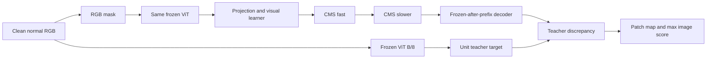
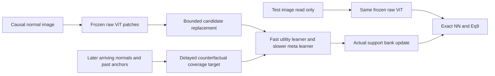

# Nested Learning for CAD — Báo cáo phân tích và định hướng phục hồi nghiên cứu

**Phiên bản:** research recovery report v1. **Ngày:** 2026-10-16, Asia/Bangkok. **Mốc dữ liệu:** W6 v4, W7.1 và W7.2 mới đã hoàn tất. **Worktree:** `D:/src/DATN/hope_cad_v2_2`; branch registry `hope_cad_v2_2`, base HEAD `b49a1036b3b79e8e28baf673dcb9da57476785f9`, cộng source được khóa bằng hash trong evidence. Báo cáo này là tài liệu phân tích và đề xuất; không thay thế architecture/spec v4 hoặc đóng băng một method mới.

**Cách đọc:** Phần A trình bày bằng chứng, lập luận toán học, cơ chế lỗi, các hướng giải quyết và điều kiện phản bác. Phần B chuyển chúng thành thứ tự công việc có đầu vào, đầu ra và điểm dừng. Các đề xuất mới mang trạng thái **PROPOSED / NOT IMPLEMENTED**. Những số liệu được tính lại từ output đã lưu không phải lượt chạy model mới.

**Kết luận chính:** v4 có nền tảng kỹ thuật kiểm chứng được, nhưng kết quả hiện tại cho thấy giả thuyết chuyển masked normal prediction thành anomaly ranking chưa thành công trên nhiều category. W7.2 xác nhận vấn đề đã xuất hiện ngay sau khi học task, chứ không chỉ do quên về sau. Vì vậy, tăng khả năng chống quên hoặc tăng steps đơn lẻ chưa giải quyết đúng nguyên nhân. Hướng có liên hệ rõ hơn với thế mạnh CADIC là bảo toàn hình học raw normal patches và cho Nested Learning học một quyết định thật sự ảnh hưởng tới normal-support memory. Hướng này cần một thuật toán, objective và phép kiểm riêng; chưa có bằng chứng nó sẽ thắng CADIC trên VisA.

Báo cáo cung cấp cơ sở để quyết định và kiểm chứng. Nó không thể bảo đảm trước một kết quả benchmark chưa xảy ra. Cam kết đúng là một quy trình có thể phát hiện và loại phương án không hiệu quả, chứ không điều chỉnh đến khi xuất hiện bảng số đẹp.

---

# PHẦN A — PHÂN TÍCH CHI TIẾT, BẰNG CHỨNG VÀ GIẢI PHÁP

## A0. Phạm vi audit và chuẩn bằng chứng

### A0.1. Đã xem gì và chưa xem gì

Đã đối chiếu các spec v3/v4, revision contract, implementation/handoff W1–W7, normal forensic r1, source của extractor/visual operator/CMS/outer learner/protocol/baseline/engine/metrics/statistics, archive W6/preflight/W7.1/W7.2 và bản sửa JSON resume. Các paper chính là CADIC, Nested Learning, VisionHOPE, ReplayCAD; tham khảo thêm Reverse Distillation, UniAD, PatchCore, nghiên cứu adaptive data analysis và continual memory selection. Nguồn chính xác ở A17.

Lượt này không chạy optimization, không chạy thêm model inference trên official test, không đọc local VisA images/masks hoặc local VisA model outputs để chọn giải pháp. Đã có exposure với kết quả MVTec hiện tại và số VisA công khai trong literature. Không tuyên bố nghiên cứu hoàn toàn độc lập với benchmark knowledge.

Tài liệu trước `research_audit_after_w7_1.md` được giữ làm snapshot. Báo cáo hiện tại bổ sung matrix W7.2 và phát triển sâu các giải pháp; những chỗ trước ghi W7.2 đang chờ phải được hiểu theo thời điểm snapshot cũ.

### A0.2. Bốn nhãn cần dùng nhất quán

| Nhãn | Nghĩa đúng | Ví dụ trong dự án |
|---|---|---|
| `implemented` | Có code thực thi đường chức năng | CMS periods1/8, RGB adapter, task matrix engine |
| `tested` | Có test hoặc kiểm chứng đúng phạm vi | FP64 oracle, exact16 meta-gradient, resume/state invariance |
| `experimentally validated: property X` | Dữ liệu thật đã đo được X với protocol cụ thể | M seed0 final I-AUROC66.8010%; W6 same-domain finite stability |
| `proposed / not implemented` | Ý tưởng hoặc thiết kế nghiên cứu chưa có bằng chứng thực thi tương ứng | Online slow decoder; learned support-memory controller |

Một implementation đúng và test pass không chứng minh objective phù hợp AD. Ngược lại, một benchmark thấp không chứng minh mọi operator hoặc toàn bộ khung Nested Learning sai.

### A0.3. Khả năng tái lập audit

Script xử lý evidence, JSON kết quả tính lại và các hình/tables dẫn xuất nằm tại:

`results/hope_cad_v2/research_recovery_after_w7_2/`.

`verify_evidence.py` chỉ đọc archive/source và ghi JSON phân tích riêng. Nó kiểm source đã khóa, hash các archive, entry hashes W7.2, tính bất biến của kết quả 7.1, 120 cells, F/BWT, collision SHA train/test và tính lại bốn final metrics từ raw arrays bằng sklearn ngoài hàm metric của dự án. Nó không tái tạo model outputs. Các assertion logic và giới hạn của kiểm chứng được trình bày cùng số liệu; không dùng một dấu PASS chung để che khác biệt về phạm vi.

## A1. Research checkpoint: bài toán, paper và phần đóng góp thực sự

### A1.1. Bài toán cần giải

Continual anomaly detection có hai yêu cầu đồng thời: tiếp thu normality của sản phẩm/category mới khi nó đến, và giữ khả năng phân biệt normal/anomaly của những category đã qua. Đầu vào cập nhật chỉ gồm normal train; test có normal và anomaly, được dùng để đo và không cập nhật persistent learner. Một mô hình giữ điểm thấp ổn định trên mọi task không phải một hệ CAD tốt chỉ vì forgetting nhỏ.

Mục tiêu đồ án nên phát biểu là: **thiết kế và kiểm chứng một cơ chế Nested Learning giúp quản lý tiếp thu và duy trì normal knowledge trong CAD dưới dữ liệu tuần tự và ngân sách hữu hạn**. “Bằng hoặc hơn CADIC” là mục tiêu thực nghiệm cụ thể; nó cần định nghĩa bằng metric và uncertainty trước confirmation. Tên đề tài không bắt buộc giữ mọi chi tiết của v4 sau khi chi tiết đó bị bằng chứng phản bác.

### A1.2. Đối chiếu CADIC, HOPE/NL và VisionHOPE

| Khía cạnh | CADIC | Nested Learning / HOPE | VisionHOPE | Instantiation v4 của đồ án |
|---|---|---|---|---|
| Knowledge carrier | Actual normal patch vectors trong unified coreset | Các learner/state theo context, objective, update frequency | Self-referential memories trong visual scan | Within-image visual memory và CMS persistent |
| Learning signal | Novelty/diversity của normal patch geometry | Task objective được thiết kế cho bài toán | Self-referential local update cùng outer task supervision | Masked clean-teacher feature regression |
| Continual across images | Coreset được cập nhật | CMS có thể học qua context theo clocks | Paper tập trung self-referential visual component | CMS weights/accumulators sống qua stream |
| Score cuối | NN raw features; image weighting Eq.9 | Không có CAD score mặc định | Không cung cấp một CAD score chuẩn cho dự án này | Squared teacher residual ở output cuối CMS; image=max |
| Điều paper hỗ trợ | Bank hữu hạn và incremental normal support là một lựa chọn CAD | Có thể thiết kế nhiều mức học cùng tương tác | Có thể điều khiển ổn định local recurrence trong vision | Các ingredients có lý do để thử |
| Điều không được suy ra | Local adapter tự động tái lập mọi author number | Hai clock tự động chống quên hoặc thắng CADIC | Stability theorem tự động cho AD/generalization | “Dùng paper mạnh” bảo đảm instantiation mạnh |

Nguồn: CADIC §III, Eq.1–9; NL §7–8, Eq.70–74; VisionHOPE Appendix A.4 và core pinned commit. [CADIC](https://arxiv.org/html/2511.08634v1#S3), [NL](https://arxiv.org/html/2512.24695v1), [VisionHOPE](https://arxiv.org/html/2609.33325v1).

Điểm then chốt trong VisionHOPE A.4: đưa CMS vào vision đòi hỏi lựa chọn thêm online objective; paper không giải quyết sẵn objective CAD của chúng ta. Do đó, masked teacher prediction là giả thuyết thiết kế riêng của đồ án. Thành công hay thất bại của giả thuyết đó không quyết định giá trị của paper NL.

### A1.3. Các mâu thuẫn hoặc khoảng trống thực sự

Không phát hiện một mâu thuẫn phương trình–code đủ giải thích toàn bộ kết quả thấp. Tuy nhiên có những khoảng trống về lập luận nghiên cứu:

1. Chưa có cơ sở đủ mạnh để suy từ giảm first-task normal MSE sang tăng AD ranking ở category mới.
2. Prefix một category được dùng để học outer representation và update initialization, nhưng deployment đòi hỏi chuyển qua nhiều category khác. Các episode calibration không chứa dạng task shift đó.
3. Chưa có objective buộc slow level giữ historical normal knowledge; khác tần suất mới chỉ tạo một điều kiện kiến trúc.
4. Normal gate lặp bottle kiểm được numerical/same-domain stability, nhưng chưa kiểm được khả năng tiếp thu category mới.
5. Một số status lịch sử trong full inherited specs vẫn mô tả W6/W7 pending và có dòng status lặp. Đây là nợ tài liệu trạng thái, không phải bằng chứng phương trình thực thi thay đổi. Việc cập nhật nên làm bằng status-index/receipt riêng để không âm thầm đổi dependency đã khóa.

Giải quyết các khoảng trống này cần objective và thí nghiệm phân biệt cơ chế. Thêm thuật ngữ HOPE/CMS hoặc thêm modules không giải quyết chúng.

## A2. Dựng lại toàn bộ đường học và dự đoán hiện tại

### A2.1. Tensor và dataflow thực thi

Với clean normalized RGB `x`, extractor frozen `F` là ViT-B/8 ImageNet-21k, block8 zero-based/layer9 one-based, bỏ CLS. Raw output `z=F(x)` có784 patches×768 channels. Teacher là `u_j=z_j/max(||z_j||,1e-8)` và detached.

Với mask view `v`, predictor nhận `F(mask_v(x))`, qua projection768→256, visual block, CMS1, CMS2 và decoder nonlinear256→768→768. Bốn views che196 patches mỗi view, hợp phủ đủ784 patches. Target là clean feature; predictor không được nhận clean target như input. ViT của masked input có global attention, nên corruption có thể thay đổi cả context ở các patch không bị che.

Nguồn: `models/hope_cad_v2/teacher_head.py:7–15`, `predictor.py:42–46,72–73`, `benchmark_adapter_v4.py:123–206`, `dataset/hope_mask_views.py`.

### A2.2. Các state có học gì và khi nào

| State | Context/objective | Clock/lifetime | Thay đổi sau prefix? |
|---|---|---|---|
| ViT pretrained | ImageNet-21k pretraining đã có từ trước | Frozen toàn experiment | Không |
| Projection/visual slow parameters/decoder | Meta/ordinary fitting trên bottle prefix | Outer optimizer, tối đa400 steps | Không |
| Within-image self-modifying memories | Visual tokens theo4 scans | Reset mỗi image/view | Có trong mỗi forward; không mang tri thức qua ảnh |
| Current CMS1 | Own partial của final teacher loss | Mỗi normal image event | Có |
| Current CMS2 | Own partial của cùng final loss, mean accumulator | Commit mỗi8 events | Có |
| Learned CMS initial weights | Outer fitting qua exact16 support unroll | Fixed sau prefix | Không |

Vì vậy, sau prefix, learner chỉ có thể thích nghi bằng current CMS phía sau một encoder/projection và trước một decoder đã đóng băng. Đây là contract có chủ đích. So sánh tensor checkpoints với W6 initialization xác nhận điều đó; không có một optimizer decoder bị quên gọi một cách ngẫu nhiên.

### A2.3. Objective và horizon

Normal event loss là:

\[
\ell_t=\frac{1}{2|\Omega_v|}\sum_{j\in\Omega_v}\|\hat u_{t,j}-u_{t,j}\|_2^2.
\]

CMS dùng final loss để lấy own partial theo từng current weight dictionary; tất cả gradient được tính từ pre-event snapshot rồi mới commit. Với period `p_l`, accumulator giữ tổng các own partial trong cửa sổ và commit `theta_l <- theta_l - beta_l * mean(g_l)` khi đến hạn. Pending không được flush/reset theo task.

Outer objective M v4 là trung bình query loss trước update và sau16 support events. Các support/query đều thuộc first-task normal prefix; M có LR cố định1e-4, trong khi static controls search ba LR đã đăng ký. Không có cross-category meta episode trong400 steps. Tăng từ200 lên400 giúp tối ưu cùng distribution lâu hơn; nó không tạo ra task diversity mới.

Nguồn: `cms.py:28–35,94–151`; `training/hope_outer_learning_v4.py:54–56,76–84,101–135,185–191`.

### A2.4. Data rights và những việc không phải leakage

First bottle prefix100 chia50 support/20 query/15validation/15probe. Online stream dùng lại70 support/query hợp lệ, loại30validation/probe, còn3.599 normal images. Dùng normal train khi category đến là học online hợp lệ. Dùng first-task support/query nhiều lần trong calibration đã được disclosure; protocol này không phải strict single pass từ ảnh đầu tiên.

Teacher clean image dùng làm regression target ở normal train và discrepancy ở test là đường score đã định nghĩa, không tự nó là label leakage. Điều cấm là dùng anomaly labels/masks hoặc official test để update/selection, hoặc cho learner nhìn future-task normals trước thời điểm được phép. Dùng test scores đã biết để sửa phương pháp là adaptive development exposure, kể cả không backprop test images.

## A3. Evidence engineering và trạng thái W1–W9

### A3.1. Những gì đã hoàn thành ở đúng phạm vi

| Work package | Implementation/test/evidence đã có | Còn thiếu để tuyên bố thành công nghiên cứu |
|---|---|---|
| W1 | Protocol/prefix/data-role validators; explicit adapter registry; per-image CADIC writes; Eq.9; mask QA | Baseline matched thật và parity assumptions cần đối chiếu |
| W2 | Source/runtime/data locks, cache checks, Kaggle preflight/resume/export | Không suy AD performance từ reproducibility |
| W3 | FP64 independent oracle; FP32/autograd; pinned upstream-core parity; real T4 technical evidence | Không phải full VisionHOPE reproduction hoặc AD utility evidence |
| W4 | Exact16 higher-order gradients; joint-final CMS; clocks/atomicity/resume; C4 inheritance | Cross-task usefulness và retention còn cần chứng minh |
| W5 | RGB masking→ViT→HOPE/CMS→decoder→score chạy thật | Score có thể sai inductive bias dù dataflow đúng |
| W6 v4 |16 fits×400 steps,11 gates,7selected initializations, real-prefix mechanism diagnostics | Học normal bottle có ích hạn chế; không xác nhận multi-category AD |
| W7.1 | M seed 0 đủ15 tasks;3.599 normal updates;1.725test images;15 checkpoints | Main performance thấp; chưa có matched controls/multi-seed conclusion |
| W7.2 | Full120 cells và F/BWT; final row giữ nguyên; normal interventions | Một seed/method; chưa cô lập nguyên nhân duy nhất |
| W7.3 | Registry/runner/refit/statistics có code và fixture tests |35registered streams chưa hoàn tất; không nên launch vô điều kiện |
| W8 | VisA official split/protocol/mask QA có modules | Chưa có complete generic runner/report: W7 còn MVTec/15 tasks hardcode |
| W9 | Nền provenance/spec/handoff đã có | Final results, thesis/repro/demo và claims vẫn phải hoàn thiện |

C0 hiện tại là static HOPE-topology control; CADIC là baseline riêng. Không dùng tên C0 của legacy để suy vai trò control v4.

### A3.2. Bản sửa W7.2 JSON resume

Bug tuple/list làm strict `lock_json` báo changed identity giả dù canonical digest giống. Launcher trong `notebook_support/w7_resume_fix/` chuẩn hóa JSON identity rồi gọi original check, verify119frozen dependencies và ghi receipt. Code học, checkpoint và metrics7.1 không đổi. Evidence local ghi130tests cũ+10focused tests và compatibility đủ15 checkpoints; W7.2 mới đã chạy xong qua wrapper này.

Đây là lỗi vận hành đã xử lý. Nó không thể giải thích performance thấp của 7.1 vì7.1 đã có scores trước khi lỗi resume xuất hiện. Archive cũ `docs/w7_kaggle_7_2/` là failure attempt; archive mới cần dùng là `docs/w7_kaggle_7_2_1/`.

### A3.3. Giới hạn của audit code

Đã kiểm source và evidence quan trọng theo đường thực thi; chưa có chứng minh hình thức cho toàn bộ chương trình. Kết luận đúng là chưa tìm thấy bug chia split/nhãn/metric/state đủ giải thích mức collapse AD. Không thể đổi thành khẳng định tuyệt đối “code chắc chắn không còn lỗi nào”.

Một lỗi quan sát có thật: `benchmark_adapter_v4.py:145–161` tính và trả normal losses, nhưng `training/hope_w7_engine.py:129` bỏ return value. Train summary chỉ giữ counts/cursors, không có online learning curves từng category. Điều này cản attribution; bản thân bỏ log không đổi update hoặc prediction.

## A4. Kết quả W6 v4: đã sửa được gì và chưa chứng minh gì

### A4.1. Hiệu quả normal learning thật

| Method | Probe loss event0 | Probe loss event70 | Diễn giải phạm vi |
|---|---:|---:|---|
| M |0.14700245|0.14549715|Giảm khoảng1.024% trên bottle probe development |
| C0 |0.08980650|0.08980650|Static, không online CMS |
| C1 |0.09095583|0.09095583|Static CMS, visual active |
| C2 |0.14567039|0.14417354|Visual updatesOFF, CMS active |
| C3 |0.14735348|0.14504519|Một CMS level |
| C4 |0.14646746|0.14486948|Equal-period, rate-matched |
| A1 |0.09095583|0.09051537|C1 initialization + M dynamics |

Loss ở đây có hệ số1/2 theo code. Không so trực tiếp nó với score bình phương không có1/2 rồi kết luận scale mismatch.

M v4 không có catastrophic zero-clock loss như v3 forensic: v3 event0≈200.97, v4≈0.147. R1 cũng từng quan sát visual center contraction cực mạnh và local/final gradient conflict trên một số states; v4 thay retention theo chunk, joint-final partials và cold/warm outer objective để xử lý các cơ chế đó. Đây là tiến bộ engineering/mechanism thực, không có nghĩa CAD benchmark đã được cứu.

Ở selected M fit β=.01, validation joint score tại200/300/400 steps lần lượt≈0.19023466/0.15745845/0.14490038.400vẫn ở budget boundary và loss còn giảm. Điều này chứng minh chưa đo convergence toàn diện; nó không chứng minh tăng tiếp steps sẽ cải thiện anomaly ranking hay task transfer. Gradient clipping xuất hiện69/400 steps, không phải mọi step bị khóa hoàn toàn.

### A4.2. Các control cho thấy gì

Position-wise teacher mean đạt normal probe≈0.04301519, thấp hơn M nhiều; C1≈0.09095583. Từ đây không suy ra mean predictor sẽ là AD winner. Nó cho thấy normal-MSE không được đồng nhất với chất lượng anomaly detector. M có bottle I-AUROC cao dù normal MSE chưa tốt nhất.

M L70 khi freeze slow≈0.14556754, freeze fast≈0.14643203. Slow contribution ở phép đo này nhỏ. VisualOFF cả adaptation lẫn scoring làm normal loss xấu hơn khoảng18%, nên visual branch không còn gần như vô hiệu như v3 forensic. Các phép đo cùng history hữu ích hơn việc ghép hai independent histories thành trajectory.

Không quy toàn bộ M–C1 gap cho meta-learning: objective, LR search và số loss terms khác nhau. C1/A1 giúp phân biệt initialization với online dynamics; muốn so optimizer công bằng còn cần matched-recipe auxiliary control đã đăng ký riêng.

### A4.3. Gate1024 events có nghĩa gì

Gate stream lặp70first-task support/query đến1024 events, kiểm finite/loss drift/norms/accumulators. PASS có giá trị với stability trên distribution đó. Nó không có cable/screw hoặc task shift, nên không xác nhận ability-to-acquire ngoài bottle. Lặp một distribution nhiều hơn không thay thế đa dạng context.

## A5. W7.1 và W7.2: bằng chứng anomaly detection và continual behavior

### A5.1. Final metrics và baseline lịch sử

| Metric | M seed0 final | CADIC10k Khang đã cung cấp | Gap M−Khang |
|---|---:|---:|---:|
| I-AUROC |66.8010%|87.72%|−20.9190 pp|
| P-AUPR/AP |17.0163%|46.71%|−29.6937 pp|
| I-AP |83.2417%|94.77%|−11.5283 pp|
| P-AUROC |81.1590%|90.02%|−8.8610 pp|

Kết quả Khang được xem là real như người dùng xác nhận. So sánh này vẫn exploratory vì chưa có artifact matched đầy đủ của baseline. Caveat đó không làm mức gap lớn hiện tại trở thành chấp nhận được. Mục tiêu tiếp theo là đo matched baseline đúng điều kiện, không hạ tiêu chuẩn baseline để rút ngắn gap.

### A5.2. W7.2 mới: acquisition quality đã thấp trước khi forgetting xảy ra

| Metric | Mean diagonal sau từng task | Final macro | BWT trên 14 old tasks | Forgetting từ prior max |
|---|---:|---:|---:|---:|
| I-AUROC |69.0439%|66.8010%|−2.4031 pp|3.8051 pp|
| P-AUPR/AP |18.9133%|17.0163%|−2.0325 pp|2.7918 pp|
| I-AP |84.8022%|83.2417%|−1.6720 pp|2.4147 pp|
| P-AUROC |85.1473%|81.1590%|−4.2731 pp|4.3988 pp|

Diagonal là chất lượng sau khi task đó đã đi qua online learner. Nó không phải acquisition *gain*: chưa có phép đo cùng task trước khi học, và đánh giá future tasks sớm không nằm trong frozen matrix. Tuy nhiên, diagonal thấp trực tiếp phản bác lời giải thích rằng model ban đầu học AD rất tốt rồi chỉ bị các task sau làm quên.

Mean diagonal–final dùng15 tasks, còn BWT dùng14 tasks cũ; không lấy hiệu hai macro15 tasks rồi bảo code BWT sai vì hai số không bằng nhau. Forgetting lấy max ở các checkpoint đã học task đó trước final, giữ dấu theo spec, không clamp 0. Nó là mô tả score trajectory, không bằng chứng causal rằng slow level thất bại.

### A5.3. Toàn bộ category: chất lượng sau task và cuối stream

| Category | I-AUROC diagonal | I-AUROC final | P-AUPR diagonal | P-AUPR final |
|---|---:|---:|---:|---:|
| bottle | 96.4286% | 93.9683% | 67.2846% | 73.3310% |
| cable | 61.7504% | 55.9033% | 8.6275% | 4.8813% |
| capsule | 42.7603% | 45.5923% | 4.9203% | 3.7973% |
| carpet | 97.2713% | 95.5457% | 46.0374% | 43.8968% |
| grid | 87.6358% | 79.9499% | 4.2941% | 2.4846% |
| hazelnut | 67.3214% | 74.5357% | 16.0401% | 12.5757% |
| leather | 99.0489% | 99.0829% | 10.6082% | 7.5175% |
| metal_nut | 45.6500% | 43.6950% | 24.7866% | 22.2900% |
| pill | 54.8009% | 43.9989% | 14.9757% | 10.3198% |
| screw | 7.2351% | 6.8867% | 0.9529% | 0.9223% |
| tile | 85.1732% | 79.1847% | 29.8844% | 23.3396% |
| toothbrush | 63.6111% | 57.2222% | 11.4469% | 7.2334% |
| transistor | 63.3750% | 63.2917% | 14.3522% | 14.8572% |
| wood | 97.1053% | 96.6667% | 19.4814% | 17.7902% |
| zipper | 66.4916% | 66.4916% | 10.0077% | 10.0077% |

Các trường hợp có sức phân biệt:

- Screw ngay sau task chỉ7.2351% I-AUROC, cuối6.8867%; việc chỉ khôi phục early state không giải quyết được collapse.
- Capsule diagonal42.7603%, cuối45.5923%; ở đây có cải thiện nhẹ về sau nhưng vẫn thấp.
- Pill54.8009%→43.9989%: có retention deterioration đáng kể ngoài chất lượng ban đầu còn yếu.
- Zipper cuối66.4916%, không có task sau; chất lượng yếu ở đây không thể do quên sau zipper.
- Bottle và một số texture vẫn tốt, cho thấy detector có signal; kết luận “toàn bộ tensor/nhãn bị đảo” không phù hợp với pattern này.

Nếu dùng test để chọn checkpoint tốt nhất riêng từng category trong các states đã lưu, macro historical envelope chỉ≈70.4094% I-AUROC và19.6557% P-AUPR. Đây là phép mô tả **test-dependent, không deployable**; cấm dùng nó chọn checkpoint. Nó chỉ cho biết tập states đã quan sát chưa chứa một lời giải tốt được che bởi final-state selection. Không gọi nó là upper bound của mọi thuật toán retention hoặc toàn bộ hypothesis class: sửa training có thể thay cả trajectory.

### A5.4. Các interventions W7.2

A2/A3 đo8bottle train normals đã thấy, bốn views, trên clones, khôi phục state/RNG:

| Can thiệp | Map delta RMS | Mean image-score delta |
|---|---:|---:|
| Reset CMS về initialization |0.42727989|−0.28394937|
| Dùng state sau bottle |0.43068142|−0.28782105|
| Single scan thay4 scans |0.07921308|−0.01969014|
| Bỏ injection cap |0.00059281|+0.00012363|
| Bỏ spectral cap |0|0|
| Active continuation8 seen normals |0.13660260|−0.08361593|
| Frozen-weight continuation |0|0|

CMS đã có ảnh hưởng thật lên output. Điều đó loại được nghi ngờ “nhánh chạy nhưng không chạm score” của prototype legacy; chưa chứng minh ảnh hưởng có ích cho AD. Score normal giảm trên các ảnh đã học không cho biết anomaly scores giảm nhiều hay ít hơn. Cap không active ở8ảnh không chứng minh cap không cần ở mọi context.

### A5.5. Runtime thực và phạm vi

W7.1 đến handoff≈44m55s; train3.599 images≈17m23s, final scoring/IO≈23m47s. W7.2 mới đến handoff≈2h56m33s, ZIP hoàn thành khoảng2h59m33s, runnerexit0. Có120 cells,13.950 image evaluations trong full triangle;7.2 thêm105 cells,12.225 image evaluations và giữ final row cũ.

Đây là thời gian thực của M seed 0 trên T4. Không lấy7.1×3 để ước lượng35 streams. Full suite còn controls, refits, baselines, orders và uncertainty. Chi phí W6 chủ yếu exact meta-fitting; W7 chủ yếu repeated scoring/task matrix. Chúng trả lời các câu hỏi khác nhau.
## A6. Phân tích toán học các cơ chế có thể gây yếu

### A6.1. Squared prediction loss tối ưu predictability, chưa phải normal-support distance

Đặt `Z` là thông tin từ masked input và `U` là clean teacher feature. Với squared loss và giả định moment hữu hạn, population optimum là conditional mean:

\[
f^*(Z)=\mathbb E[U\mid Z].
\]

Phân rã chuẩn cho bất kỳ predictor khả tích bình phương:

\[
\mathbb E\|U-f(Z)\|^2
=\mathbb E\operatorname{tr}\operatorname{Cov}(U\mid Z)
+\mathbb E\|\mathbb E[U\mid Z]-f(Z)\|^2.
\]

Cross term bằng 0 do residual quanh conditional mean có conditional expectation0. Hệ số1/2 của training chỉ nhân toàn biểu thức, không đổi minimizer.

Số hạng đầu là bất định do corruption/context; số hạng thứ hai là estimation/approximation/optimization error. Không số hạng nào tự đồng nhất với mức độ nằm ngoài normal support. Một normal cấu trúc phức tạp, pose khác hoặc background khó có thể khó dự đoán hơn một anomaly đơn giản. Ngược lại, một network quá mạnh có thể dự đoán anomaly tốt. Vì vậy “fit normal tốt hơn” là điều kiện hữu ích để kiểm learner nhưng không đủ cho AD.

Cơ sở literature: reconstruction/teacher discrepancy đã có thành công trong AD, nhưng những kiến trúc như [Reverse Distillation](https://openaccess.thecvf.com/content/CVPR2022/html/Deng_Anomaly_Detection_via_Reverse_Distillation_From_One-Class_Embedding_CVPR_2022_paper.html) và [UniAD](https://arxiv.org/html/2206.03687) còn phải giải quyết inductive bias và shortcut. Không thể chuyển kết quả của họ sang masked HOPE bằng tên objective chung.

**Hệ quả thiết kế:** cần kiểm liệu residual đang phản ánh “khác normal support” hay “khó khôi phục từ mask”. Nếu chọn tiếp predictor route, objective và score phải xử lý ambiguity/calibration thay vì chỉ tối ưu MSE thêm. Nếu chọn support-memory route, NN score nối trực tiếp hơn với normal support nhưng vẫn cần assumptions về anomaly separation.

### A6.2. Frozen decoder tạo một giới hạn điều khiển thực, nhưng chưa chứng minh bất khả biểu diễn

Sau prefix, decoder `D_theta:R^256→R^768` cố định. Dù CMS đổi hidden `h` thế nào, output chỉ nằm trong:

\[
\mathcal R_D=\{D_\theta(h):h\in\mathbb R^{256}\}.
\]

Với target `u`:

\[
\|D_\theta(h)-u\|^2\geq \inf_{v\in\mathcal R_D}\|v-u\|^2.
\]

Đây là bound đúng theo định nghĩa. Jacobian tại một hidden có rank≤256; local output perturbations chỉ đi trong range của Jacobian. Tuy nhiên nonlinear decoder không phải một affine subspace256chiều cố định, và rank bound không chứng minh các teacher targets thực có positive global error floor.

**Diagnostic đúng:** với normal train đã đến, so initial error, best-found latent optimization với decoder fixed, CMS-only parameter adaptation và decoder-only adaptation dưới budget cố định. Có thể tính first-order inaccessible residual `(I−JJ^+)r`, nhưng đó là linearization tại một điểm, không là chứng minh irreducible error. Optimizer không tìm được lời giải cũng không chứng minh lời giải không tồn tại.

**Root concern:** một bộ mã hóa/giải mã học từ bottle có thể co-adapt với statistics của bottle; chỉ CMS được giao nhiệm vụ đưa category mới vào một output map chưa từng được huấn luyện cho chúng. Đây là transfer assumption mạnh mà calibration chưa rèn trực tiếp.

### A6.3. Norm amplification đã được xác lập từ saved scores

Teacher norm không vượt1 trong số học lý tưởng, xấp xỉ1 trong FP32. Với `r=||u_hat||`, unit teacher và góc `theta`:

\[
a=\|\hat u-u\|^2=r^2+1-2r\cos\theta.
\]

Triangle inequality còn cho:

\[
\|\hat u\|\geq \max(0,\sqrt a-\|u\|)\approx\max(0,\sqrt a-1).
\]

Từ raw W7.1/7.2 final arrays của screw:

- 41/41 normal images có max patch residual>4, với tolerance so sánh1e-5.
- Median max score normal=10.57911682, anomaly=4.70773745.
- Median lower bound cho prediction norm tại patch tạo max score normal=2.25255543.

Nếu cả prediction và teacher đều unit norm, squared distance không thể vượt4. Vì vậy các normal scores này buộc phải có prediction norm amplification. Đây là kết luận toán học từ output, mạnh hơn một giả thuyết chưa đo. Nó vẫn không cho biết bao nhiêu phần của *ranking error* do norm và bao nhiêu do angle/context; cần đọc actual norm/cosine tensors để attribution.

Đường truyền amplitude có cơ sở trong code: raw unnormalized ViT features đi qua projection skip của visual block; CMS là residual MLP; LayerNorm nằm trong branches, không chặn toàn residual stream; decoder output không normalize. Numerical bounds của visual recurrence không phải bound cho output của toàn predictor.

**Không tự sửa bằng unit-normalizing output rồi gọi cùng method.** Làm vậy thay score/objective geometry, có thể bỏ amplitude hữu ích hoặc làm anomaly được khớp tốt hơn. Phải xem normal-only stage norms/tail statistics và đăng ký revision. Không search normalization theo screw anomaly scores.

### A6.4. Teacher normalization thay hình học so với CADIC

CADIC đối chiếu raw patch Euclidean geometry. V4 teacher target giữ direction nhưng bỏ raw-feature radial magnitude. Ví dụ raw features `z` và `lambda*z` cho cùng unit target khi `lambda>0`. Điều này xác định một kênh target information bị mất so với raw distance.

Không suy ra toàn detector không phân biệt được hai ảnh đó: masked raw input và context vẫn có thể khác. Cũng không suy ra raw magnitude luôn hữu ích; magnitude có thể là nuisance. Điểm cần kiểm là ta đã chuyển bài toán metric mà không có benchmark evidence rằng chuyển đổi đó phù hợp CAD hơn raw feature support.

### A6.5. Max pooling là phép đo tail, trong khi loss là mean

Train loss trung bình196masked patches; image score lấy max784 patches. Learner có thể giảm mean error nhưng vẫn giữ vài outlier residual ở normal images. Một outlier đó đủ đảo image ranking. Pixel-AUROC cao nhưng I-AUROC thấp của screw tương thích với tình huống này.

Nếu các patch scores độc lập và cùng CDF normal `G`, max có CDF `G(s)^784`; patch thực tế có phụ thuộc nên công thức này chỉ là minh họa, không model dữ liệu. Nó giải thích vì sao tail nhỏ trong mỗi patch có thể ảnh hưởng nhiều ở image level. Diagnostic cần mean/p95/p99/max và vị trí patch thắng, không chỉ global loss.

Pixel-AUPR còn nhạy với false-positive area và prevalence. I-AP83.24% không phải bằng chứng model gần đạt: macro anomaly prevalence trong test khoảng72.30%; screw prevalence74.375% nhưng I-AP chỉ54.7042%. Không so AP giữa datasets khi bỏ qua prevalence/mask geometry.

### A6.6. Hai timescale không tự sinh retention objective

Với current gradient `g_cur` và past risk gradient `g_old`, một SGD step nhỏ có:

\[
L_{old}(\theta-\beta g_{cur})-L_{old}(\theta)
\approx-\beta\langle g_{old},g_{cur}\rangle.
\]

Nếu inner product âm, current update có thể làm old risk tăng. Commit ít hơn hoặc lấy mean có thể giảm magnitude/variance nhưng không buộc alignment dương. Dù local derivative của final loss đúng, nó vẫn là loss của current observation, không tự chứa historical constraint.

Với gradient gần hằng trong8 events, M slow commit `beta*g` mỗi8 events và C4 update`beta/8*g` mỗievent tương đương first-order. Khác biệt thực đến từ path, nonlinear curvature, stale gradients và interaction với fast learner. Vì vậy C4 là control cần thiết. Muốn nói slow memory chuyên giữ kiến thức dài hạn cần evidence vượt equal-effective-rate control hoặc objective/context retention rõ.

Final relative CMS drift≈9.7653%fast/0.9718%slow và finite parameter norms không phản bác khả năng function/ranking drift. Deep nonlinear composition có thể nhạy với thay đổi nhỏ. W7.2 đo được deterioration nhưng chưa quy nguyên nhân chỉ cho slow period.

### A6.7. Prefix meta-learning chưa huấn luyện đúng dạng chuyển phân phối

Trong400episodes,16 support lấy từ50bottle và1 query từ20bottle. Học initialization để đáp ứng16 updates cùng domain có thể có ích ở bottle. Nó không trực tiếp huấn luyện “bottle→cable→...→screw”. W6 gate cũng không bổ sung diversity này.

Không giải quyết bằng cách cho outer learner nhìn tất cả future categories rồi vẫn claim first-task-prefix protocol. Các lựa chọn hợp lệ là: causal slow learning tiếp khi task đến; independent external-normal pretraining có disclosure; hoặc thiết kế update/objective ít phụ thuộc first-category statistics. Mỗi lựa chọn thay protocol/cost theo cách cần khóa và so baseline rõ ràng.

Order studies hiện hành giữ bottle ở đầu rồi shuffle các task sau (`training/hope_w7_contract.py:76–93`). Chúng kiểm order robustness sau calibration, không kiểm robustness với category calibration đầu tiên. VisA bắt đầu candle là một transfer challenge khác.

### A6.8. Những bảo đảm không thể có từ normal-only evidence

AUROC là xác suất score anomaly cao hơn score normal, có xử lý ties. Với normal distribution cố định nhưng anomaly distribution chưa biết, hai score functions có thể được xếp hạng ngược nhau bằng cách đặt anomaly mass ở vùng mà chúng bất đồng. Normal-only loss/FPR không quyết định được mọi anomaly ranking.

Thêm baseline branch chỉ chứng minh hypothesis class chứa baseline. Ví dụ baseline cho normal0/anomaly1, nhánh phụ cho normal2/anomaly0: lấy max làm normal2>anomaly1 dù fused score pointwise không nhỏ hơn baseline. “Có fallback” hoặc “score không giảm” không phải AUROC guarantee.

Conformal normal-FPR control, nếu assumptions phù hợp, có thể kiểm một loại error ở một operating point; không bảo đảm future anomaly recall/AUPR/AUROC. Không được dùng nó làm giấy bảo hành VisA. Cách bảo đảm bằng prediction thật sự là giữ exact baseline score; lúc đó nghiên cứu cần đóng góp khác đo được, như efficiency, chứ không tuyên bố AD gain do một nhánh không đổi output.

## A7. Cây nguyên nhân và sức nặng bằng chứng

| Giả thuyết | Bằng chứng hiện có | Mức kết luận hợp lệ | Kiểm tra phân biệt tiếp theo |
|---|---|---|---|
| Split/nhãn/metric sai | Hash inventory; labels/paths/masks; metric recompute; read-only cells | Chưa thấy lỗi giải thích collapse | Independent audit route nếu baseline cũng bất thường |
| Resume làm đổi model |275immutable entries7.1 bảo toàn;119locked sources khớp | Không có bằng chứng drift do fix | Receipt/source check mỗi continuation |
| Main branch không ảnh hưởng score | Final score đọc CMS; reset/continuation đổi maps | Đã phản bác cho v4 | So tác động có ích bằng controls |
| Chỉ quên về sau | Diagonal69.04/18.91 đã thấp; screw7.24 ngay sau task | Đã phản bác như lời giải thích duy nhất | Current-vs-past normal diagnostics |
| Head/projection bottle không transfer | Freeze contract; no cross-domain meta episodes; weak diagonals | Rủi ro cấu trúc mạnh, chưa causal proof | CMS-only vs decoder-only normal fits |
| Norm/tail làm image ranking hỏng | Screw normal41/41score>4; teacher norm≈1 | Norm amplification đã xác lập; attribution chưa | Stage norm/cosine/tail diagnostic |
| Mask-predictability khác normality | Objective math; heterogeneity metrics | Mismatch có cơ sở lý thuyết | Mask sensitivity trên legal normals; support-based comparison |
| Slow layer vô dụng | Small bottle intervention; W7state effects nonzero | Chưa đủ kết luận toàn cục | C3/C4 và matched retention controls |
| Chỉ chưa train đủ | Validation còn giảm tại400 | Có optimization limitation, không evidence AD remedy | Bounded matched convergence test, không vô hạn steps |
| Backbone không đủ mạnh | CADIC cùng feature family có kết quả tốt hơn lịch sử | Không phải lý do đầu tiên nên đổi backbone | Matched CADIC10k cùng checkpoint |

Chuỗi nguy cơ hợp lý hiện tại là: first-category calibration → frozen outer map ở category mới → amplitude/conditional-prediction error → max/tail score → poor AD ngay sau task; current-only updates tiếp tục làm một số category cũ xấu hơn. Đây là một mô hình giải thích cần kiểm, không phải một causal attribution đã chứng minh cho từng mũi tên.

Vì thế, ưu tiên khắc phục phải bắt đầu ở **normal-support/acquisition và objective–score alignment**, đồng thời có retention. Chỉ làm retention trước sẽ giữ lại một detector mà ngay khi học task đã yếu.

## A8. Gói điều tra nhỏ để phân biệt cơ chế trước revision lớn

### A8.1. Ba registered development controls cần ưu tiên

1. `CADIC10000_seed0`: cùng checkpoint, data rights, order, resize, raw feature/layer và metric integration đã khóa. Đây là đối chứng mức hình học/support.
2. `C1_seed0`: ordinary initialization với visual active và static CMS. Nó kiểm mức transfer của static learned predictor trong cùng family.
3. `A1_seed0`: bắt đầu từ C1 và dùng online dynamics/rate của M. C1↔A1 hữu ích để nhìn effect của online adaptation từ cùng ordinary initialization; M↔A1 hỗ trợ đánh giá meta initialization nhưng vẫn có recipe confounds.

Đây là các jobs trong registry, không cần phát minh control sau khi thấy score đẹp. Chúng là development evidence vì MVTec đã được xem. Có thể chạy final row trước rồi chỉ thêm matrix cho câu hỏi còn chưa rõ, miễn lưu đủ task checkpoints và ghi scope; chưa hoàn tất mọi matrix thì chưa gọi full benchmark.

Không launch full35 streams chỉ để hy vọng một seed cứu score. Không bỏ control bất lợi khỏi báo cáo. Nếu cần rút scope full study sau negative result, đăng ký lại kế hoạch có lý do và vẫn báo toàn bộ runs đã thực hiện.

### A8.2. Normal-only checkpoint diagnostics

Đề xuất một diagnostic sidecar riêng, không thay frozen engine: với từng checkpoint, chỉ đọc normal train của category đã đến. Lấy8identities/category bằng rule hash cố định, đồng nhất mọi control. Đo diagonal state và final state trước; nếu cần mới mở rộng theo protocol đã ghi.

Lưu các nhóm sau:

- Raw ViT/teacher norm và variance; masked-view sensitivity.
- Projection/visual/CMS1/CMS2/decoder activation norm, p50/p95/p99/max.
- Final residual radial component và angular component; vị trí patch thắng image max.
- Own gradient norm, applied update norm, accumulator norm và fast/slow output sensitivity.
- Current-task normal fit, past-task normal retention, state/reset comparisons.
- Model/state/RNG hashes trước–sau, identity và exact scope của samples.

Các normal train này đã tham gia online stream: kết quả là in-sample/forensic evidence, không được đổi tên held-out generalization. Nếu auxiliary fit chia4 support/4 query trong tập đã được model gốc xem, query chỉ held-out với *auxiliary fit*, không untouched với nghiên cứu gốc. Việc xây một holdout mới cho revision phải khóa trước training revision và áp quyền dữ liệu tương ứng cho baseline.

Đọc earlier checkpoint trên future-category normals để chọn nó trước task đó sẽ tạo một phép nhìn trước nếu đem quyết định vào deployed learner. Sidecar này không làm vậy. Mọi diagnostic clones bị discard, không export lại thành “selected initialization” chính.

### A8.3. Bounded capacity/retention experiment

Các arms cần cân bằng data/steps trước chạy:

- CMS-only, decoder frozen.
- Decoder-only, CMS frozen theo trạng thái ban đầu của clone.
- CMS+slow decoder, current normals only.
- CMS+slow decoder, current normals + bounded historical replay/anchors.

Chốt budget optimizer, LR candidates hữu hạn, replay bytes, số ảnh và seed trước. Đo current fit và old fit riêng, không chỉ tổng mean. Nếu decoder-only giảm current normal residual rõ mà CMS-only không làm được, head acquisition là ưu tiên hợp lý. Nếu cả hai đều fit normals nhưng AD vẫn kém, objective–score mismatch còn tồn tại. Nếu replay giữ old fit nhưng current acquisition giảm mạnh, cần nhìn trade-off thay vì ca ngợi forgetting thấp.

Gói này là **PROPOSED**, chưa chạy. Không nêu con số improvement giả định như thể đã đo.

## A9. Hướng sửa A — giữ predictor HOPE nhưng cho slow acquisition thực sự

**Trạng thái: PROPOSED / NOT IMPLEMENTED.** Đây là nhánh sửa ít xa v4 hơn, không phải khuyến nghị mặc định rằng chỉ sửa decoder sẽ thắng CADIC.

### A9.1. Thiết kế có thể kiểm chứng

Giữ frozen raw ViT. CMS fast tiếp thu normal stream thường xuyên. Decoder trở thành một learning level chậm, được cập nhật causal từ normal images đã đến. Nếu projection cũng được học online thì phải quy định ownership/clock/cache rõ; không mở toàn backbone trong cùng revision chỉ vì muốn capacity lớn hơn.

Một loss family cho slow update:

\[
L_s=L_{cur}^{teacher}+\lambda_rL_{replay}^{teacher}
+\lambda_aL_{anchor}^{function}.
\]

Replay targets là clean frozen-teacher features của past normals, không là pseudo anomaly labels. Functional anchors có thể giữ output của snapshot cũ hoặc direct teacher target; hai lựa chọn có semantics khác, phải chọn trước. Snapshot output sai có thể khóa error cũ, direct teacher vẫn chịu predictability mismatch; không trộn tên rồi bỏ qua hệ quả.

Fast/slow updates phải được tính từ snapshot nào, gradient có đi qua nhau không, lúc commit có reset accumulator không và rollback ra sao đều phải đặc tả. Không tự flush task boundaries để “giúp model”. Nếu các clock mới thay semantics v4 thì dùng method ID mới.

### A9.2. Giải quyết điều gì, còn yếu ở đâu

Nó mở khả năng map teacher targets ở category mới và có explicit past-normal retention. Vì thế có thể xử lý giới hạn điều khiển decoder. Nó không tự giải quyết ambiguity do mask, max-tail mismatch hoặc anomaly được reconstruct tốt. Cần so với ordinary online predictor + replay; nếu matched ordinary learner đạt tương tự thì không quy gain cho Nested Learning.

Nếu chỉ decoder thay đổi, cache frozen raw ViT/masked inputs vẫn dùng được khi hashes/geometry khớp. Cache của learned encoder/projection phải invalidate khi producer đổi. Past replay phải lưu đủ masked input/target hoặc images để recompute; một record “entry” không thể coi bằng một raw patch vector của CADIC.

### A9.3. Điều kiện để tiếp tục hoặc loại hướng A

Tiếp tục nếu bounded diagnostics cho thấy acquisition bottleneck được xử lý, old knowledge được giữ ở budget hợp lý, norm/tail được kiểm soát và AD development improvement đi cùng controls đúng. Loại hoặc hạ ưu tiên nếu normal fit tốt hơn nhưng AD ranking không tiến bộ, hoặc replay cost vượt baseline quá lớn mà không có benefit.

Không chọn giữa A và B bằng seed0VisA. Chọn trước local VisA anomaly outputs theo cơ chế và development evidence hữu hạn.

## A10. Hướng sửa B — Nested Learning quản lý normal-support memory

**Trạng thái: PROPOSED / NOT IMPLEMENTED.** Đây là hướng ưu tiên nghiên cứu nếu mục tiêu chính là CADIC-level AD và transfer sang VisA. Nó giữ thế mạnh geometry của baseline, nhưng thay nhiệm vụ learner từ dự đoán mọi clean patch sang học quyết định lưu/giữ normal knowledge.

### A10.1. Forward và nhiệm vụ học

Bank `C_t` chứa actual observed normal raw ViT patches. Final patch score vẫn là nearest-neighbor distance trong raw 768-dimensional geometry; image score dùng cùng Eq.9 của baseline. Một HOPE/CMS learner phải điều khiển write/eviction/consolidation thực sự, tạo bank khác có thể đo được; không chỉ chạy bên cạnh hoặc điều chỉnh metadata không ảnh hưởng score.

Nhánh prediction v4 có thể được dùng như một candidate context encoder nếu có evidence cần thiết, nhưng không bắt buộc nhét nguyên bộ decoder vào controller. Một large bottle-trained representation có thể tái tạo vấn đề transfer cũ. Geometry/statistics task-free như novelty, uniqueness của eviction, usage/age và distance quantiles có lý do transfer rõ hơn; bản thân fixed statistics cũng có thể đủ, nên phải có nonlearned control.

Đây là method revision về prediction architecture, không phải “thêm chút HOPE vào CADIC mà vẫn cùng v4”. Nó vẫn đúng tên Nested Learning for CAD nếu có learning levels, objectives, cross-level credit và ảnh hưởng cuối thật. Nếu chỉ là một hand-coded coreset rule cộng hai timer thì cần mô tả đúng như vậy, không nhận đóng góp HOPE đầy đủ.

### A10.2. Lý do hình học có điều kiện

Với finite set normal patches đã quan sát `S`, nonempty `C⊆S`, đặt:

\[
\epsilon(C,S)=\max_{s\in S}d(s,C).
\]

Triangle inequality cho mọi query `z`:

\[
d(z,S)\leq d(z,C)\leq d(z,S)+\epsilon(C,S).
\]

Bound trái do`C⊆S`. Với nearest`s*∈S`, chọn nearest`c*∈C` của`s*`; khi đó`||z−c*||≤||z−s*||+||s*−c*||`, cho bound phải.

Nếu normal query cách`S`không quá`r0`, anomaly cách`S`ít nhất`r1`, và`r1>r0+epsilon`, patch NN scores có separation margin. Đây là giả định support-separation cần kiểm; không đã được chứng minh trên MVTec hoặc VisA. Bound chỉ nói về observed S, không bao phủ mọi future normals.

Coverage tốt hơn vẫn không bảo đảm AUROC tốt hơn. Counterexample cùng K: `S={0,4,10}`, `C_A={0,4}` có epsilon = 6;`C_B={0,10}` có epsilon = 4. Với normal 3 / anomaly 10.1, A xếp đúng`1<6.1`, B xếp sai`3>0.1`. Anomaly quá gần một normal mode nên separation assumption thất bại. Bound patch NN cũng không tự chuyển thành theorem cho neighbor-weighted image Eq.9.

Vì vậy B có **mục tiêu toán học gắn trực tiếp hơn với approximation của support**, không có bảo đảm benchmark hơn CADIC. CADIC sử dụng một heuristic diversity có evidence thực nghiệm; learner chỉ đáng tồn tại nếu vượt fixed-policy controls ở cùng budget.

### A10.3. Objective coverage/retention có thể học được

Một objective family trên legal normal reference images R:

\[
J(C;R)=\frac{1}{|R|}\sum_{x\in R}
\left[\operatorname{mean}_{j}d(F(x)_j,C)^2
+\lambda_{tail}\operatorname{Tail}_{j}d(F(x)_j,C)^2\right].
\]

`Tail` phải là max hoặc fixed quantile được chọn trước; không search bằng anomaly masks. Image averaging giúp tránh một ảnh có nhiều patches lấn át mọi ảnh khác. Past anchors thêm retention term; chúng là bộ nhớ và training targets, không free independent validation.

Điểm cốt lõi là prequential evaluation: reference mới phải được đánh giá trước write của chính nó. Nếu insert vector rồi lấy distance của nó với bank sẽ nhận0tự nhiên; đó không chứng minh learning hữu ích. Các patches cùng candidate image rất phụ thuộc, nên đánh giá bằng **later arriving normal images** mạnh hơn chia random patches trong cùng ảnh.

### A10.4. Credit assignment cụ thể qua hành động discrete

Một prototype tối thiểu để giải quyết khoảng trống của audit trước là **delayed counterfactual replacement utility**:

1. Tại quyết định t, có bank`C^-`và proposal thay vector`e`bằng current normal vector`c`: `C^+=(C^-\{e})∪{c}`.
2. Controller từ context đã biết dự đoán advantage`Delta_hat`; quyết định accept/reject theo rule đã khóa.
3. Giữ hai candidate banks này fixed trong một cửa sổ L normal images tiếp theo. Candidate image bị loại khỏi reward. Operational bank là một trong hai; không dùng official test.
4. Khi các normal observations tương lai đã thực sự đến, tính realized target:

\[
\Delta=J(C^-;R_{next})-J(C^+;R_{next})
+\lambda_r[J(C^-;A_t)-J(C^+;A_t)],
\]

với frozen past anchors`A_t`được chốt ở đầu cửa sổ. Positive Delta nghĩa proposal tốt hơn theo objective đã khai báo.

5. Dùng target stop-gradient để huấn luyện utility predictor; tiếp theo mới phát sinh quyết định khác theo schedule. Không sửa lại bank history đã xảy ra vì đã nhìn được reward.

Rule này cho label cho cả accepted và rejected proposals trên cùng realized normal future. Nó không phải unbiased estimate của entire counterfactual future policy trajectory: sau một lựa chọn khác, các quyết định sau có thể khác. Estimand chỉ là bounded-horizon fixed-bank replacement advantage.

Nếu cho arbitrary subsequent writes trong cửa sổ, không thể chỉ giữ một old vector rồi giả vờ reconstruct được bank đối chứng ban đầu. Phải hoặc khóa bank theo window như trên, hoặc lưu đủ reversible journal và định nghĩa lại estimand. Đây là điều kiện correctness quan trọng, không chi tiết có thể để model tự đoán.

### A10.5. Không cần full shadow bank cho one-swap comparison

Nếu operational bank là`C^-`, exact top-2 distances cùng IDs cho query q đủ để tính nearest distance sau loại`e`; sau đó so với`||q−c||`. Nếu bank là`C^+`, làm ngược lại: loại candidate`c`, thêm retained old vector`e`.

Với tối đa m distinct removed slots, exact top-(m+1)cho phần operational bank tìm được nearest unaffected entry khi bank đủ lớn; so tiếp với tập vectors tái chèn. Phải hỗ trợ trường hợp bank nhỏ, duplicated vectors, ties và repeated replacements bằng stable IDs. Nội dung extra tối thiểu là vectors không nằm trong operational bank cộng IDs/journal; không cần copy ngầm toàn K×768 features.

Mỗi proposal/window phải xác định số swaps tối đa, bootstrap fill và policy khi chưa đủ reference. Windows dài hoặc chỉ một swap có thể làm acquisition chậm; đó là lý do phải có matched-window control và profile. Prototype này giải quyết tính causal/credit, chưa là lựa chọn tối ưu về tốc độ hay performance.

### A10.6. Nested Learning ở đâu, gradient thực sự đi qua đâu

Một cấu trúc có thể đặc tả rõ:

\[
\hat\Delta(h)=f_{\theta_s}(h)+g_{\phi_f}(h),\qquad
\phi_f^{j+1}=\phi_f^j-\eta_f\nabla_{\phi_f}
\ell(\hat\Delta(h_j),\Delta_j).
\]

Slow learner cập nhật ít hơn bằng later-labeled utility queries sau fast support updates:

\[
\theta_s\leftarrow\theta_s-\eta_s\nabla_{\theta_s}
\sum_{q\in Q_{later}}
\ell(f_{\theta_s}(h_q)+g_{\phi_f^K(\theta_s)}(h_q),\Delta_q).
\]

Support/query labels phải **đã được tiết lộ causal** ở thời điểm slow update. Có thể dùng bounded chronological replay của completed decision episodes. Slow gradient đi qua fast learner unroll nếu đăng ký exact nested version; không đi xuyên argmin/eviction. Hard bank action được detach. Context h phải là thông tin đã có ở thời điểm quyết định, hoặc được recompute từ archived legal raw context. Nếu h phụ thuộc learned encoder, giữ hoặc tái tính graph trong meta episode để encoder nhận đúng gradient đã khai; chỉ utility labels và discrete bank history được detach. Chỉ lưu detached encoded contexts sẽ loại encoder meta-gradient và là một variant khác. Nếu dùng ordinary regression cho slow level thay meta gradient, phải nêu đúng biến thể yếu hơn và so control.

Đây là skeleton về credit/ownership. Trước implementation freeze cần chọn chính xác family của`f/g`, có dùng sequential CMS hay residual utility learners, initial states, optimizer, clocks, support/query schedule, horizon và stop rules. Nó **không mặc nhiên giữ nguyên full HOPE topology v4**. Muốn gọi HOPE-derived phải giải thích mapping với self-modifying/context learner và CMS, không dựa vào tên. Có thể reuse tested operators khi vai trò phù hợp; không thêm visual memory chỉ để đủ acronym.

Một bound học utility có thể biện hộ có điều kiện: nếu trên finite action set predictor có uniform error≤epsilon đối với *true expected declared utility*, chọn argmax cho regret≤2epsilon so best action trong set. Proof: `Delta(a*)≤Delta_hat(a*)+epsilon≤Delta_hat(a_hat)+epsilon≤Delta(a_hat)+2epsilon`. Trên nonstationary stream, training MSE không chứng minh uniform error này; bounded realized labels cũng không tự là expected utility. Bound không nói AD-regret.

### A10.7. Baseline proposer không miễn phí

CADIC hiện hành (`cadic_patch_coreset.py:127–157`) lặp farthest candidate, tìm global closest pair, thay designated member khi novelty vượt min-pair distance. `_closest_pair:385–441` tiled nhưng vẫn có quadratic K distance work khi gọi. Một learned gate chạy sau proposer không tự tiết kiệm chi phí proposer.

B phải báo cả proposal/NN/reward evaluation/controller/slow unroll/IO. Không hứa “mỗi image chỉ forward một ViT nên chắc nhanh hơn” khi thêm nhiều counterfactual queries hoặc expensive bank maintenance. Giữ bank fixed theo cửa sổ thay cadence so CADIC; control nonlearned phải dùng cùng cadence để tránh quy schedule gain cho NL.

### A10.8. Memory fairness, failure modes và controls bắt buộc

Tổng non-backbone persistent bytes gồm bank features, anchors, utility replay, journal, age/usage/IDs, controller/initial weights, optimizer moments, accumulators và index. Báo cả equal-main-bank K và equal-total-bytes; chỉ equal K với replay miễn phí không đủ fairness. Offline peak VRAM/temporary distance matrices cũng phải profile riêng.

Các controls tối thiểu cho B:

- CADIC chuẩn route đã khóa, cùng raw geometry và score.
- Cùng proposer/windows/anchors/budget nhưng fixed admission hoặc fixed geometric utility rule.
- Learned fast-only; slow-only hoặc ordinary shared-rate learner; equal-period/rate-matched nếu claim timescale.
- No-meta-gradient/ordinary utility learner nếu claim meta advantage.
- Same total bytes với thêm bank capacity cho baseline nếu controller chiếm budget đáng kể.
- Learned-policyOFF có bank/prediction difference log: nếu policy luôn PASS và bank giống CADIC, không có contribution về AD.

Failure modes: stale utility qua domain shift; anchor overfit; rare mode bị density reward bỏ; hard-to-predict normals bị loại sai; controller thêm variance; proposal set không chứa hành động tốt; cadence giảm acquisition; compute lớn hơn improvement. Synthetic stress phải làm những lỗi này có thể quan sát được trước VisA.

**Lý do ưu tiên B:** nó nối learner với knowledge storage trực tiếp quyết định NN score, giữ raw geometry và tránh decoder phải đại diện mọi clean patch từ một bottle prefix. **Lý do chưa freeze ngay:** objectives/window/action budget/transfer và contribution NL cần contract prototype đầy đủ rồi kiểm evidence trước scientific freeze; hiện chưa có công thức nào bảo đảm nó đánh bại CADIC.

### A10.9. Nếu giữ HOPE/VisionHOPE là ràng buộc kiến trúc

Đồ án đã chọn HOPE, nên một revision cụ thể không được âm thầm thay nó bằng hai scalar optimizers rồi giữ tên HOPE. Mapping có thể nghiên cứu là: context tokens của current normal image/proposals → self-modifying context encoder kế thừa tested visual operator → persistent sequential CMS → scalar utility head. Final utility điều khiển bank action; bank đó quyết định NN score. Slower outer learner học context encoder/head/initialization qua fast-update support/query episodes có labels đã đến causal. Teacher 768-dimensional reconstruction decoder v4 được thay bằng utility head vì nhiệm vụ learner thay đổi.

Đây vẫn mới là mapping đề xuất. Nó phải kiểm rằng self-modifying component có ích hơn fixed context encoder, CMS có ích hơn ordinary utility predictor và bank actions thật sự thay đổi. Việc score cuối là NN không làm NL vô tác dụng nếu learned state thay nội dung bank; nhưng nếu bank luôn trùng CADIC thì chưa có AD contribution. Cần chứng minh trên control và actual bank/prediction differences, không chỉ vẽ mũi tên architecture.

Các công thức utility learner ở A10.6 minh họa credit assignment; chúng không tự động là một bản HOPE faithful. Trước freeze phải chọn một topology duy nhất, liệt kê modules kế thừa/cải biên và không trộn hai family equations thành một implementation mơ hồ.

## A11. Hướng C và các cách bổ sung khác: điều gì hợp lệ, điều gì dễ thành chắp vá

### A11.1. Exact CADIC score + learned search scheduling

Giữ bank semantics và Eq.8/9 identical CADIC. NL chỉ xếp thứ tự các vùng tìm kiếm. Chỉ bỏ phần chưa search khi geometric lower bound certify rằng nó không thể chứa neighbor tốt hơn; chưa có certificate thì tiếp tục exact search. Cần exact cả query tìm 9 neighbors phục vụ Eq.9, không chỉ patch 1-NN.

Nếu chứng minh được mọi neighbor/tie/score bằng baseline thì accuracy parity theo construction là có thể. Thế mạnh cần đo là latency/energy/index memory so exact brute-force hoặc static scheduling, gồm fallback. Trên768 dimensions và GPU GEMM, bounds có thể yếu còn brute-force rất hiệu quả; learner/index overhead có thể làm chậm. Đây là phương án nghiên cứu efficiency có điều kiện, không cứu accuracy bằng cách gắn tên HOPE lên output CADIC.

### A11.2. Những bổ sung nên tạm giữ ở future work

NSP2, CBP, subspace recycling, generative replay, multi-scale decoder hoặc backbone DINO khác đều có thể là đề tài riêng. Hiện chưa có evidence cần từng thành phần để xử lý failure đã thấy. Thêm đồng thời sẽ tăng attribution ambiguity, resource cost và degrees of freedom khi đã biết MVTec test. Không dùng độ dài bảng component thay lý do cơ chế.

Nếu diagnostics chỉ rõ một vấn đề cụ thể, một thành phần có objective/role rõ có thể được đăng ký trong revision; phải có control và tính cost. Replay normals bounded gắn với retention là một ví dụ có causal role rõ hơn việc thêm một loạt acronym.

### A11.3. Các “miếng trám” không được dùng để giả tạo parity

Không đảo dấu riêng screw; không chọn top-k/pooling theo từng anomaly category; không blend weights để tối đa hóa known MVTec labels rồi gọi normal-only selection; không dùng test masks để chọn patch layer/normalization; không report best seed; không thêm uncounted replay bank hoặc đổi baseline route sau khi xem method mới.

Synthetic corruption từ normal train có thể là một objective hợp lệ nếu khai báo nó là auxiliary synthetic discrimination, không claim đã có labels của future real anomalies. Family/strength của corruption phải khóa trước confirmation; synthetic success không bảo đảm real anomaly transfer. Nó là một lựa chọn nghiên cứu khác cần budget/controls, chưa được chọn trong report này.

## A12. Fairness với CADIC và vấn đề baseline

### A12.1. Ba khái niệm cần tách

1. **Paper-control:** so số paper hoặc run lịch sử có khác protocol, dùng làm context.
2. **Matched comparison:** cùng legal data/order/checkpoint/geometry/metrics và rõ các khác biệt của method.
3. **Resource-matched comparison:** thêm ràng buộc tổng bytes, peak memory, data reads, compute hoặc latency. Cùng backbone không tự là compute matching.

Historical Khang result là paper-control thật; cần raw artifacts/config/source/runtime để xác định có nâng thành matched được không. Không phủ nhận run đó, cũng không gọi baseline hoàn hảo khi author parity assumptions chưa giải quyết.

### A12.2. Baseline hiện hành đã làm đúng gì

Explicit registry reject unknown routes. `cadic_matched_prefix_v2.yaml` khai `exact_parity_claim:false`, dùng per-image updates, raw ViT layer9 và full Eq.9. Batch extraction và update unit được tách. `benchmark_metrics_v1.py` dùng sklearn average precision cho P-AUPR; phải ghi AP integration, không tự tráo sang trapezoid khi so paper.

Các author details checkpoint/preprocess/norm/b/init/tie/eval integration còn assumptions. Chốt adapter trước method test; không sửa vì baseline làm gap xấu hơn. Nếu phát hiện baseline bug khách quan, sửa với revision/provenance rõ và rerun mọi method bị ảnh hưởng, giữ kết quả cũ.

### A12.3. Data privilege và repeated exposure

Matched prefix protocol loại cùng validation/probe khỏi online data. M được calibration lặp trên70 normals; CADIC không có cùng outer fitting objective nhưng dùng các legal images đó theo bank update flow. Đây là comparison của full algorithms với disclosed data access, chưa phải matched number-of-reads/compute. Báo số lượt calibration và streaming thật.

Causal new-category normal adaptation hợp lệ cho cả hai. Nếu thêm external normals hoặc giữ per-category replay với category IDs thì phải khai quyền mới và baseline counterpart. Task ID chỉ dùng bookkeeping không được âm thầm thành privileged router của proposed method.

### A12.4. Memory và compute

V4 measured tensor payload: continual CMS state4.214.784 bytes, model parameters8.591.872 bytes, shared frozen backbone343.231.488 bytes, total356.038.144 bytes. CADIC10k raw patch payload riêng30.720.000 bytes. Chưa có matched full baseline deployment accounting nên không tuyên bố tỷ lệ tiết kiệm end-to-end từ hai payload này. Main model của v4 chứa learned initials; current CMS và accumulators được tính riêng, peak allocator/object overhead cũng không nằm trong tensor payload.

W7 M online train dùng clean+1masked extractor forward mỗi image, score dùng clean+4masked forwards. Full matrix 13.950scoreimages tương ứng69.750 image-view extractions, ngoài 7.198train-view extractions; calibration/cache/refits là chi phí thêm. Đây là count logic, không walltime model vì batching/IO/kernel overhead khác. Same ViT không làm hai methods có cùng compute.

CADIC các canonical seeds có thể cho identical bank nếu algorithm/order/ties/runtime deterministic; seed field không tự tạo independent replicates. Có thể đăng ký dedup deterministic baseline nhưng phải sửa registry/reporting plan rõ; không silently bỏ jobs, không copy một run thành ba independent observations. Current frozen suite35 streams vẫn là scope hiện hành nếu chưa có experiment-plan revision.

## A13. Bảo vệ VisA và chống bias của cả người lẫn AI

### A13.1. Exposure ledger cần giữ

| Nguồn dữ liệu/thông tin | Hiện đã biết/được phép | Vai trò hợp lệ |
|---|---|---|
| MVTec first-task normals/W6 | Đã calibration và forensic nhiều lần | Development/selection theo quyền đã khai |
| MVTec official anomaly outputs7.1/7.2 | Đã xem chi tiết | Development diagnosis cho revision sau; không fresh confirmation |
| Các normal train tasks đã đến | Learner được dùng causal | Online adaptation; historical diagnostics có scope rõ |
| Future-task normals tại early state | Không được dùng sớm trong deployed algorithm | Chỉ dùng khi chúng thật sự đến; offline hindsight phải tách khỏi causal claim |
| Published VisA results/paper knowledge | Có literature exposure | Background, không chọn threshold theo local model test |
| Local VisA anomaly images/masks/model outputs | Chưa dùng trong audit này | Confirmation sau full freeze |

Không cần xóa ký ức MVTec để làm nghiên cứu đúng; cần công khai adaptation history và dùng một confirmation protocol chưa được chỉnh theo local confirmation outputs. AI biết test results cũng có bias chọn thiết kế, nên quy tắc phải ràng buộc AI như ràng buộc người nghiên cứu.

### A13.2. Cơ chế ngăn leakage trong hệ thống

- Tách train/calibration/eval roles và manifest hashes; forbidden reads fail closed.
- Selection runner không import evaluation metrics hay được cấp test provider.
- Checkpoint source/runtime/data identity khóa; thay recipe tạo method revision, không rebind old checkpoint.
- Scoring snapshot read-only: state/RNG/bank/optimizer hashes không đổi qua cả image và evaluation cell.
- Selection traces lưu cả candidate thất bại, trial counts, normal-only selection rules và diagnostics đã được xem.
- VisA report runner lưu đầy đủ results kể cả seed 0 bất lợi; không cho scientific continuation quyết định bằng anomaly metrics giữa chừng.
- Nếu con người/AI xem outputs VisA rồi đổi method, đánh dấu VisA development cho revision tiếp. Đổi folder, reset seed hoặc sửa method ID không xóa exposure.

Đây là biện pháp giảm nguy cơ, không lời khẳng định tuyệt đối không thể có lỗi. Integrity/hash kiểm nội dung và lineage, không tự kiểm mọi quyết định của researcher.

### A13.3. Transfer rule cần chốt chính xác

Frozen v4 định nghĩa fresh initialization/fitting trên first VisA prefix candle, chuyển recipe/hyperparameters/steps chứ không tự chuyển learned MVTec weights. Không gọi đó là zero-shot transfer. Proposed A/B có thể cần rule khác, nhưng phải ghi trước VisA: initial pretrained backbone, controller init/meta-init lấy ở đâu, có MVTec learned knowledge hay không, state reset nào, first-task calibration dùng bao nhiêu normals, clocks có global across tasks ra sao.

Nếu giữ MVTec learned controller rồi thích nghi VisA thì đó là một transfer-learning setting mới, có thể hợp lệ nhưng cần baseline/data-cost disclosure. Không trộn với fresh-prefix result trong cùng cột như thể cùng protocol.

### A13.4. VisA implementation chưa chỉ là đổi path

Protocol official1cls.csv,12 categories, split integrity và mask QA đã có code. `run_w7.py:30–45` còn MVTec-specific; `report_w7.py:89–91` giả định15×15. W8 cần generic task count12,78trianglecells, official filenames/palette masks, task-order locks, prefix min check, source/runtime/data binding và report semantics.

Mask nearest resize có thể xóa tiny defect: đếm và disclosure, giữ image label theo policy chung, không drop sample để đẹp metrics. Square224/normalization/interpolation phải chung methods và khóa trước. Nếu muốn higher resolution thì đó là protocol study mới, không sửa riêng our model sau khi biết điểm.

## A14. Định nghĩa “ngang hoặc hơn” và tiêu chuẩn chấp nhận

### A14.1. Không dùng một con số đẹp thay mục tiêu

- **Exact prediction parity:** mọi score/map bằng baseline dưới declared numerical tolerance và same inputs. Có thể chứng minh theo construction ở route C, không phải qua nonsignificance.
- **Noninferiority:** đặt chênh lệch D = method − CADIC và practical margin δ ≥ 0 đã định trước. Quy tắc primary yêu cầu paired lower confidence bound của D > −δ cho từng endpoint cần bảo toàn. Margin phải có ý nghĩa độc lập với gap VisA đã quan sát; equality chính xác không được suy từ việc chưa bác bỏ difference.
- **Superiority:** delta dương với interval/rule đã đăng ký; co-primary I-AUROC/P-AUPR phải đạt đồng thời nếu đó là claim.
- **Trade-off:** accuracy gần baseline trong margin nhưng tốt hơn về bytes/latency/retention ở cùng điều kiện. Chỉ claim phần thực đo được và giữ failure cases.

CI chứa 0không chứng minh equality/noninferiority. Margin lựa chọn cần quyết định trước VisA; không có industrial tolerance trong dữ liệu hiện tại để report này tự đóng dấu một margin cụ thể. Có thể chuẩn bị sensitivity tables với những margin dự kiến trước khi mở outputs, nhưng chỉ một primary decision rule được dùng để kết luận.

### A14.2. Statistical unit

Current code paired-bootstrap2.000 resamples của whole images trong fixed category/label strata, dùng cùng multiplicities qua checkpoints, không resample pixels độc lập. Primary paired interval dùng97.5% per endpoint để hỗ trợ joint rule; secondary 95%. Các intervals conditional trên fixed categories và trained seeds, không ước lượng generalization tới mọi factory hay training distribution.

Cần report seed variability tách khỏi image-sampling uncertainty. Ba fixed seeds không phải hàng nghìn independent learners chỉ vì bootstrap tạo2.000 replicates. Có thể thêm exploratory category-level uncertainty nhưng12 VisA categories là mẫu ít và không đại diện mọi domain; không lấy nó làm proof universal transfer.

### A14.3. Acceptance có nhiều tầng

| Tầng | Điều phải đạt | Điều chưa được suy ra |
|---|---|---|
| Correctness | Oracle/gradient/state/atomic resume/source/data rights đúng | AD usefulness |
| Mechanism | Learner cải thiện declared normal acquisition/retention/utility so matched controls, có effect thật | Unknown-anomaly superiority |
| Development AD | MVTec paired comparison theo finite trial history | Unbiased confirmation |
| Prospective VisA | Complete locked suite, all seeds/methods, co-primary/NI rule | Universal production guarantee |
| Contribution | Ablation quy gain cho NL thay vì extra memory/reads/capacity | Novelty toàn literature hoặc mọi recipe khác |

Nếu learner không hơn nonlearned memory rule ở same budget, B chưa có contribution NL dù final accuracy ngang CADIC. Nếu method vượt historical Khang result nhưng không vượt matched CADIC, không được lấy historical gap làm superiority claim.
## A15. Quyết định ưu tiên và các điều kiện dừng

### A15.1. Khuyến nghị chuyên môn hiện tại

1. Nghiệm thu kỹ thuật7.2; giữ M seed 0 như negative-but-valid research result.
2. Ưu tiên matched CADIC10k, C1, A1 và bounded normal diagnostics. Đây là lượng evidence nhỏ hơn rất nhiều so full suite, nhưng có khả năng loại các giải thích sai.
3. Nếu diagnostics xác nhận head limitation, chạy nhánh A ở phạm vi nhỏ để định lượng. Không lấy normal-MSE gain làm bằng chứng đủ để theo nó vô hạn.
4. Với mục tiêu ngang/hơn CADIC và giữ phong độ VisA, ưu tiên thiết kế B có actual learning target cho support memory. Khóa contract prototype trước triển khai; freeze scientific recipe sau khi giải quyết các choices còn mở và có prototype mechanism evidence.
5. Route C chỉ nên chọn nếu mục tiêu đóng góp efficiency phù hợp và profile cho thấy cơ hội thật. Không dùng nó để lách yêu cầu NL usefulness.

Đây là lựa chọn theo cơ sở hiện có, không chấm xác suất thành công chủ quan. Chưa có dữ liệu để nói80% hay 90% thắng VisA.

### A15.2. Bảng quyết định từ kết quả sắp đo

| Kết quả | Ý nghĩa chính | Hành động |
|---|---|---|
| Matched CADIC cao, C1/A1/M thấp | Geometry/support route có lợi thế trong setting này | Ưu tiên B; dừng tối ưu decoder đơn thuần sau bounded diagnostic |
| C1 cao, A1 thấp | Online dynamics từ ordinary init có thể làm hại | Điều tra updates/retention/norm; không bỏ C1 result |
| C1/A1 cao, M thấp | Meta recipe/init có vấn đề tương đối | Matched-recipe meta vs ordinary; không quy lỗi toàn bộ NL |
| CADIC cũng thấp bất thường | Protocol/checkpoint/adapter có thể khác historical reference | Audit baseline/protocol trước ranking claims |
| Decoder adaptation cải thiện current normals, replay giữ old normals | Cơ sở cho A ở learning mechanism | Test bounded development AD; chưa dùng VisA chọn |
| B utility không dự báo out-of-time advantage hoặc policy giống fixed | Chưa có learning mechanism hữu ích | Không scale; sửa một giả thuyết có lý do hoặc dừng family |
| B tốt hơn coverage nhưng AD thấp | Proxy vẫn chưa đủ cho anomaly separation | Báo mismatch; không tiếp tục coi coverage là performance guarantee |
| VisA thất bại theo rule đã khóa | Confirmation thất bại | Báo trung thực; revision sau cần confirmation khác hoặc exploratory scope |

### A15.3. Trial budget đề xuất, chưa freeze

Để tránh sửa mãi theo benchmark, đề xuất khóa một budget nhỏ sau khi đọc controls: một primary candidate family; tối đa3 normal-only hyperparameter recipes ở development seed 0; một selection rule không dùng official anomaly labels cho hyperparameters; các matched mechanism controls cố định; refits theo đủ 3 seeds sau selection. Một bounded capacity diagnostic có thể đi trước, không biến thành hàng chục method variants.

Các con số này là planning proposal, cần profile cost và ghi vào experiment registry trước chạy. Không chọn recipe tốt nhất bằng MVTec test rồi gọi normal-only selection; nếu architecture family được chọn nhờ MVTec development AD, phải disclosure chính điều đó. Không có VisA-driven retry budget.

Nếu hết compute, giảm optional candidate families hoặc scope claim trước khi chạy; không bỏ mandatory adverse controls, không giả lập seed, không suy metrics còn thiếu từ curve. Đưa trial/failed fits vào ledger.

## A16. Kế hoạch code và verification cho revision — chưa triển khai

### A16.1. Giữ phần có giá trị

Giữ extractor/checkpoint contract, protocol manifests/data roles, independent numerical oracle, deterministic schedules, atomic state/RNG resume, read-only evaluation, raw-score storage và paired-statistics machinery. Đó là hạ tầng đã có giá trị dù v4 accuracy thấp. Giữ nguyên historical bundles/ZIPs và frozen 119dependency map để mọi run cũ vẫn tái lập được.

### A16.2. Modules mới cần có tùy hướng

| Thành phần đề xuất | Trách nhiệm | Ghi chú |
|---|---|---|
| Diagnostic sidecar | Đọc checkpoint/legal normals; norm/angle/loss/gradient/retention traces | Không làm đổi state hoặc historical outputs |
| Online slow-head session nếu A | Update ownership, replay, clocks, atomic commit của decoder | Cần new method identity và cache producer rules |
| Support bank nếu B | Stable vector IDs, legal normal provenance, exact score semantics | Reuse reference CADIC scoring khi phù hợp |
| Candidate proposer nếu B | Fixed action set/budget/bootstrap/window schedule | Tách để có nonlearned matched control |
| Counterfactual journal nếu B | Reconstruct exact alternative distances, reward sums, pendingwindow resume | Count content bytes, no full shadow bank hidden |
| Utility HOPE/CMS learner nếu B | Predict advantage; causal fast/slow learning/meta credit | No fake gradient qua hard insert/evict |
| Generic CAD runner | Dataset/task-count independent, matched data rights, source/runtime locks | W8 cần12 tasks, không copy15hardcode |
| Selection/registry/report | Trial cap, failures, transfer rule, claims/uncertainty | Toàn bộ new modules phải vào identity hash |

Tên module cụ thể chưa được freeze; bảng này là work breakdown, không khẳng định source đã tồn tại. Không sửa source frozen hiện hành rồi cố resume như cùng v4.

### A16.3. Tests có ý nghĩa cho hướng B

- Explicit two-bank brute-force distances bằng journal/top2hoặc top-(m+1), gồm ties/duplicates/emptybootstrap/smallbank/repeatedslot.
- Label utility bằng nhau bất kể operational action accept hayreject khi candidate pair/future observations giống nhau.
- Candidate image không đi vào future reward; anchors không chứa forbidden/future/test samples.
- Bank fixed đúng window, không reconstruct sai sau writes khác.
- Changing unavailable future data không đổi decision trước thời điểm nó đến.
- Mid-window/mid-meta-unroll resume tái tạo bank/journal/replay/learner/RNG/clock; failure rollback toàn event.
- Gradient finite differences tới active fast/slow groups trên small fixture; hard action detached được test rõ.
- Scoring read-only, Eq.8/9 parity khi bank identical, no task-aware inference routing.
- Source/cache/bytes/trial receipts fail closed khi mismatch.

Resource profile phải bao gồm proposer, reward NN, higher-order unroll và checkpoint/export; không chỉ synthetic forward. Chỉ giữ exact higher-order graph nếu cần cho declared algorithm và measured feasible; nếu đổi sang approximation phải là explicit algorithm variant, không detach ngầm.

## A17. Nguồn, định vị code và mức giới hạn của literature audit

### A17.1. Papers/repositories chính

- **CADIC:** local `docs/papers/CADIC_Continual_Anomaly_Detection_Based_on_Incremental_Coreset.pdf`, pp4–5/Eq.1–9; [primary paper](https://arxiv.org/html/2511.08634v1). Raw patch support, incremental replacement và scoring là cơ sở đối chiếu.
- **Nested Learning:** local `docs/papers/Nested_Learning_The_Illusion_of_Deep_Learning_Architectures.pdf`, pp27–30/§7–8; [primary paper](https://arxiv.org/html/2512.24695v1). Objective của mỗi context phải được chọn, không có CAD theorem mặc định.
- **VisionHOPE:** local `docs/papers/VISIONHOPE_2609.33325v1.pdf`, Appendix A.4 p16; [primary paper](https://arxiv.org/html/2609.33325v1). [Pinned core code](https://github.com/PSRben/VisionHOPE/blob/98cfb5d6004472a0ba3d212d3cf884393e39c134/models/srnl.py); upstream hash giữ nguyên từ numerical reference.
- **ReplayCAD:** [IJCAI 2025 paper](https://www.ijcai.org/proceedings/2025/0328.pdf), [official repo](https://github.com/HULEI7/ReplayCAD). Replay đưa actual past information vào learner; không đồng nhất với chỉ giảm update frequency. `refs/ReplayCAD` local rỗng ở audit, nên không claim đã audit local reference implementation.
- **Teacher/reconstruction AD:** [Reverse Distillation](https://openaccess.thecvf.com/content/CVPR2022/html/Deng_Anomaly_Detection_via_Reverse_Distillation_From_One-Class_Embedding_CVPR_2022_paper.html), [UniAD](https://arxiv.org/html/2206.03687). Cung cấp precedent và shortcut caution, không validate riêng v4.
- **Patch support memory:** [PatchCore primary paper](https://arxiv.org/abs/2106.08265), [official repository](https://github.com/amazon-science/patchcore-inspection). Memory representation và coreset là nền liên quan; không nhận ý tưởng bank/coreset là mới.
- **Memory-selection related work:** [Gradient-based Sample Selection](https://arxiv.org/abs/1903.08671), [Maximally Interfered Retrieval](https://arxiv.org/abs/1908.04742). Đây là prior art cần đối chiếu nếu chọn B; learning/retrieval/selection không phải vùng chưa ai làm.
- **Adaptive analysis:** [Generalization in Adaptive Data Analysis and Holdout Reuse](https://arxiv.org/abs/1506.02629). Repeated adaptive benchmark use có thể overfit holdout ngay cả không gradient trên test.

Đã kiểm relevant equations/text của primary sources và repository entrypoints liên quan; chưa làm exhaustive systematic novelty search, chưa tái lập mọi method từ các repo ngoài. Chưa xác minh một official released CADIC repo từ paper/search trong lượt này, nên không gán local adapter thành author code. Proposed B cần novelty review riêng trước claim mới; một đồ án có thể đóng góp bằng rigorous adaptation/evaluation mà không claim first-ever.

### A17.2. Evidence-to-code index

Tất cả path dưới đây tính từ `D:/src/DATN/hope_cad_v2_2`:

| Code / định vị | Điều được dùng làm bằng chứng |
|---|---|
| [predictor.py](D:/src/DATN/hope_cad_v2_2/models/hope_cad_v2/predictor.py:22) | Registered controls, C4 beta inheritance, periods/rates, final decoder |
| [teacher_head.py](D:/src/DATN/hope_cad_v2_2/models/hope_cad_v2/teacher_head.py:7) | Nonlinear decoder và unit frozen teacher |
| [visual_block.py](D:/src/DATN/hope_cad_v2_2/models/hope_cad_v2/visual_block.py:70) | Projection/residual paths và visual forward |
| [cms.py](D:/src/DATN/hope_cad_v2_2/models/hope_cad_v2/cms.py:94) | Own partials, joint final objective, mean commits, no boundary reset |
| [CMSSession](D:/src/DATN/hope_cad_v2_2/training/hope_cms_session_v2.py:13) | Frozen outer model sau prefix, state lifecycle và event policy |
| [outer learning](D:/src/DATN/hope_cad_v2_2/training/hope_outer_learning_v4.py:119) | Cold/warm exact16 objective, static difference, LR rules |
| [stress gate](D:/src/DATN/hope_cad_v2_2/training/hope_cms_stress_v4.py:65) | Repeated first-prefix horizon scope |
| [RGB adapter](D:/src/DATN/hope_cad_v2_2/models/hope_cad_v2/benchmark_adapter_v4.py:123) | Normal-only updates, loss return, fourview score, image max |
| [W7 engine](D:/src/DATN/hope_cad_v2_2/training/hope_w7_engine.py:129) | Discarded normal loss; checkpoints/triangle read-only evaluation |
| [interventions](D:/src/DATN/hope_cad_v2_2/scripts/hope_cad_v2/diagnose_w7.py:19) |8 seen bottle normals và discarded intervention clones |
| [ViT extractor](D:/src/DATN/hope_cad_v2_2/models/feature_extractors/cadic_vit_v1.py:136) | Raw layer9 tokens, preprocessing/checkpoint assumptions |
| [CADIC coreset](D:/src/DATN/hope_cad_v2_2/models/cadic_paperfaithful/cadic_patch_coreset.py:127) | Real update algorithm, ties, quadratic pair-search cost |
| [registry](D:/src/DATN/hope_cad_v2_2/models/benchmark_registry_v2.py:7) | Unknown route rejection and explicit integration route |
| [metrics](D:/src/DATN/hope_cad_v2_2/training/benchmark_metrics_v1.py:39) | sklearn AP và FM convention |
| [statistics](D:/src/DATN/hope_cad_v2_2/training/hope_w7_statistics.py:166) | Paired whole-image bootstrap, fixed-category/seed uncertainty |
| [W7 contract](D:/src/DATN/hope_cad_v2_2/training/hope_w7_contract.py:76) |35 job registry và fixed-first-task order studies |
| [VisA loader](D:/src/DATN/hope_cad_v2_2/dataset/benchmark_protocol_v2.py:57) | Official split/causal task data infrastructure |
| [VisA QA](D:/src/DATN/hope_cad_v2_2/dataset/visa_mask_qa_v2.py:8) | Palette/nonzero/tiny-mask policy |
| [W7 launcher fix](D:/src/DATN/hope_cad_v2_2/notebook_support/w7_resume_fix/launcher.py) | JSON normalization wrapper và frozen-reference verification |

## A18. Kiểm toàn vẹn độc lập của snapshot hiện tại

| Archive | Bytes | SHA256 |
|---|---:|---|
| `docs/w6_kaggle_v4.1/hope_cad_v4_normal_evidence.zip` | 2,200,519,602 | `ae9d257ecf1ced738df651fa07887b838a96da5fe4cdda84e46c51533c9bcd71` |
| `docs/w7_kaggle_preflight/hope_cad_w7_evidence.zip` | 65,539,129 | `ce11eae03c2b6b9d3ccb5212af6425626c1147d1dc06e1f09880541054bed0fd` |
| `docs/w7_kaggle_7_1/hope_cad_w7_evidence.zip` | 460,054,213 | `9bdf8089155e2c325e96057892d52db4d641391546680bc09d0bc765fd831e65` |
| `docs/w7_kaggle_7_2_1/hope_cad_w7_evidence.zip` | 2,478,022,383 | `a4cba0f4c04c1c8e6677eb79e1f51b419efb8d88a02838fc91cd5f1086469563` |

- W7.2: 2,089 manifest files; 0 entry-hash mismatches; 0 duplicated archive entries.
- 119 locked source/spec dependencies khớp frozen reference.
- 275 immutable entries của 7.1 được giữ nguyên, gồm states, final-score cells, locks và train/final summaries.
- 120 cells complete; 13.950 image evaluations; all matrix entries bằng corresponding cell metrics; all cells ghi read-only state/RNG.
- Independent final-row metric recomputation trên toàn 15 categories: maximum absolute error `3.3306690738754696e-16`.
- Train manifests: 3629 images/3629 unique hashes; test: 1725 images/1725 unique hashes; cross-split image SHA256 collision=0.
- F/BWT được tính lại từ matrix, sai khác với saved summary bằng 0. Labels/path của final arrays khớp; không có anomaly mask bị rỗng trong final evidence.
- Full raw NPZ arithmetic được tính lại cho 15 final cells; 105 new cells được kiểm hash và consistency matrix/result, chưa độc lập tính lại toàn bộ pixel AP của 105 cells.
- No new model inference/optimization; no local VisA test access. Normal train manifest 3629 bao gồm cả 30 prefix validation/probe; deployed stream 3599 đã loại chúng.

Thời gian chạy script audit (archive hashing/decompression và metric arithmetic) khoảng 81.2 giây local. Đây không phải thời gian training hoặc Kaggle.

Các kiểm chứng này ủng hộ việc dùng result hiện tại để phân tích. Chúng không bảo đảm method đúng inductive bias hoặc không còn bất kỳ bug nào. Trạng thái `reportable:false` trong handoff được giữ nguyên: report này không sửa evidence thành full-suite acceptance. Ta có thể báo M seed 0 negative result đúng scope trong nghiên cứu; chưa có superiority hoặc final thesis acceptance.

---

# PHẦN B — TÓM TẮT VÀ HƯỚNG DẪN TỪNG BƯỚC

## B0. Những quyết định cần nhớ

- V4 hiện tại chưa đạt mục tiêu performance.7.2 cho thấy chất lượng đã thấp ngay sau task; forgetting là vấn đề thêm.
- Không cần chạy lại W6/preflight/7.1 chỉ vì JSON resume fix;7.2 mới đã hoàn tất với old states/scores được giữ.
- Việc tiếp theo là đo matched baseline và phân biệt cơ chế, sau đó chọn **một** revision. Không mặc định chạy hết7.3của v4 trước rồi mới được sửa nghiên cứu.
- Hướng B là ưu tiên thiết kế cho mục tiêu CADIC-level; A là diagnostic/alternative có điều kiện. Chưa có candidate mới implemented hoặc guaranteed VisA.
- Giữ MVTec làm development; freeze trước local VisA anomaly outputs và chạy đầy đủ suite đã định, kể cả seed 0 xấu.

## B1. Bước 1 — Nghiệm thu và đóng snapshot 7.2

**Đầu vào:** ZIP/log tại`docs/w7_kaggle_7_2_1/`, parent7.1/W6, source bundle/fix receipts.

**Thực hiện:** kiểm hashes/inventory,119 dependencies,15taskstates,120 cells,13.950 image evaluations, unchanged7.1final row và read-only state/RNG. Tính lại metrics/F/BWT và lưu report riêng. Giữ archive cũ failure attempt để provenance, không overwrite.

**Đầu ra:** evidence audit JSON và kết luận M seed 0complete, negative AD evidence, no superiority claim. Phần kiểm độc lập cần cho bước này đã được thực hiện trong report hiện tại. Không cần người dùng bấm lại Kaggle cho công việc đã có evidence.

## B2. Bước 2 — Khóa gói điều tra development nhỏ

**Đầu vào:** kết luận A7 và registered jobs hiện có.

**Thực hiện:** chốt CADIC10000_seed0,C1_seed0,A1_seed 0; ghi thứ tự, expected outputs, source/data/runtime locks và budget. Chọn trước normal diagnostic identities/rules và bounded auxiliary arms. Không đổi baseline route khi thấy score.

**Đầu ra:** diagnostic protocol/registry riêng; notebook hoặc CLI chỉ chạy jobs này, có saved checkpoints, failure artifacts và resume. Những file điều phối này chưa được tạo trong lượt viết report. Khi triển khai sẽ dùng namespace/source identity rõ; không phá frozen v4continuation.

**Dừng nếu:** input checkpoint/split/provenance không khớp hoặc baseline route chưa xác định. Sửa integrity trước benchmark, không “chạy thử rồi tính sau”.

## B3. Bước 3 — Chạy controls và norm/acquisition diagnostics

**Bạn cần làm trên Kaggle:** attach source đúng phiên bản, MVTec/checkpoint hiện có và reviewed W6/7.2parents theo notebook mới; Save Version/RunAll, lưu ZIP/log kể cả failure.

**Agent làm:** chuẩn bị runner/notebook/preflight/checks, kiểm outputs và so code/evidence. Không tự dùng tài khoản/quota của bạn khi chưa có cơ chế được cấp.

**Đầu ra cần có:** matched CADIC final metrics; C1/A1final metrics; state checkpoints; normal-only stage norms/cosines/tails/current-vs-past fit; counts/bytes/runtime. Matrix của controls chỉ bổ sung khi câu hỏi còn cần nó, không gọi final-only là full continually evaluated result.

**Dừng nếu:** baseline cũng bất thường cần source/protocol audit; hoặc diagnostics vẫn không phân biệt được giả thuyết. Không đưa MVTec anomaly labels vào hyperparameter selection.

## B4. Bước 4 — Chọn một revision và viết spec hoàn chỉnh

Dùng decision table A15.2. Nếu geometry baseline tốt còn predictors yếu, ưu tiên B. Nếu evidence tập trung vào decoder acquisition và bounded A có benefit, có thể chọn A. Chọn C chỉ khi efficiency contribution là mục tiêu đã thống nhất và có profile hỗ trợ.

Spec mới phải có đủ:

1. Task/protocol và transfer rule; exact data rights lúc mỗi event.
2. Tensor shapes, modules, mathematical objective, score formula.
3. State ownership, reset/persistence, clocks, support/query/event horizon.
4. Actual gradient graph; discrete decisions, stop-gradient và delayed targets.
5. Bank/replay/journal/optimizer/index total bytes, peak memory và compute budget.
6. Selection rule, finite trial cap, failures, seeds/orders và planned controls.
7. Causal/atomic/resume correctness tests và normal mechanism acceptance.
8. AD endpoints, uncertainty, practical noninferiority margins hoặc joint-superiority rule.
9. Explicit inheritance/revision map từ v4; mọi component chưa code là proposed.

**Đầu ra:** architecture decision/planning/instruction revision khớp nhau và method ID mới. Báo cáo này không thay thế bước freeze đó; nó nêu những lựa chọn cần giải quyết trước khi gọi spec implementable.

## B5. Bước 5 — Implement và kiểm chứng gọn đúng objective mới

**Thực hiện:** reuse infrastructure đã đúng; implement một family đã chọn. Với B, làm exact bank/journal/brute-force oracle trước learner; tiếp theo causal utility targets; sau đó fast/slow/meta updates. Với A, làm ownership/replay/slow-head atomicity trước long stream.

**Đầu ra:** source/tests; CPU small-fixture math parity; GPU resource spike; real-normal smoke; interrupted/resume exactness; complete source/runtime/data/budget receipts. Không giảm support/unroll hoặc detach ngầm để fit GPU.

**Dừng nếu:** target bị self-inclusion, counterfactual bank reconstruct sai, learner không chạm actions hoặc label/clock/state resume không exact. Không dùng official anomaly test để debug những lỗi này.

## B6. Bước 6 — Pilot normal-only và bounded MVTec development

**Thực hiện:** chạy đúng tối đa candidate budget đã khóa. Selection hyperparameters dùng legal normal objective; architecture development dựa trên MVTec đã biết phải disclosure. Kiểm out-of-time utility/sign/past retention với fixed-policy controls. Sau mechanism PASS mới làm development AD của candidate và matched baselines.

**Đầu ra:** candidate selection và failure table; effects tại matchedbytes/compute; benefit NL so controls; gap/error analysis. Không chỉ normal MSE curve.

**Dừng nếu:** learned utility không hơn rule cố định, bank giống baseline, AD không tiến bộ dù proxy đẹp hoặc resource vượt mức chấp nhận. Có thể giữ negative result và dừng family; không cứu bằng vô hạn recipes.

## B7. Bước 7 — Prospective freeze cho VisA

**Thực hiện:** chốt một candidate, transfer/reset recipe, all seeds/baselines/orders, geometry/mask policy, metrics/AP integration, margins/CIs, compute/trial cap và failure rules. Generalize runner/report sang12 tasks/78 cells; kiểm bằng fixture/split QA, không chọn method theo anomaly outputs.

**Đầu ra:** immutable source/spec/config manifest; acceptance decision sheet; notebook các phases có resume/export; blinded access plan nếu cộng tác được. Có thể để người khác giữ confirmation artifacts tới khi toàn suite xong; không gửi lời nhờ bên thứ ba tự động nếu người dùng chưa chỉ định.

**Dừng nếu:** còn kiến trúc/scoring/selection choices chưa chốt. Không bắt đầu local VisA test rồi vừa nhìn vừa sửa.

## B8. Bước 8 — Chạy đủ VisA confirmation và hoàn thiện study

**Thực hiện:** learner chỉ nhận normals khi đến; chạy đủ declared seeds/methods dù seed 0 bất lợi. Compute paired deltas/CIs, F/BWT, resource/byte tradeoffs, all failures. Không select category/checkpoint/seed bằng confirmation test.

**Đầu ra:** xác nhận hoặc bác bỏ noninferiority/superiority theo rule; nếu thất bại, kết luận trung thực. Bất kỳ revision sau outputs VisA cần confirmation khác hoặc exploratory label.

Đồ án chỉ hoàn thiện khi research claims, controls và reproducibility khớp evidence, không chỉ notebook chạy hết. W9 viết background/phương pháp/protocol/results/ablation/limitations và hướng dẫn tái lập; phần tương lai có thể chứa những component chưa được kiểm.

## B9. Phân công và thứ tự thực tế ngay sau report

| Thứ tự | Agent có thể làm | Người dùng/cộng tác cần hỗ trợ | Kết quả cần mang về |
|---|---|---|---|
| Hiện tại | Hoàn tất report/audit7.2 | Không cần rerun | Report+derived evidence |
| Tiếp theo | Diagnostic protocol, controls runner/notebook/preflight | Chạy Kaggle jobs đã đóng gói | ZIP/log/parents đầy đủ |
| Sau controls | Phân tích và concrete revision spec | Chốt tradeoff/claim nếu ảnh hưởng mục tiêu | Một architecture freeze mới |
| Implementation | Code/tests/resourceproof/bundles | GPU pilot khi cần | Correctness+mechanism evidence |
| Confirmation | Generic VisA runner/statistics/report | Chạy all declared jobs, giữ artifacts | Complete prospective study |

**Điểm quyết định hiện tại:** chưa từ bỏ đề tài, cũng chưa bảo vệ v4 bằng mọi giá. Đã có đủ evidence để ưu tiên thay cách học normal knowledge hơn là chỉ kéo dài fitting. Bước thực nghiệm có giá trị cao nhất tiếp theo là matched CADIC+C1+A1 và diagnostics đã nêu; bản thân report không phải bằng chứng một method mới đã đạt CADIC.

---

## Phụ lục: manifest deliverable và cập nhật sau này

- `docs/main_spec/research_recovery_report_v1.md`: report A/B hiện tại, có W7.2 mới.
- `results/hope_cad_v2/research_recovery_after_w7_2/verify_evidence.py`: script audit read-only có thể chạy lại.
- `results/hope_cad_v2/research_recovery_after_w7_2/evidence_audit.json`: hashes, exact stats, per-category metrics và scope của recomputation.
- `results/hope_cad_v2/research_recovery_after_w7_2/task_matrix_summary.png`: hình mô tả primary matrices/diagonal-final, không là scientific claim riêng.

Mỗi lần bổ sung matched controls/normal diagnostics cần ghi ngày, input hash, source/protocol, new exposure và chính kết luận nào được củng cố hoặc bác bỏ. Giữ các snapshot trước; không sửa lịch sử thành phương pháp “được thiết kế đúng ngay từ đầu”.
